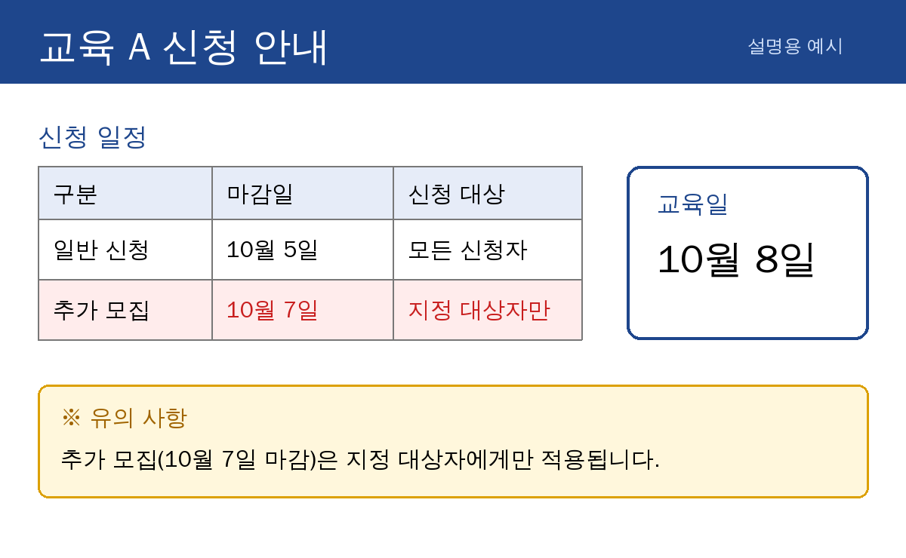

# 5장 RAG를 사용하려면 어떤 자료를 미리 준비해야 하는가

<!--
문서 정보
- 상태: 본문 초안, 2026-10-28 독자 검토 20개 항목 반영 후 같은 독자 재테스트 지적까지 반영 (검토노트/5장_독자검토_20261028.md)
- 기준 구성안: 학습문서_구성안/05_RAG자료준비와VectorDB.md (2026-10-28 사용자 결정: 5.3.5 이미지는 Claude가 코드로 그리고, 같은 이미지에 Tesseract OCR과 비전 모델을 실제로 실행)
- 작성일: 2026-10-28
- 그림 표기: [그림 5-n] 블록은 나중에 디자인 이미지로 교체할 자리다. 블록 아래의 텍스트 그림은 이미지가 들어오기 전까지 쓰는 임시 그림이다. 디자인 메모는 시안이며 확정안이 아니다. 그림 5-3의 안내문 이미지는 실제 파일(images/fig-05-03_교육A_안내문.png)이 있다.
- 실제 실행 결과: 5.3.5의 OCR 결과와 비전 모델 결과는 2026-10-28에 실제로 실행한 출력이다(조건은 본문과 아래 그림 목록 주석에 기록). 그 밖의 사례·청크·벡터 값·저장 항목은 설명용 예시다.
- 집필 경계: 검토노트/5장_충돌점검_20261028.md 2절의 22개 항목을 따른다. 특히 '임베딩'은 5.5 전에는 쓰지 않고, 벡터끼리 비교하는 계산과 검색 방식의 정의는 6장으로 넘긴다. 손실 같은 9장 용어, 2.8 전용 용어는 쓰지 않는다. 사무실 비유는 5.2에서 한 문단만 쓴다.
-->

## 장 도입

4장 끝에서 이런 질문을 남겼습니다. 4.7에서 모델이 교육 A의 마감일을 바르게 고를 수 있었던 것은 사용자가 안내문을 대화창에 직접 붙여 넣었기 때문입니다. 그렇다면 사용자가 매번 자료를 붙여 넣지 않아도, 필요한 자료를 찾아 입력에 넣어 줄 수는 없을까요?

이 일을 하는 방법이 이 장의 주제인 **RAG**입니다. RAG는 질문이 들어왔을 때 관련 자료를 찾아 모델의 입력에 넣어 주는 방식입니다. 그런데 '찾는다'는 일은 질문이 들어온 순간에 갑자기 할 수 있는 것이 아닙니다. 도서관에서 책을 빨리 찾을 수 있는 것은 누군가 미리 책을 분류하고 목록을 만들어 두었기 때문인 것처럼, 자료도 미리 준비해 두어야 찾을 수 있습니다.

이 장에서는 그 **질문 전의 준비**를 따라갑니다. 원본 문서에서 글자를 꺼내고, 적당한 조각으로 나누고, 검색할 수 있는 형태로 바꾸어 저장하는 과정입니다. 예시는 1장과 4장에서 쓴 '교육 A 신청 안내'를 그대로 씁니다. 실제로 찾는 방법, 즉 검색은 6장에서 다룹니다.

---

## 5.1 RAG는 무엇인가

**RAG**는 Retrieval-Augmented Generation의 머리글자로, 우리말로는 '검색 증강 생성'이라고 옮기기도 합니다. 이름을 풀어 보면 하는 일이 드러납니다. 관련 자료를 **검색**(Retrieval)해서, 찾은 내용으로 모델의 입력을 **보강**(Augmented)한 뒤, 답변을 **생성**(Generation)합니다. RAG는 특정 모델의 이름이 아니라 **앱이 자료와 모델을 함께 쓰는 방식**의 이름입니다.

### 학습한 지식만 쓰는 경우와 자료를 함께 받는 경우

2장에서 본 것처럼 모델은 학습한 글을 바탕으로 다음 토큰을 고릅니다. 그래서 학습한 글에 없는 내용, 예를 들어 우리 회사의 교육 A 일정은 알 방법이 없습니다. 2.6에서는 모델이 그럴듯하지만 틀린 답을 만들 수 있다는 것도 보았습니다. 같은 질문에 대해 두 경우를 비교해 보겠습니다.

| 구분 | 모델 입력에 들어가는 것 | 설명용 가상 출력 |
|---|---|---|
| 학습한 지식만 쓰는 경우 | 지침 + "교육 A 일반 신청 마감이 언제야?" | "교육 A의 일정은 확인할 수 없습니다." 또는 그럴듯하게 지어낸 날짜 |
| RAG를 쓰는 경우 | 지침 + 질문 + 검색으로 찾은 안내문 조각("일반 신청 마감: 10월 5일") | "일반 신청 마감은 10월 5일입니다. (출처: 교육 A 신청 안내)" |

두 경우의 차이는 모델이 아니라 **입력에 무엇이 들어 있는가**입니다. 2.2에서 "필요한 자료를 찾아 골라 넣는 방법은 5장부터 다룬다"고 했고, 2.6에서 "믿을 만한 자료를 찾아 컨텍스트에 넣어 주는 방법"을 예고했던 것이 바로 이것입니다.

### 1장에서 이미 본 RAG

사실 우리는 1장에서 RAG의 모습을 이미 보았습니다. 1.2.5의 '앱 C'는 사내 문서 검색 도구가 연결되어 있어 회사 규정을 근거로 답했습니다. 1.6에서는 모델이 문서 검색을 요청하고, 앱이 검색 도구로 '교육 A 신청 안내'를 찾아 입력에 넣었습니다. 둘 다 "관련 자료를 검색해 입력에 넣고 답변을 만드는" RAG의 한 형태입니다.

RAG는 앱이 질문을 받자마자 자동으로 검색하는 방식으로도, 1.6처럼 모델이 검색을 요청하면 앱이 검색 도구를 실행하는 방식으로도 구성할 수 있습니다.

### RAG에 대한 두 가지 오해

- **RAG는 벡터 검색만을 뜻하지 않습니다.** 6장에서 보겠지만 자료를 찾는 방법은 여러 가지이고, 그 가운데 무엇을 쓰든 '찾아서 넣어 주는' 구조라면 RAG입니다.
- **자료를 넣었다고 정답이 보장되지는 않습니다.** 엉뚱한 자료를 찾아오거나, 필요한 조건이 빠진 조각만 찾아오거나, 오래된 자료를 찾아올 수 있습니다. 올바른 자료가 입력에 들어가도 모델이 조건을 잘못 이어 답할 수도 있습니다(4장). RAG는 정답의 가능성을 높이는 방법이지 보증이 아닙니다.

<!-- 그림 시작: fig-05-01 -->
> **[그림 5-1] RAG 한눈에 보기**
>
> - **보여줄 핵심:** 질문이 들어오면 앱이 관련 자료를 검색해 입력에 함께 넣고, 모델은 그 입력으로 답변을 만든다.
> - **구성 요소:** 사용자 질문, 앱, 검색 대상 자료(문서 묶음), 찾은 조각, 모델 입력 상자(지침 + 질문 + 찾은 조각), 모델, 답변.
> - **배치와 흐름:** 왼쪽 질문 → 앱 → 아래쪽 자료에서 조각 검색 → 입력 상자에 합류 → 모델 → 오른쪽 답변. 검색 부분은 앱·도구 색, 모델 부분은 모델 색.
> - **디자인 메모(시안, 확정 아님):** 1장 그림 1-5의 앱 C와 같은 아이콘을 쓰면 연결이 잘 보인다.
> - **대체 텍스트:** 사용자의 질문을 받은 앱이 준비된 자료에서 관련 조각을 찾아, 지침·질문과 함께 모델 입력으로 묶어 보내고, 모델이 그 입력으로 답변을 만드는 흐름.
> - **성격:** 설명용 흐름도. 학습은 포함하지 않는다.

```text
 사용자 질문 ─▶ [앱] ── 검색 ──▶ [준비된 자료]
                 │                 │
                 │ ◀── 찾은 조각 ───┘
                 ▼
         ┌ 모델 입력 ────────────────┐
         │ 지침 + 질문 + 찾은 조각     │ ─▶ [모델] ─▶ 답변
         └───────────────────────────┘
```
<!-- 그림 끝: fig-05-01 -->

> **이해 확인**
> 같은 모델을 쓰는 두 앱 가운데 한 앱만 회사 교육 일정을 정확히 답했습니다. RAG의 관점에서 이 차이는 어디서 생겼을 가능성이 클까요?

---

## 5.2 질문 전의 준비와 질문 후의 실행 구분하기

RAG에는 서로 다른 두 시점이 있습니다. **질문이 들어오기 전에 미리 해 두는 준비**와 **질문이 들어온 뒤 그때그때 하는 실행**입니다. 이 둘을 구분하지 않으면 "질문할 때마다 문서를 처음부터 다 읽고 정리하나?" 하는 오해가 생깁니다.

### 질문 전의 준비

준비는 자료가 새로 생기거나 바뀔 때 합니다. 질문마다 반복하지 않습니다.

1. **원본 수집**: 검색 대상이 될 문서를 모읍니다(5.3).
2. **내용 추출**: 원본에서 글자와 구조를 꺼냅니다. 이미지로 된 문서라면 글자를 인식하는 처리가 필요합니다(5.3).
3. **청킹**: 문서를 검색하기 알맞은 조각으로 나눕니다(5.4).
4. **검색 색인 만들기**: 조각마다 검색에 쓸 정보를 만들어 저장합니다. 뜻이 가까운 조각을 찾기 위한 **검색용 벡터**(5.5~5.6)와, 같은 단어가 들어 있는 조각을 찾기 위한 **키워드 색인**(5.7)이 대표적입니다. 이 책에서 '검색 색인'은 이 둘을 함께 부르는 말이고, 5.7에서 따로 다루는 것은 그 가운데 키워드 색인입니다.
5. **원문 연결**: 검색으로 찾은 조각에서 원래 문서와 위치로 되돌아갈 수 있게 연결해 둡니다(5.6).

### 질문 후의 실행

질문이 들어오면 준비해 둔 자료를 씁니다.

1. **관련 자료 검색**: 질문으로 준비된 색인을 검색해 관련 조각을 고릅니다. 뜻으로 찾을 때는 질문도 준비 때와 같은 방식으로 검색용 벡터로 바꾸어 비교합니다. 이 변환에는 질문을 벡터로 바꾸는 별도의 모델을 한 번 실행합니다(5.5).
2. **원문 조회**: 고른 조각의 원문과 출처를 가져옵니다.
3. **모델 입력 구성**: 지침, 질문, 가져온 원문을 묶어 입력을 만듭니다.
4. **답변 생성**: **생성 모델**, 즉 1장부터 보아 온 글을 만드는 모델을 실행해 답변을 만듭니다. 4장의 말로 하면 Inference입니다.

1~3은 앱과 검색 도구가 맡는 일이고(1번 안의 벡터 변환에 쓰는 모델은 5.5에서 따로 봅니다), 4만 생성 모델의 Inference입니다. 4장 그림 4-1에서 앱의 처리와 Inference를 선으로 나누었던 것과 같은 경계입니다.

자료를 찾는 방법은 크게 세 가지입니다. 같은 단어가 들어 있는 조각을 찾는 **키워드 검색**, 표현이 달라도 뜻이 가까운 조각을 찾는 **의미 기반 검색**, 그리고 둘을 함께 쓰는 **혼합 검색**입니다. 이 장에서는 이 검색들이 쓸 재료를 준비하는 데까지만 다루고, 각 검색이 실제로 어떻게 조각을 고르는지는 6장에서 자세히 봅니다.

<!-- 그림 시작: fig-05-02 -->
> **[그림 5-2] 질문 전의 준비와 질문 후의 실행**
>
> - **보여줄 핵심:** 원본 수집부터 색인·원문 연결까지는 질문 전에 한 번 해 두는 준비이고, 검색부터 답변 생성까지는 질문마다 하는 실행이다. 실행 단계 가운데 생성 모델의 Inference는 마지막 답변 생성뿐이다.
> - **구성 요소:** 위쪽 띠 '질문 전 준비(자료가 바뀔 때)': 원본 수집 → 내용 추출 → 청킹 → 검색 색인(검색용 벡터, 키워드 색인) → 원문 연결. 가운데 저장소 아이콘(준비된 자료). 아래쪽 띠 '질문 후 실행(질문마다)': 질문 → 관련 자료 검색(질문도 검색용 벡터로 바꿈, 작은 모델 아이콘) → 원문 조회 → 모델 입력 구성 → 답변 생성(Inference). 저장소에서 아래 띠로 내려가는 화살표.
> - **배치와 흐름:** 두 띠를 위아래로 나란히. 위 띠 오른쪽 끝에서 저장소로, 저장소에서 아래 띠의 '관련 자료 검색'과 '원문 조회'로 화살표. 아래 띠의 '답변 생성'만 모델 색으로 칠하고 'Inference' 이름표.
> - **디자인 메모(시안, 확정 아님):** 이 장의 대표 그림 후보다. 위 띠에 '가끔', 아래 띠에 '매번'이라는 시계 아이콘을 붙이면 시점 차이가 잘 보인다.
> - **대체 텍스트:** 위쪽에는 자료가 바뀔 때 한 번 하는 준비 과정(원본 수집, 내용 추출, 청킹, 검색 색인 만들기, 원문 연결)이 있고, 그 결과가 저장소에 쌓인다. 아래쪽에는 질문마다 하는 실행 과정(관련 자료 검색, 원문 조회, 모델 입력 구성, 답변 생성)이 있으며, 저장소의 자료를 꺼내 쓴다. 관련 자료 검색 옆에는 질문을 검색용 벡터로 바꾸는 별도의 모델이 작게 표시되어 있고, 답변 생성만 생성 모델의 Inference로 표시되어 있다.
> - **성격:** 설명용 구조도. 학습은 포함하지 않는다.

```text
 [질문 전 준비]  자료가 새로 생기거나 바뀔 때
   원본 수집 → 내용 추출 → 청킹 → 검색 색인 만들기 → 원문 연결
                                 (검색용 벡터·키워드 색인)  │
                                                          ▼
                                                   ┌─────────────┐
                                                   │ 준비된 자료   │
                                                   └──────┬──────┘
 [질문 후 실행]  질문이 들어올 때마다                        │
   질문 → 관련 자료 검색 ◀──────────────────────────────────┤
          (질문도 검색용 벡터로, 5.5)                          │
              ↓                                           │
          원문 조회 ◀──────────────────────────────────────┘
              ↓
          모델 입력 구성 → 답변 생성 (= 생성 모델의 Inference)
   └──────── 앱·검색 도구 ────────┘ └──── 모델 ────┘
```
<!-- 그림 끝: fig-05-02 -->

1장의 사무실 비유로 말하면(설명용 비유), 질문 전 준비는 비서가 한가할 때 미리 서류 보관함을 정리해 두는 일입니다. 서류를 주제별로 나누어 철하고, 어떤 서류가 어느 칸에 있는지 색인 카드를 만들어 둡니다. 그래야 전문가에게 일을 맡길 때 필요한 서류를 금방 찾아 서류철에 끼울 수 있습니다. 질문이 들어올 때마다 보관함 전체를 처음부터 다시 정리하지는 않습니다. 비유는 역할을 잡기 위한 것일 뿐이며, 실제로는 앱과 검색 도구가 데이터를 처리하고 저장하는 일입니다.

> **이해 확인**
> 회사가 새 교육 안내문을 하나 올렸습니다. 이때 해야 하는 일은 '질문 전 준비'와 '질문 후 실행' 가운데 어느 쪽일까요? 직원이 그 교육에 대해 질문할 때마다 해야 하는 일은 무엇인가요?

---

## 5.3 원본 문서를 검색 가능한 자료로 만들기

RAG가 찾을 수 있는 것은 준비 과정에서 **글자로 꺼내 둔 내용뿐**입니다. 원본에 분명히 적혀 있어도 꺼내는 과정에서 빠지거나 깨지면, 그 내용은 검색되지 않습니다. 그래서 준비의 첫 단계는 원본에서 내용을 제대로 꺼내는 것입니다.

### 5.3.1 먼저 원본의 형태를 확인하기

검색 대상이 될 원본은 여러 형태로 존재합니다. PDF, 웹페이지, Word 문서, 이미지 파일, 데이터베이스의 표 같은 것들입니다. 형태에 따라 내용을 꺼내는 방법이 다르므로 먼저 형태를 확인합니다.

같은 PDF라도 두 가지가 있습니다. 하나는 컴퓨터로 작성해 저장한 PDF처럼 **글자 정보가 들어 있는 PDF**입니다. 이런 PDF에서는 마우스로 글자를 드래그해 복사할 수 있습니다. 다른 하나는 종이를 스캔한 PDF처럼 **페이지가 그림으로만 저장된 PDF**입니다. 사람 눈에는 글자로 보이지만 파일 안에는 점들의 색만 들어 있어서, 글자를 드래그해도 선택되지 않습니다.

형태와 함께 **보존해야 할 구조**도 확인합니다. 제목과 본문, 표, 그림, 각주, 페이지 번호 같은 것들입니다.

1장과 4장에서는 교육 A 안내문을 글머리표 목록으로 보았습니다. 하지만 같은 내용이 회사 게시판에는 표가 들어간 안내문으로 올라와 있을 수도 있습니다. 이 절에서는 그런 안내문을 예로 들겠습니다(5.3.5에서 실제 이미지를 봅니다). 표는 다음과 같습니다.

| 구분 | 마감일 | 신청 대상 |
|---|---|---|
| 일반 신청 | 10월 5일 | 모든 신청자 |
| 추가 모집 | 10월 7일 | 지정 대상자만 |

이런 안내문이라면 이 표의 칸 관계, 그리고 "추가 모집은 지정 대상자에게만 적용된다"는 유의 사항이 반드시 지켜야 할 구조입니다.

### 5.3.2 일반적인 텍스트와 구조 추출

글자 정보가 들어 있는 문서는 그 글자와 구조를 **직접 꺼내는 것**이 가장 정확합니다. 글자를 다시 인식할 필요 없이 파일에 들어 있는 글자를 그대로 가져오기 때문입니다.

다만 글자만 꺼내고 구조를 잃으면 뜻이 달라질 수 있습니다. 예를 들어 위의 표를 칸 구분 없이 한 줄로 꺼내면 다음과 같이 됩니다.

```text
[설명용 예시] 표 구조가 사라진 추출 결과
구분 마감일 신청 대상 일반 신청 10월 5일 모든 신청자 추가 모집 10월 7일 지정 대상자만
```

사람이 원래 표를 알고 보면 읽을 수 있지만, '10월 7일'과 '지정 대상자만'이 같은 줄에 묶여 있었다는 정보는 약해졌습니다. 목록의 들여쓰기나 제목과 본문의 구분도 같은 방식으로 사라질 수 있습니다.

또 **화면에 보이는 순서와 꺼낸 글자의 순서가 다를 수 있습니다.** 두 단으로 된 문서에서 왼쪽 단을 다 읽기 전에 오른쪽 단의 글자가 끼어들거나, 옆에 놓인 상자의 글자가 본문 중간에 섞이는 일이 생깁니다.

### 5.3.3 OCR은 무엇을 하는가

페이지가 그림으로만 저장된 문서에서는 글자를 직접 꺼낼 수 없습니다. 이때 쓰는 기술이 **OCR**(Optical Character Recognition, 광학 문자 인식)입니다. OCR은 이미지 속 **글자 모양을 찾아 문자 데이터로 바꾸는 기술**입니다. 스캔한 PDF, 사진으로 찍은 문서, 이미지 안에 들어 있는 글자를 검색할 수 있는 글자로 만들 때 씁니다.

OCR이 하는 일은 '글자를 알아보는 것'까지입니다. 표에서 어느 칸이 어느 칸과 연결되는지, 그림이 무엇을 나타내는지, 문서 전체가 무엇을 안내하려는지까지 정리해 주는 것은 아닙니다. 또 다음과 같은 경우에 틀리기 쉽습니다.

- 흐리거나 번진 글자, 기울어지거나 회전된 페이지
- 칸이 많고 선이 복잡한 표
- 서로 비슷하게 생긴 글자와 숫자(예: 숫자 0과 영문자 O, 숫자 1과 영문자 l)
- 색이 있는 바탕 위의 글자

### 5.3.4 비전 모델은 무엇을 더 볼 수 있는가

1장에서 모델은 주로 글을 입력받아 글을 만드는 언어 모델이었습니다. **비전 모델**은 **이미지도 입력으로 받을 수 있는 모델**입니다. 요즘에는 글을 만드는 모델이 이미지 입력을 함께 받는 경우도 많습니다. 어떤 모델이 이미지를 받을 수 있는지는 제품마다 다릅니다.

비전 모델은 페이지 이미지를 입력받아 글자뿐 아니라 **배치, 표, 그림, 도표, 요소 사이의 관계를 반영한 출력**을 만들 수 있습니다. 예를 들어 표를 '항목: 값' 형태로 정리하거나, 차트가 나타내는 경향을 문장으로 설명하거나, 문서에서 필요한 항목만 골라 정리하는 데 쓸 수 있습니다.

그렇다고 비전 모델이 OCR을 언제나 대체하는 것은 아닙니다. 글자를 빠르고 일정하게 옮겨 적는 일은 OCR이 더 알맞을 때가 많고, 실제로는 OCR, 문서 구조 분석, 비전 모델을 함께 쓰기도 합니다. 그리고 비전 모델도 모델이므로 2장에서 본 방식대로 출력을 만듭니다. 숫자나 작은 글자, 복잡한 표를 잘못 옮기거나, **원문에 없는 내용을 그럴듯하게 만들어 낼 수도 있습니다.**

### 5.3.5 같은 예시 이미지로 OCR과 비전 모델 결과 비교하기

같은 이미지 한 장에 OCR과 비전 모델을 실제로 실행해 결과를 비교해 보겠습니다. 이미지는 이 교재를 위해 코드로 직접 그린 '교육 A 신청 안내문'이며, 1장의 안내문과 같은 내용을 표와 색 강조, 유의 사항 상자로 배치했습니다.

<!-- 그림 시작: fig-05-03 -->
> **[그림 5-3] 같은 안내문 이미지의 원본, OCR 결과, 비전 모델 결과**
>
> - **보여줄 핵심:** OCR 결과는 인식된 글자가 줄 단위의 평평한 문자열로 나오며 표의 칸 관계와 옆 상자의 위치가 흐려지고 인식 오류도 섞인다. 비전 모델 결과는 항목·날짜·대상·예외 조건의 관계를 반영한 구조로 나온다. 두 결과 모두 실제 실행한 출력이다.
> - **구성 요소:** 세 칸 비교. 왼쪽 원본 이미지(images/fig-05-03_교육A_안내문.png), 가운데 OCR 원본 출력, 오른쪽 비전 모델 원본 출력. OCR 칸에서 오류가 난 부분('교육 세', '신청ㅅ', 의미 없는 글자 줄, '교육일'이 표 머리글 줄에 붙은 부분)에 표시.
> - **배치와 흐름:** 세 칸을 나란히 두고, 원본의 '10월 7일 / 지정 대상자만' 칸에서 OCR 칸과 비전 모델 칸의 해당 줄로 가는 연결선을 그린다.
> - **디자인 메모(시안, 확정 아님):** 원본 이미지는 실제 파일을 그대로 쓰되, 디자인 단계에서 교재 글꼴로 다시 그린다면 OCR과 비전 모델을 다시 실행해 결과를 바꾸어 넣어야 한다.
> - **대체 텍스트:** 왼쪽은 교육 A 신청 안내문 이미지로, 제목, 신청 일정 표(일반 신청 10월 5일 모든 신청자, 추가 모집 10월 7일 지정 대상자만), 오른쪽의 교육일 10월 8일 상자, 아래쪽 유의 사항 상자로 이루어져 있다. 가운데 OCR 결과는 줄마다 글자를 나열했고 일부 글자가 틀리거나 의미 없는 글자가 섞였다. 오른쪽 비전 모델 결과는 문서 종류, 교육일, 신청 구분별 마감일과 대상, 예외 조건을 나누어 정리했다.
> - **성격:** 실제 실행 결과. 원본 이미지는 설명용으로 만든 것이다. 실행 조건은 각 출력 아래에 적었다.


<!-- 그림 끝: fig-05-03 -->
<!-- 텍스트 그림 없음: 실제 이미지를 위에 싣고, OCR·비전 모델 출력은 아래 본문에 그대로 싣는다. 디자인 단계에서 세 칸 비교 그림으로 합칠 것. -->

위가 실험에 쓴 실제 이미지입니다.

**OCR 결과**는 다음과 같습니다. 오픈소스 OCR 프로그램인 Tesseract로, 페이지를 줄 단위로 나누어 읽는 설정을 써서 실행한 출력을 줄바꿈까지 그대로 옮겼습니다.

```text
[실제 실행 결과] OCR 원본 출력 (Tesseract)
교육 세 신청 안내                      설명용 예시

신청 일정

구분           마감일          신청 대상             교육일

일반 신청       10월 5일        모든 신청ㅅ                 우
일                린              !         10월 8일

추가 모집       10월 7일        지정 대상자만

※ 유의 사항

추가 모집(10월 7일 마감)은 지정 대상자에게만 적용됩니다.
```

*실행 조건: Tesseract 버전 5.3.4, 한국어 학습 데이터, 페이지 분할 설정 4번(줄 단위), 2026년 10월 28일 실행.*

대부분의 글자는 맞게 나왔지만 몇 가지가 눈에 띕니다.

- **인식 오류**: 제목의 'A'가 '세'로, '모든 신청자'가 '모든 신청ㅅ'로 나왔습니다. 오른쪽 상자 근처에는 '우', '일', '린', '!'처럼 원본에 없는 글자가 생겼습니다.
- **배치가 섞임**: 오른쪽 상자의 '교육일'이 표의 머리글 줄 끝에 붙었고, '10월 8일'은 '일반 신청' 줄 아래에 끼어 있습니다. 이 글자만 보면 '10월 8일'이 일반 신청과 관련된 날짜처럼 읽힐 수도 있습니다.
- **관계가 약해짐**: 표의 줄 구분은 공백으로만 남았습니다. '10월 7일'과 '지정 대상자만'이 같은 칸 줄에 있다는 것은 여전히 짐작할 수 있지만, 어느 것이 어느 칸의 머리글에 속하는지는 글자만으로 확인해야 합니다.

같은 프로그램을 기본 설정으로 실행했을 때는 글자 대부분이 조각나 거의 읽을 수 없는 출력이 나왔습니다. 출력의 일부를 옮기면 다음과 같습니다.

```text
[실제 실행 결과] 같은 OCR을 기본 설정으로 실행한 출력의 일부
2| 0 | 고
줍| 기 | 죠
10 | 41 | 00
기| 머 | ㅠ
(…생략…)
용됩니다.
(…생략…)
7일 마감)
```

*실행 조건: 위와 같고 페이지 분할 설정만 3번(기본값). 출력 가운데 일부 줄만 옮겼습니다.*

날짜와 대상이 거의 남지 않았습니다. 표의 선이나 색 바탕 같은 요소가 글자 인식을 방해했을 수 있습니다(5.3.3에서 본 '색이 있는 바탕 위의 글자'). 같은 OCR이라도 설정과 이미지 상태에 따라 결과가 크게 달라진다는 뜻입니다.

**비전 모델 결과**는 다음과 같습니다. 같은 이미지를 이미지 입력을 받을 수 있는 모델인 Claude에 아래 지시문과 함께 넣어 실행한 출력을 그대로 옮겼습니다.

```text
[실제 실행 결과] 비전 모델 원본 출력 (Claude)
지시문: 이 이미지를 문서 종류, 교육일, 신청 구분별 마감일과 대상, 예외 조건으로
        나누어 정리해 줘. 이미지에 없는 내용은 쓰지 마.

문서 종류: 교육 신청 안내 (제목: 교육 A 신청 안내)
교육일: 10월 8일
신청 일정 (표):
- 일반 신청: 마감 10월 5일 / 대상: 모든 신청자
- 추가 모집: 마감 10월 7일 / 대상: 지정 대상자만 (표에서 빨간색으로 강조)
예외 조건: 추가 모집(10월 7일 마감)은 지정 대상자에게만 적용됨 (유의 사항 상자)
기타: 오른쪽 위에 '설명용 예시' 표시가 있음
```

*실행 조건: Claude, 2026년 10월 28일 실행. 지시문은 출력 위에 함께 적었습니다.*

이 결과에서는 '10월 7일'이 '추가 모집'과 '지정 대상자만'에 묶여 있고, '교육일 10월 8일'이 신청 일정과 따로 정리되어 있습니다. 빨간색 강조와 유의 사항 상자처럼 글자가 아닌 시각 요소도 출력에 반영되었습니다.

### 두 결과를 어떻게 읽을까

이 비교는 어느 쪽이 항상 더 낫다는 것을 보여 주려는 것이 아닙니다. **출력의 목적과 정보의 형태가 다르다**는 것을 보여 줍니다.

| 구분 | OCR 결과 | 비전 모델 결과 |
|---|---|---|
| 출력의 형태 | 이미지 속 글자를 줄 단위로 옮긴 문자열 | 지시문에 맞춰 항목별로 정리한 글 |
| 표와 배치 | 공백으로만 남고, 옆 상자의 글자가 섞일 수 있음 | 칸의 관계와 상자의 구분이 반영될 수 있음 |
| 틀리는 방식 | 글자 단위로 잘못 인식하거나 없는 글자가 생김 | 그럴듯한 문장 속에 잘못 옮긴 값이나 원본에 없는 내용이 섞일 수 있음 |
| 확인할 점 | 숫자·고유명사의 오타, 읽기 순서 | 원본에 실제로 있는 내용인지, 값이 정확한지 |

이번 이미지에서는 비전 모델 결과가 원본과 맞았지만, 이미지 한 장으로 한 번 실행한 결과일 뿐입니다. 5.3.4에서 본 것처럼 비전 모델도 틀릴 수 있고, 틀린 내용이 깔끔한 문장 속에 섞이면 오히려 알아채기 어렵습니다. 배치 분석 기능을 갖춘 OCR 제품도 있으므로, 이 비교를 모든 OCR이나 모든 비전 모델로 일반화하지는 마세요.

### 5.3.6 어떤 방식을 선택할지 비교하기

원본의 상태에 따라 먼저 고려할 처리를 정리하면 다음과 같습니다.

| 원본 상태 | 우선 고려할 처리 | 확인할 점 |
|---|---|---|
| 글자 정보가 들어 있는 문서 | 원문 글자와 구조를 직접 추출 | 읽기 순서와 표 구조가 보존되었는지 |
| 이미지로 된 문서 | OCR | 글자와 숫자의 인식 오류 |
| 표·차트·그림의 의미가 중요함 | 구조 분석 또는 비전 모델 | 칸의 관계와 시각 요소가 바르게 옮겨졌는지 |
| 복잡한 페이지 | 여러 방식을 함께 사용 | 처리마다 결과가 다를 때 어느 것을 쓸지 |

<!-- 그림 시작: fig-05-04 -->
> **[그림 5-4] 원본 형태에 따라 내용을 꺼내는 경로**
>
> - **보여줄 핵심:** 원본에 글자 정보가 있으면 직접 추출하고, 이미지로 된 원본은 OCR로 글자를 인식하며, 표·그림의 관계가 중요하면 구조 분석이나 비전 모델을 더한다. 어느 경로든 결과는 원본과 대조한다.
> - **구성 요소:** 왼쪽 원본 아이콘들(글자 PDF·Word·웹페이지 / 스캔 PDF·사진 / 표·차트가 많은 문서). 가운데 처리 상자 세 개(직접 추출 / OCR / 구조 분석·비전 모델). 오른쪽 '추출된 글자와 구조' 상자와 그 아래 '원본과 대조' 확인 표시.
> - **배치와 흐름:** 왼쪽 → 가운데 → 오른쪽. 복잡한 페이지는 여러 처리 상자로 화살표가 갈라졌다가 다시 모인다.
> - **대체 텍스트:** 글자 정보가 있는 문서는 직접 추출로, 이미지 문서는 OCR로, 표와 그림의 의미가 중요한 문서는 구조 분석이나 비전 모델로 처리되어 '추출된 글자와 구조'가 되고, 모든 결과는 원본과 대조하는 흐름도.
> - **성격:** 설명용 흐름도. 실제 처리 방식은 도구와 제품마다 다르다.

```text
 글자 PDF·Word·웹페이지 ──▶ [직접 추출] ───────────┐
 스캔 PDF·사진         ──▶ [OCR] ─────────────────┼──▶ 추출된 글자와 구조
 표·차트가 중요한 문서   ──▶ [구조 분석·비전 모델] ──┘          │
 복잡한 페이지 ──▶ 여러 처리를 함께                            ▼
                                                     원본과 대조 ✔
```
<!-- 그림 끝: fig-05-04 -->

어떤 방식으로 꺼냈든, **어떤 방식으로 추출했는지 기록해 두고 중요한 값은 원본 페이지와 대조**하는 것이 좋습니다. 그리고 이 절의 처음에 말한 것을 다시 기억해 두세요. RAG가 나중에 검색할 수 있는 것은 이 준비 과정에서 보존된 내용뿐입니다. 표의 관계가 여기서 깨지면, 뒤의 어떤 검색도 그 관계를 되살려 주지 못합니다.

> **이해 확인**
> 스캔한 안내문을 OCR로 처리했더니 '10월 8일'이 '일반 신청' 줄 아래에 섞여 나왔습니다. 이 결과를 그대로 검색 자료로 쓰면 어떤 문제가 생길 수 있을까요?

---

## 5.4 문서를 청크로 나누기

내용을 꺼냈다면 이제 문서를 **청크**(chunk)로 나눕니다. 청크는 **검색을 위해 문서를 나눈 조각**이고, 문서를 청크로 나누는 일을 **청킹**(chunking)이라고 합니다.

### 왜 나누는가

문서를 통째로 검색 대상으로 삼으면 두 가지 문제가 생깁니다. 첫째, 질문과 관련된 부분이 문서의 한 문단뿐이어도 문서 전체를 찾아오게 됩니다. 둘째, 그 전체를 모델 입력에 넣으면 2.2에서 본 컨텍스트 윈도를 금방 채우고, 관련 없는 내용이 함께 들어갑니다. 문서를 적당한 크기로 나누어 두면 **질문과 관련된 조각만 골라 입력에 넣을 수 있습니다.**

### 청크와 토큰은 다르다

청크와 토큰은 둘 다 '글을 나눈 조각'이라 헷갈리기 쉽습니다. 하지만 목적이 다릅니다.

| 구분 | 토큰 (2.3) | 청크 |
|---|---|---|
| 무엇을 위해 나누는가 | 모델이 글을 계산하기 위해 | 자료를 검색하고 골라 넣기 위해 |
| 누가 나누는가 | 모델의 토크나이저 | 자료를 준비하는 쪽(앱·준비 도구) |
| 크기 | 글자 몇 개 정도 | 문장 몇 개에서 몇 문단 정도 |
| 관계 | — | 청크 하나는 토큰 여러 개로 이루어진다 |

### 크기와 중첩

청크의 **크기**는 보통 글자 수나 토큰 수로 정합니다. 문단이나 제목처럼 문서의 구조를 따라 나누기도 합니다. 알맞은 크기는 문서의 종류와 쓰임에 따라 달라서, 정답이 하나로 정해져 있지 않습니다.

청크를 나눌 때 앞 청크의 끝부분을 다음 청크의 앞에 조금 겹쳐 넣기도 합니다. 이것을 **중첩**(overlap)이라고 합니다. 경계에서 문장이 잘려 앞뒤 내용이 끊어지는 것을 줄이기 위해서입니다. 긴 규정 문서를 문장 단위로 나눈다면 다음과 같은 모양입니다.

```text
[설명용 예시] 중첩의 모양
  청크 1: 문장 1 · 문장 2 · 문장 3
  청크 2:                   문장 3 · 문장 4 · 문장 5     ← 문장 3이 두 청크에 함께 들어감
```

문장 3이 앞뒤 어느 청크로 검색되더라도 바로 앞이나 뒤의 문장과 함께 읽힙니다.

### 너무 작을 때: 조건과 예외가 갈라진다

청크가 너무 작으면 함께 있어야 할 내용이 다른 조각으로 갈라집니다. 1장의 글머리표 안내문을 한 줄씩 잘게 나누었다고 해 보겠습니다. 5.3에서 본 표 안내문과 내용은 같고, 이 절의 예시는 모두 글머리표 안내문을 나눈 것입니다.

```text
[설명용 예시] 너무 작게 나눈 청크
  청크 1: 교육 A 신청 안내
  청크 2: 교육일: 10월 8일
  청크 3: 일반 신청 마감: 10월 5일
  청크 4: 추가 모집 마감: 10월 7일
  청크 5: (지정 대상자에게만 적용)
```

누군가 "교육 A 신청 마감이 언제야?"라고 물었다고 해 보겠습니다. 검색은 '마감'이라는 말이 들어 있는 청크 3과 4를 골라 올 가능성이 큽니다. 그런데 "지정 대상자에게만 적용"이라는 예외 조건은 청크 5에 따로 있고, 청크 5에는 '마감'이라는 말도 날짜도 없어서 함께 골라지기 어렵습니다. 그러면 입력에는 마감일 두 개만 들어가고, 10월 7일이 누구에게 적용되는지는 빠집니다. 모델은 더 늦은 10월 7일을 누구나 쓸 수 있는 마감일처럼 답할 수 있습니다. 4.7에서 지정 대상자가 아닌 사람에게 10월 5일을 골라 준 것은 안내문 전체가 입력에 있었기 때문이었습니다. 예외 조건이 빠진 조각만 들어가면 같은 문제를 바르게 풀 재료가 없어집니다.

### 너무 클 때: 관련 없는 내용이 함께 들어온다

반대로 청크가 너무 크면, 예를 들어 교육 A부터 교육 F까지의 안내를 한 청크로 묶어 두면, 교육 A의 마감을 물었을 때도 다른 교육 다섯 개의 일정이 함께 입력에 들어옵니다. 입력이 길어지고, 모델이 다른 교육의 날짜와 섞어 답할 가능성도 생깁니다. 또 6장에서 보겠지만 여러 주제가 섞인 큰 조각은 질문과의 관련성을 정확히 따지기도 어렵습니다.

### 적당할 때: 함께 있어야 할 내용이 한 조각에 들어간다

같은 안내문을 '교육 개요'와 '신청 일정'처럼 내용의 묶음을 따라 나누고, 두 번째 청크 앞에도 문서 제목 줄을 붙이면 다음과 같습니다.

```text
[설명용 예시] 적당하게 나눈 청크
  eduA-001: 교육 A 신청 안내
            교육일: 10월 8일
  eduA-002: 교육 A 신청 안내                          ← 제목 줄을 다시 붙임
            일반 신청 마감: 10월 5일
            추가 모집 마감: 10월 7일 (지정 대상자에게만 적용)
```

이제 마감을 묻는 질문에 eduA-002가 골라지면, 두 마감일과 예외 조건이 한꺼번에 입력에 들어갑니다. 4.7처럼 조건을 이어 10월 5일을 고를 재료가 갖추어집니다. 앞에 붙인 제목 줄 덕분에 eduA-002만 읽어도 이 마감일이 어느 교육의 것인지 알 수 있습니다. 교육 B, 교육 C의 마감 청크와 섞여 검색되더라도 헷갈리지 않습니다. 제목 줄을 붙이는 것은 엄밀히 말하면 앞 청크의 끝을 겹치는 중첩과는 다른 방법이지만, 조각만 읽어도 앞뒤 맥락을 알 수 있게 한다는 목적은 같습니다.

교육 A 안내문은 짧아서 두 조각이면 충분하고, 그래서 개요 조각인 eduA-001도 두 줄로 작아졌습니다. 여러 쪽짜리 문서라면 개요 쪽도 문단 몇 개가 됩니다. 여러 쪽짜리 규정집이라면 장과 절의 제목을 따라 나누고, 한 절이 너무 길면 문단 단위로 다시 나눕니다. 이때도 기준은 같습니다. **조건과 그 예외처럼 함께 읽어야 뜻이 통하는 내용은 한 조각에 둡니다.**

크기에 정답은 없지만 감을 잡자면, 실제로는 문단 하나에서 몇 개 정도, 토큰으로는 수백 개 정도에서 시작해 검색 결과를 보며 조정하는 경우가 많습니다. 이것은 권장값이 아니라 출발점의 대략적인 감이며, 쓰는 도구의 안내를 함께 확인하는 것이 좋습니다. <!-- 확인 필요: 청크 크기의 일반적 출발점(문단 1~수 개, 수백 토큰)은 업계 관행에 대한 일반론. 출간 전 근거 자료 확인 -->

<!-- 그림 시작: fig-05-05 -->
> **[그림 5-5] 청크 크기에 따라 달라지는 것**
>
> - **보여줄 핵심:** 너무 작은 청크는 조건과 예외를 갈라놓고, 너무 큰 청크는 관련 없는 내용을 함께 끌어온다. 적당한 크기로 나누면 함께 있어야 할 내용이 한 조각에 담기고, 조각 앞의 제목 줄은 어느 문서의 조각인지 알려 준다.
> - **구성 요소:** 세 줄 비교. ① 너무 작음: 안내문이 다섯 조각으로 갈려 '10월 7일'과 '지정 대상자에게만'이 다른 조각에 있음(끊어진 선 표시). ② 적당함: eduA-001(제목·교육일)과 eduA-002(제목·두 마감일·예외 조건) 두 조각, 두 조각에 함께 있는 제목 줄을 같은 색 띠로 표시. ③ 너무 큼: 교육 A~F 안내가 한 조각에 들어 있고 교육 A 부분만 작게 강조.
> - **배치와 흐름:** 위에서 아래로 세 줄. 각 줄 오른쪽에 "교육 A 신청 마감이 언제야?"라는 질문에 입력으로 들어가는 내용을 작게 보여 준다.
> - **대체 텍스트:** 같은 안내문을 너무 작게, 적당하게, 너무 크게 나눈 세 경우를 비교한 그림. 너무 작으면 마감일과 예외 조건이 다른 조각에 있어 예외가 빠지고, 너무 크면 다른 교육의 일정이 함께 들어오며, 적당하면 마감일과 예외 조건이 한 조각에 함께 있다.
> - **성격:** 설명용 개념도. 청크 크기는 설명용 예시이며 권장값이 아니다.

```text
 ① 너무 작음  [교육 A 안내] [교육일] [일반 마감 10/5] [추가 모집 10/7] [지정 대상자만]
                                                       └─ 따로 검색됨 ─┘ ✗ 예외가 빠질 수 있음
 ② 적당함    [eduA-001 교육 A 안내 · 교육일 10/8]
             [eduA-002 교육 A 안내 · 일반 마감 10/5 · 추가 모집 10/7(지정 대상자만)]
                       └ 다시 붙인 제목 줄 ┘
 ③ 너무 큼    [교육 A … 교육 B … 교육 C … 교육 D … 교육 E … 교육 F …]
                 ✗ 관련 없는 일정이 함께 들어옴
```
<!-- 그림 끝: fig-05-05 -->

> **이해 확인**
> "청크는 토큰과 같은 것이니까, 토크나이저가 알아서 나눠 준다." 이 말에서 틀린 곳은 어디일까요?

---

## 5.5 문서 조각을 검색용 벡터로 바꾸기

청크를 만들었다면, 뜻으로 찾을 수 있도록 각 청크를 **검색용 벡터**로 바꿉니다. 2.4에서 벡터는 '숫자 묶음'이라고 했습니다. 검색용 벡터도 숫자 묶음입니다. 다만 이번에는 토큰 하나가 아니라 **청크 하나의 뜻**을 담은 숫자 묶음입니다.

이 절부터 '임베딩'이라는 말이 다시 나옵니다. 이 장과 6장에서 '임베딩'이라고 하면 특별한 말이 없는 한 **검색용 임베딩**을 가리킵니다. 2.4의 임베딩과 무엇이 다른지는 아래 표로 정리합니다.

### 검색용 임베딩 모델의 역할

청크를 검색용 벡터로 바꾸는 일은 **검색용 임베딩 모델**이 합니다. 임베딩 모델은 글을 입력받아 그 글의 뜻을 담은 벡터 하나를 출력하는 모델입니다. 뜻이 비슷한 글은 비슷한 벡터로, 뜻이 다른 글은 다른 벡터로 바뀌도록 학습되어 있습니다. 그래서 "신청 마감일"과 "언제까지 신청해야 하나요" 처럼 단어는 달라도 뜻이 가까운 글은 가까운 벡터가 됩니다. 벡터가 '가깝다'는 것을 어떻게 계산하는지는 6장에서 봅니다.

```text
[설명용 예시] 청크를 검색용 벡터로 바꾸기
  청크 eduA-002: "교육 A 신청 안내 / 일반 신청 마감: 10월 5일 / 추가 모집 마감: 10월 7일 (지정 대상자에게만 적용)"
     ↓ 검색용 임베딩 모델
  검색용 벡터: [0.12, -0.48, 0.33, …]   (실제로는 수백~수천 개의 숫자)
```

청크를 벡터로 바꾸는 것도 임베딩 모델을 **실행**하는 일입니다. 4장에서 Inference를 설명할 때는 생성 모델을 기준으로 했기 때문에, 다음 토큰을 하나 고르고 이어 붙이는 반복이 들어 있었습니다. 임베딩 모델은 그렇게 토큰을 하나씩 고르며 반복하지 않고, 입력된 글 하나에 대해 벡터 하나를 한 번에 출력합니다. 출력의 모양은 다르지만, 학습이 끝난 모델에 입력을 넣어 결과를 얻는다는 점에서 이것도 임베딩 모델의 Inference입니다.

그래서 RAG에서 질문 하나를 처리할 때는 서로 다른 두 모델이 각각 실행됩니다. 질문을 벡터로 바꾸는 임베딩 모델이 한 번, 답변을 만드는 생성 모델이 한 번입니다. 이것은 앱이 질문을 받자마자 검색하는 방식을 기준으로 센 것입니다. 1.6처럼 모델이 검색을 요청하는 방식이라면, 생성 모델은 검색 요청을 만들 때와 답변을 만들 때 적어도 두 번 실행됩니다.

질문이 들어왔을 때도 같은 임베딩 모델로 질문을 벡터로 바꿉니다(5.2). 문서와 질문을 **같은 모델**로 바꾸어야 두 벡터를 서로 비교할 수 있습니다. 다른 모델로 만든 벡터끼리는 숫자의 뜻이 달라서 비교할 수 없습니다.

### 토큰 임베딩과 검색용 임베딩은 다르다

'임베딩'이라는 말은 2.4에서 이미 나왔습니다. 같은 말이 두 가지 뜻으로 쓰이므로 구분해 두겠습니다.

| 구분 | 토큰 임베딩 (2.4) | 검색용 임베딩 (이 절) |
|---|---|---|
| 무엇을 벡터로 바꾸나 | 토큰 하나 | 청크나 질문 같은 글 전체 |
| 어디서 일어나나 | 생성 모델 안의 첫 단계 | 별도의 검색용 임베딩 모델 |
| 결과의 쓰임 | 모델 내부 계산의 출발점 | 검색 자료로 저장했다가 질문과 비교 |
| 언제 만드나 | 답을 만들 때마다 모델 안에서 | 청크 벡터는 질문 전 준비 때, 질문 벡터는 질문 때 |

둘 다 '글을 숫자 묶음으로 바꾼다'는 점은 같지만, 바꾸는 대상과 쓰임이 다릅니다.

### 벡터는 원문을 되살리는 압축 파일이 아니다

검색용 벡터가 청크의 뜻을 담고 있다고 해서, 벡터에서 원래 문장을 그대로 되살릴 수 있는 것은 아닙니다. 벡터는 '이 글이 대략 어떤 뜻인가'를 비교하기 위한 숫자일 뿐, 압축 파일처럼 원문을 담아 두는 것이 아닙니다. '10월 5일'이라는 정확한 날짜도 벡터에서 다시 꺼낼 수 없습니다.

그래서 RAG에서는 벡터와 함께 **원문 또는 원문의 위치를 꼭 따로 저장**합니다. 검색은 벡터로 하고, 모델 입력에는 그 벡터가 가리키는 원문을 넣습니다. 이 저장이 다음 절의 주제입니다.

<!-- 그림 시작: fig-05-06 -->
> **[그림 5-6] 토큰 임베딩과 검색용 임베딩의 차이**
>
> - **보여줄 핵심:** 토큰 임베딩은 생성 모델 안에서 토큰 하나를 숫자 묶음으로 바꾸고, 검색용 임베딩은 별도의 임베딩 모델이 청크나 질문 전체를 벡터 하나로 바꾼다.
> - **구성 요소:** 위쪽 '생성 모델 안': 토큰 여러 개(한국 / 의 / ␣수도 …) → 토큰마다 숫자 묶음 하나씩. 아래쪽 '검색용 임베딩 모델': 청크 글 상자 하나 → 벡터 하나, 그 옆에 질문 글 상자 하나 → 벡터 하나. 아래쪽 두 벡터 사이에 '6장에서 비교' 점선.
> - **배치와 흐름:** 위아래 두 줄. 위 줄은 2장 그림 2-4와 같은 모양, 아래 줄은 새 모양.
> - **대체 텍스트:** 위쪽에서는 생성 모델 안에서 토큰 하나하나가 각각 숫자 묶음으로 바뀌고, 아래쪽에서는 검색용 임베딩 모델이 청크 전체와 질문 전체를 각각 벡터 하나로 바꾸며, 두 벡터는 6장에서 비교된다는 표시가 있다.
> - **성격:** 설명용 개념도. 벡터 값은 설명용 예시다.

```text
 생성 모델 안 (2.4)     한국 → [ … ]   의 → [ … ]   ␣수도 → [ … ]     (토큰마다 하나씩)

 검색용 임베딩 모델      "교육 A … 10월 5일 … 지정 대상자에게만" → [0.12, -0.48, …]  (청크 하나에 하나)
                       "언제까지 신청해야 하나요?"            → [0.10, -0.51, …]  (질문 하나에 하나)
                                                         └── 6장에서 비교 ──┘
```
<!-- 그림 끝: fig-05-06 -->

> **이해 확인**
> 검색용 벡터만 저장하고 원문은 저장하지 않았습니다. 마감을 묻는 질문에 검색이 eduA-002의 벡터를 정확히 찾아냈습니다. 그래도 "일반 신청 마감은 10월 5일입니다"라는 답을 만들 수 있을까요? 답을 만들려면 모델 입력에 무엇이 있어야 하는지부터 생각해 보세요.

---

## 5.6 Vector DB에는 무엇을 저장하는가

검색용 벡터를 많이 모아 두고 빠르게 찾을 수 있게 해 주는 저장소를 **Vector DB**(벡터 데이터베이스)라고 합니다. 데이터베이스는 정보를 정해진 형식으로 저장하고 꺼내 쓸 수 있게 해 주는 프로그램이고, Vector DB는 그 가운데 벡터를 저장하고 가까운 벡터를 찾는 일에 맞춘 것입니다.

### 한 항목에 들어가는 것

Vector DB에는 청크마다 항목 하나를 만들어 저장합니다. 한 항목에는 보통 다음이 들어갑니다.

- **검색용 벡터**: 5.5에서 만든 숫자 묶음. 뜻으로 찾을 때 씁니다.
- **청크 ID**: 청크마다 붙인 고유한 이름표. 같은 청크를 다른 저장소와 연결할 때 씁니다.
- **원문 또는 원문 위치**: 청크의 원문 자체, 또는 원문이 어느 파일의 어느 부분에 있는지 가리키는 정보.
- **출처와 메타데이터**: 원문에 대한 정보를 적어 둔 것입니다.

**메타데이터**는 '자료에 대한 자료'입니다. 청크의 내용 자체가 아니라, 그 청크가 어떤 문서에서 왔고 언제 만들어졌는지 같은 정보입니다. 교육 A의 경우 다음과 같은 메타데이터를 붙일 수 있습니다.

```text
[설명용 예시] Vector DB의 한 항목
  청크 ID      : eduA-002
  검색용 벡터    : [0.12, -0.48, 0.33, …]
  원문         : "교육 A 신청 안내 / 일반 신청 마감: 10월 5일 / 추가 모집 마감: 10월 7일 (지정 대상자에게만 적용)"
  메타데이터
    출처        : 교육 A 신청 안내, 1쪽
    추출 방식     : 글자 정보가 있는 문서에서 직접 추출 (글머리표 안내문)
    문서 버전     : v1
    적용 대상     : 전 직원 (추가 모집은 지정 대상자)
    작성일       : 9월 20일
    임베딩 모델   : 검색용 임베딩 모델 ○○ (설명용 이름)
```

### 메타데이터가 하는 일

메타데이터는 검색 결과를 걸러 내거나 믿을 만한지 확인하는 데 씁니다.

- **문서 버전과 작성일**: 같은 안내문의 옛 버전과 새 버전이 함께 있을 때 최신 것만 고를 수 있습니다.
- **적용 대상**: 특정 부서나 대상에게만 해당하는 자료를 구분할 수 있습니다.
- **출처와 추출 방식**: 답변에 "출처: 교육 A 신청 안내, 1쪽"처럼 근거를 붙이고, 사용자가 원문을 확인하게 할 수 있습니다. 어떤 방식으로 글을 꺼냈는지 적어 두면, 오류가 의심될 때 어디부터 확인할지 알 수 있습니다.
- **임베딩 모델 정보**: 5.5에서 본 것처럼 질문과 청크는 같은 임베딩 모델로 바꾸어야 비교할 수 있습니다. 어떤 모델로 만든 벡터인지 기록해 두어야, 나중에 임베딩 모델을 바꿀 때 어떤 벡터를 다시 만들어야 하는지 알 수 있습니다.

### 원문을 함께 저장할까, 위치만 저장할까

원문을 Vector DB 항목에 **함께 저장**하면, 검색하자마자 원문을 바로 꺼낼 수 있어 간단합니다. 대신 원본 문서가 바뀌면 Vector DB의 원문도 함께 고쳐야 합니다.

원문은 원래 있던 문서 저장소에 두고 Vector DB에는 **원문 위치를 가리키는 ID만 저장**할 수도 있습니다. 원본을 한곳에서만 관리하면 되는 장점이 있지만, 검색한 뒤 원문을 가져오는 단계(5.2의 '원문 조회')가 하나 더 필요합니다. 어느 쪽을 택하든, 검색으로 찾은 청크에서 원문으로 되돌아갈 수 있어야 한다는 점은 같습니다.

이미지나 스캔 문서처럼 OCR이나 비전 모델로 글을 만든 경우에는 한 가지를 더 생각해야 합니다. 이때 저장되는 '원문'은 원본 그 자체가 아니라 **변환한 글**, 즉 OCR 결과나 비전 모델이 정리한 글입니다. 그래서 원문 위치는 변환한 글이 아니라 **원본 파일과 그 쪽 번호**를 가리키게 하고, 메타데이터에 추출 방식을 적어 둡니다. 그래야 변환한 글이 틀렸을 때 원본 이미지를 다시 열어 확인할 수 있습니다.

### 전용 Vector DB가 꼭 필요한 것은 아니다

Vector DB라는 이름 때문에 RAG를 하려면 반드시 전용 Vector DB를 따로 갖추어야 하는 것처럼 느껴질 수 있습니다. 하지만 자료가 적다면 벡터를 일반 파일에 저장해 두고 계산해도 되고, 이미 쓰는 일반 데이터베이스에 벡터 검색 기능이 들어 있는 경우도 있습니다. 6장에서 볼 키워드 검색만으로 RAG를 구성할 수도 있습니다. 전용 Vector DB는 자료가 많고 빠른 검색이 필요할 때 쓰는 선택지입니다.

<!-- 그림 시작: fig-05-07 -->
> **[그림 5-7] Vector DB의 한 항목에 저장되는 것**
>
> - **보여줄 핵심:** Vector DB의 항목 하나에는 검색용 벡터와 함께 청크 ID, 원문(또는 원문 위치), 출처와 메타데이터가 들어 있다. 검색은 벡터로 하고, 모델 입력에는 원문을 넣는다.
> - **구성 요소:** 카드 모양의 항목 하나. 맨 위 청크 ID, 그 아래 벡터 막대, 원문 상자, 메타데이터 표(출처, 추출 방식, 문서 버전, 적용 대상, 작성일, 임베딩 모델). 옆에 '원문 위치만 저장하는 경우'를 점선으로 그려 원래 문서 저장소를 가리키는 화살표.
> - **배치와 흐름:** 카드에서 '검색에 쓰임' 화살표는 벡터에서, '모델 입력에 들어감' 화살표는 원문에서 나간다.
> - **대체 텍스트:** Vector DB의 한 항목에 청크 ID, 검색용 벡터, 원문, 출처와 메타데이터가 함께 저장된 카드 그림. 벡터는 검색에 쓰이고 원문은 모델 입력에 들어간다. 원문 대신 원문 위치만 저장하고 원래 문서 저장소를 가리키는 방식도 점선으로 표시되어 있다.
> - **성격:** 설명용 구조도. 항목의 값은 설명용 예시이며, 실제 저장 형식은 제품마다 다르다.

```text
 ┌ Vector DB 항목 ─────────────────────────────────┐
 │ 청크 ID   eduA-002                               │
 │ 검색용 벡터 [0.12, -0.48, 0.33, …]   ──▶ 검색에 쓰임 │
 │ 원문      "교육 A 신청 안내 / …"    ──▶ 모델 입력 │
 │ 메타데이터 출처·추출 방식·버전·적용 대상·작성일·임베딩 모델│
 └─────────────────────────────────────────────────┘
   (원문 대신 원문 위치만 저장하면 ┈┈▶ [원래 문서 저장소])
```
<!-- 그림 끝: fig-05-07 -->

> **이해 확인**
> 교육 A 안내문이 수정되어 v1과 v2가 모두 Vector DB에 들어 있습니다. 직원이 마감일을 물었을 때 옛 날짜를 답하지 않게 하려면 메타데이터의 어떤 정보를 쓸 수 있을까요?

---

## 5.7 키워드 검색용 색인과 자료 관리

검색용 벡터는 뜻으로 찾기 위한 준비였습니다. 같은 원문으로 **단어로 찾기 위한 준비**도 함께 해 둘 수 있습니다. 이것이 **키워드 색인**입니다.

### 키워드 색인은 책 뒤의 '찾아보기'와 같다

두꺼운 책의 맨 뒤에는 '찾아보기'가 있습니다. "임베딩 … 45쪽, 112쪽"처럼 단어마다 그 단어가 나오는 쪽을 적어 둔 목록입니다. **키워드 색인**도 같은 구조입니다. 청크에 나오는 단어마다 그 단어가 들어 있는 청크 ID를 적어 둡니다.

```text
[설명용 예시] 키워드 색인의 일부
  추가 모집    → eduA-002
  지정 대상자  → eduA-002
  교육 A      → eduA-001, eduA-002
  교육일      → eduA-001
  마감        → eduA-002, eduB-005
```

eduA-001과 eduA-002는 5.4에서 나눈 교육 A의 두 청크이고, eduB-005는 다른 교육 안내의 청크입니다(설명용 이름). '교육 A'가 두 청크에 모두 있는 것은 5.4에서 두 번째 청크 앞에도 제목 줄을 붙였기 때문입니다. 이렇게 만들어 두면 질문에 '지정 대상자'라는 단어가 들어 있을 때 그 단어가 나오는 청크를 바로 찾을 수 있습니다. 문서 번호, 제품 코드, 사람 이름처럼 **정확히 같은 글자로 찾아야 하는 것**에 특히 쓸모가 있습니다. 검색용 벡터와 키워드 색인을 함께 써서 서로의 약점을 메우는 혼합 검색, 그리고 각 검색이 실제로 순위를 매기는 방법은 6장에서 다룹니다.

### 문서가 바뀌면 모두 함께 바꿔야 한다

준비된 자료는 한 번 만들고 끝이 아닙니다. 원본 문서가 바뀌면 그 문서로 만든 **원문, 청크, 검색용 벡터, 키워드 색인**을 모두 함께 갱신해야 합니다.

교육 A의 일반 신청 마감이 10월 5일에서 10월 6일로 바뀌었다고 해 보겠습니다(설명용 예시). 원본 안내문만 고치고 나머지를 그대로 두면 어떻게 될까요? 옛 청크에는 여전히 '10월 5일'이 적혀 있고, 옛 벡터와 키워드 색인도 그 청크를 가리킵니다. 검색은 옛 청크를 찾아오고, 모델은 그 입력대로 "10월 5일"이라고 답합니다. 모델이 틀린 것이 아니라 **입력에 옛 자료가 들어간 것**입니다. 1.4에서 검색 도구가 오래된 웹페이지를 성실하게 가져왔던 것과 같은 일입니다.

그래서 자료를 관리할 때는 다음도 함께 반영해야 합니다.

- **삭제**: 더 이상 쓰지 않는 문서는 그 청크·벡터·색인 항목까지 함께 지웁니다.
- **버전 교체**: 새 버전을 넣을 때 옛 버전을 지우거나, 메타데이터로 옛 버전임을 표시해 검색에서 걸러 냅니다.
- **접근 권한 변경**: 특정 부서만 볼 수 있는 문서라면, 권한이 없는 사람의 질문에는 그 청크가 검색되지 않게 해야 합니다. 권한이 바뀌면 그 정보도 함께 고칩니다.

> **이해 확인**
> 회사가 교육 A 안내문을 v2로 고치면서 원본 파일만 바꾸고 Vector DB와 키워드 색인은 그대로 두었습니다. 직원이 질문하면 어떤 답이 나올 수 있고, 그 원인은 모델과 준비 과정 가운데 어디에 있을까요?

---

## 5.8 자료를 저장하는 것과 모델을 학습하는 것은 다르다

지금까지 문서를 꺼내고, 나누고, 벡터로 바꾸어 저장했습니다. 그러면 "Vector DB에 문서를 넣었으니 이제 모델이 우리 회사 교육 일정을 알게 되었다"고 말해도 될까요? 그렇지 않습니다.

**문서를 Vector DB에 추가해도 생성 모델의 파라미터는 바뀌지 않습니다.** 모델이 교육 A의 마감일을 답할 수 있는 것은 새로 배워서가 아니라 앱이 찾은 안내문 조각을 **입력에 넣어 주기 때문**이고, 그래서 Vector DB에서 그 문서를 지우면 모델은 다시 교육 A를 모르는 상태로 돌아갑니다(4.9의 "실행을 여러 번 하는 것은 학습이 아니다"를 자료 쪽에서 본 것입니다).

이 장에서 나온 세 가지 일을 나란히 놓으면 차이가 분명해집니다.

| 구분 | 하는 일 | 바뀌는 것 | 생성 모델의 파라미터 |
|---|---|---|---|
| 임베딩 모델 실행 | 청크와 질문을 검색용 벡터로 바꾼다 (임베딩 모델의 Inference) | 새 벡터가 만들어진다 | 바뀌지 않는다 |
| 검색 자료 저장 | 벡터·원문·메타데이터·키워드 색인을 저장하고 갱신한다 | 검색할 수 있는 자료 | 바뀌지 않는다 |
| 모델 학습 | 학습 자료로 모델의 파라미터 자체를 고친다 | 모델 | **바뀐다** |

세 번째 줄의 학습 가운데, 이미 만들어진 모델을 특정 목적에 맞게 추가로 학습시키는 것을 **Fine tuning**이라고 합니다. Fine tuning은 Vector DB에 문서를 넣는 것과 전혀 다른 작업으로, 별도의 학습 자료를 준비해 모델의 파라미터를 고칩니다. 자세한 내용은 9장에서 다룹니다.

> **이해 확인**
> 팀장이 "Vector DB에 우리 규정집을 넣었으니까, 이제 이 모델은 우리 규정을 학습한 거지?"라고 물었습니다. 무엇이라고 설명하면 좋을까요?

---

## 5장 정리

| 단계 | 시점 | 하는 일 | 핵심 용어 |
|---|---|---|---|
| RAG | 질문 후 | 관련 자료를 검색해 모델 입력에 넣고 답변을 만든다 | RAG |
| 원본 확인과 추출 | 질문 전 | 원본의 형태와 구조를 확인하고 글자와 구조를 꺼낸다 | 직접 추출, OCR, 비전 모델 |
| 청킹 | 질문 전 | 문서를 검색하기 알맞은 조각으로 나눈다 | 청크, 청킹, 중첩 |
| 검색용 벡터 | 질문 전 (질문 벡터는 질문 때) | 임베딩 모델로 청크의 뜻을 벡터로 바꾼다 | 검색용 임베딩 모델 |
| 저장 | 질문 전 | 벡터와 원문(또는 위치), 메타데이터를 저장한다 | Vector DB, 청크 ID, 메타데이터 |
| 키워드 색인과 관리 | 질문 전, 자료가 바뀔 때 | 단어별 색인을 만들고, 변경·삭제·권한을 함께 반영한다 | 키워드 색인 |
| 저장과 학습의 구분 | — | 자료를 저장해도 생성 모델은 바뀌지 않는다 | Fine tuning (9장) |

## 스스로 확인하기

1. RAG를 쓰는 앱과 쓰지 않는 앱에서 모델은 같은데 답이 달라지는 이유는 무엇인가요?
2. '질문 전 준비'와 '질문 후 실행'에 속하는 일을 각각 두 가지씩 말해 보세요.
3. 5.3.5의 OCR 결과와 비전 모델 결과는 정보의 형태가 어떻게 달랐나요? 각각 무엇을 확인해야 하나요?
4. 청크를 너무 작게 나누면 교육 A 안내문에서 어떤 문제가 생길 수 있나요?

## 이해 확인 해설

본문 중간의 '이해 확인'과 위의 '스스로 확인하기'에 대한 짧은 해설입니다. 먼저 스스로 답해 본 뒤 비교해 보세요.

**본문 중간의 이해 확인**

- **5.1 한 앱만 회사 교육 일정을 정확히 답한 이유** — 모델이 같다면 차이는 입력에 있을 가능성이 큽니다. 정확히 답한 앱은 회사 자료를 검색해 입력에 넣는 RAG가 구성되어 있고, 다른 앱은 그렇지 않았을 수 있습니다(1.2.5의 앱 C와 같은 경우).
- **5.2 새 안내문을 올렸을 때와 질문할 때** — 새 안내문을 올렸을 때는 질문 전 준비(내용 추출, 청킹, 검색 색인 만들기, 원문 연결)를 합니다. 직원이 질문할 때마다는 질문 후 실행(관련 자료 검색, 원문 조회, 입력 구성, 답변 생성)을 합니다. 준비는 질문마다 반복하지 않습니다.
- **5.3 '10월 8일'이 '일반 신청' 줄에 섞인 OCR 결과** — 검색 자료에 그 결과가 그대로 들어가면, 교육일 10월 8일이 일반 신청과 관련된 날짜처럼 보이는 조각이 만들어집니다. 그 조각이 입력에 들어가면 모델이 10월 8일을 신청과 관련된 날짜로 답할 수 있습니다. RAG는 준비 과정에서 보존된 내용만 쓸 수 있으므로, 추출 결과를 원본과 대조해 고쳐야 합니다.
- **5.4 "청크는 토큰과 같고 토크나이저가 나눠 준다"** — 청크와 토큰은 다릅니다. 토큰은 모델이 계산하기 위해 토크나이저가 나눈 작은 조각이고, 청크는 검색을 위해 자료를 준비하는 쪽이 나눈 큰 조각입니다. 청크 하나는 토큰 여러 개로 이루어집니다.
- **5.5 벡터만 저장하고 원문은 저장하지 않았다면** — 원문을 근거로 한 답은 만들 수 없습니다. 답을 만들려면 "일반 신청 마감: 10월 5일"이라는 원문이 모델 입력에 있어야 합니다. 벡터는 뜻을 비교하기 위한 숫자일 뿐 압축 파일이 아니어서, 벡터에서 '10월 5일'을 꺼낼 수 없습니다. 찾기는 맞게 찾았어도 입력에 넣을 재료가 없는 것입니다. 모델이 학습한 지식만으로 답하면 5.1에서 본 것처럼 확인할 수 없다고 하거나 그럴듯한 날짜를 지어낼 수 있습니다.
- **5.6 v1과 v2가 함께 있을 때** — 메타데이터의 문서 버전이나 작성일을 써서 최신 버전(v2)의 청크만 검색 결과로 고르거나, 옛 버전 청크를 걸러 낼 수 있습니다.
- **5.7 원본만 바꾸고 색인은 그대로 둔 경우** — 검색이 옛 청크를 찾아와 옛 마감일이 담긴 답이 나올 수 있습니다. 원인은 모델이 아니라 준비 과정에 있습니다. 원문, 청크, 벡터, 키워드 색인을 함께 갱신하지 않았기 때문입니다.
- **5.8 "Vector DB에 넣었으니 모델이 학습했다"** — 예시 답: "Vector DB에 넣은 것은 검색할 자료를 저장한 것이지 모델을 학습시킨 것이 아닙니다. 모델의 파라미터는 그대로이고, 질문할 때마다 앱이 관련 규정을 찾아 입력에 넣어 주기 때문에 규정에 맞게 답할 수 있는 것입니다. 규정집을 지우면 다시 모르게 됩니다."

**스스로 확인하기**

1. RAG를 쓰는 앱은 질문과 관련된 자료를 검색해 모델 입력에 함께 넣어 줍니다. 모델이 같아도 입력에 들어가는 자료가 다르기 때문에 답이 달라집니다.
2. 질문 전 준비: 원본 수집, 내용 추출, 청킹, 검색 색인 만들기, 원문 연결 가운데 두 가지. 질문 후 실행: 관련 자료 검색, 원문 조회, 모델 입력 구성, 답변 생성 가운데 두 가지.
3. OCR 결과는 이미지 속 글자를 줄 단위로 나열한 문자열이어서 표의 칸 관계와 옆 상자의 위치가 흐려졌고 인식 오류도 섞였습니다. 비전 모델 결과는 항목, 날짜, 대상, 예외 조건을 나누어 정리한 글이었습니다. OCR 결과는 글자와 숫자의 오타와 읽기 순서를, 비전 모델 결과는 원본에 실제로 있는 내용인지와 값의 정확성을 확인해야 합니다.
4. "추가 모집 마감: 10월 7일"과 "(지정 대상자에게만 적용)"이 다른 청크로 갈라지면, 검색이 마감일 청크만 가져왔을 때 예외 조건이 입력에 빠집니다. 그러면 모델이 10월 7일을 누구에게나 해당하는 마감일처럼 답할 수 있습니다.

## 다음 장으로

이제 교육 A 안내문은 청크로 나뉘고, 검색용 벡터와 키워드 색인이 만들어져 저장되었습니다. 그렇다면 직원이 "저 아직 신청할 수 있어요?"처럼 안내문과 전혀 다른 말로 물었을 때, 준비된 수많은 청크 가운데 어느 것을 골라야 할까요? 6장에서는 키워드 검색, 의미 기반 검색, 혼합 검색이 관련 청크를 찾아 순위를 매기는 과정을 살펴봅니다.

---

<!--
그림 목록 (디자인 작업용)
| 번호 | ID | 제목 | 위치 | 성격 |
| 5-1 | fig-05-01 | RAG 한눈에 보기 | 5.1 | 흐름도 |
| 5-2 | fig-05-02 | 질문 전의 준비와 질문 후의 실행 (대표 그림) | 5.2 | 구조도 |
| 5-3 | fig-05-03 | 같은 안내문 이미지의 원본, OCR 결과, 비전 모델 결과 | 5.3.5 | 실제 실행 결과 (원본 이미지는 설명용으로 제작) |
| 5-4 | fig-05-04 | 원본 형태에 따라 내용을 꺼내는 경로 | 5.3.6 | 흐름도 |
| 5-5 | fig-05-05 | 청크 크기에 따라 달라지는 것 | 5.4 | 개념도 |
| 5-6 | fig-05-06 | 토큰 임베딩과 검색용 임베딩의 차이 | 5.5 | 개념도 |
| 5-7 | fig-05-07 | Vector DB의 한 항목에 저장되는 것 | 5.6 | 구조도 |

실제 실행 기록 (5.3.5)
- 원본 이미지: images/fig-05-03_교육A_안내문.png (1200×740, Python Pillow로 그림, 글꼴 WenQuanYi Zen Hei, 2026-10-28)
- OCR: Tesseract 5.3.4, 언어 kor, 명령 `tesseract fig-05-03_교육A_안내문.png out -l kor --psm 4`, 2026-10-28. 본문에는 출력 전체를 그대로 옮겼다(빈 줄 포함).
  - 같은 이미지를 기본 설정(--psm 3, kor)으로 실행하면 글자 대부분이 조각난 출력이 나왔다. 본문에는 그 출력의 일부 줄만 옮겼다(2026-10-28 재실행으로 같은 출력 확인).
- 비전 모델: Claude(이 교재 집필 작업 중 이미지를 직접 입력받아 실행), 2026-10-28. 지시문과 출력 전체를 본문에 그대로 옮겼다.
- 디자인 단계에서 이미지를 다시 그리면 OCR·비전 모델 결과도 다시 실행해 교체해야 한다.
-->
