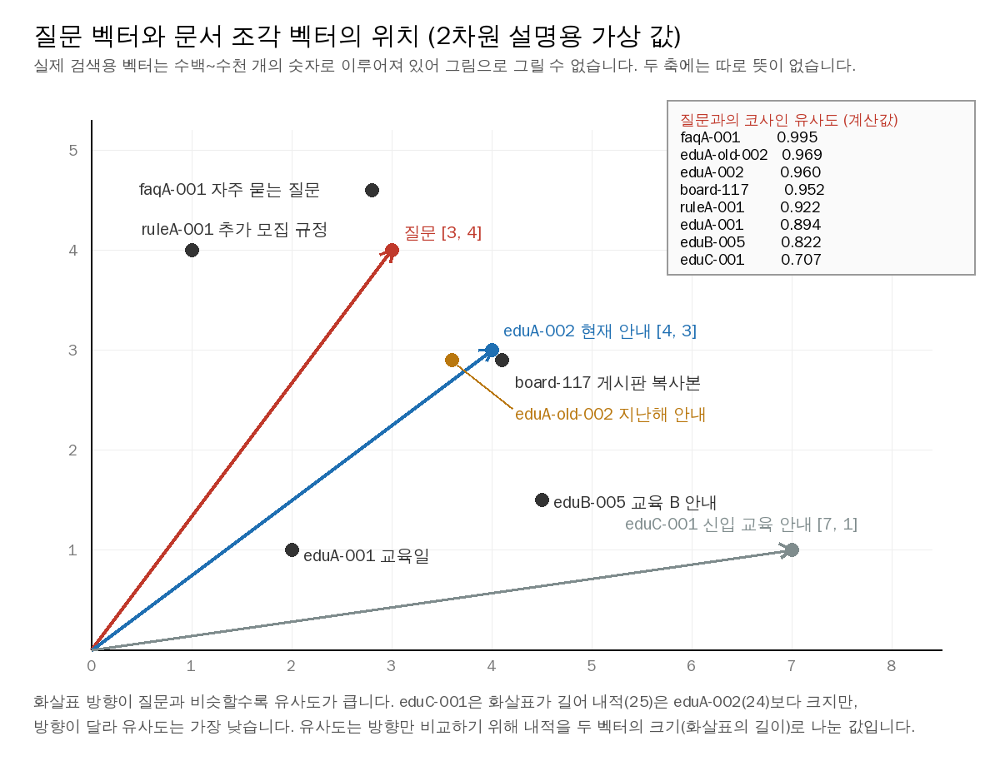

# 6장 질문과 관련된 자료는 어떻게 찾는가

<!--
문서 정보
- 상태: 본문 초안. 2026-10-29 독자 검토 19개 항목 반영 (검토노트/6장_독자검토_20261029.md)
- 기준 구성안: 학습문서_구성안/06_의미키워드혼합검색.md
- 작성일: 2026-10-29
- 결정 사항(검토노트/6장_충돌점검_20261029.md, 2026-10-29 사용자 지시로 추천안 적용): (1) 5장 조각에 설명용 조각(ruleA-001, eduA-old-002, board-117)을 더한 자료 세트를 6장 전체에서 씀. faqA-001은 6.7의 '표현이 다른 문서' 사례를 위해 집필 중 더함. eduB-005·eduC-001의 내용은 6장에서 정함. (2) 그림 6-1~6-10, 6-5만 코드로 그린 실제 이미지(images/fig-06-05_벡터위치.png). (3) BM25는 본문에서 방향만, 참고 상자에 실제 공식 계산값.
- 그림 표기: [그림 6-n] 블록은 나중에 디자인 이미지로 교체할 자리다. 블록 아래의 텍스트 그림은 이미지가 들어오기 전까지 쓰는 임시 그림이다. 디자인 메모는 시안이며 확정안이 아니다.
- 숫자: BM25 점수와 RRF 점수는 설명용 문서에 실제 공식을 적용해 계산한 값이다(조건은 장 끝 주석). 벡터 값과 재정렬 점수, 6.11의 둘째 질문 결과는 설명용 가상 값이다. 코사인 유사도는 가상 벡터로 실제 계산한 값이다.
- 집필 경계: 검토노트/6장_충돌점검_20261029.md 2절의 23개 항목을 따른다. 특히 6.6에서 '정규화'라는 말을 쓰지 않는다. RRF 상수는 '보정값'으로 부른다. 검색 점수에 %를 붙이지 않는다. 사무실 비유는 쓰지 않는다. 10장의 지정 대상자 기준은 쓰지 않는다.
-->

## 장 도입

5장 끝에서 이런 질문을 남겼습니다. 4.7에서 교육 A에 대해 묻던 직원, 즉 지정 대상자가 아닌 그 직원이 이번에는 이렇게 묻습니다. "저 아직 신청할 수 있어요?" 안내문 어디에도 '아직'이나 '할 수 있어요' 같은 말은 없습니다. 그래도 앱은 준비해 둔 수많은 조각 가운데 이 질문에 필요한 조각을 골라야 합니다.

이 장은 그 **고르는 과정**을 따라갑니다. 질문을 검색 요청으로 바꾸고, 단어로 찾고, 뜻으로 찾고, 두 결과를 합치고, 겹치는 후보를 정리하고, 순서를 다시 매겨 최종 후보를 정하기까지입니다. 5장에서 준비한 청크, 검색용 벡터, 키워드 색인, 메타데이터가 여기서 쓰입니다.

한 가지를 먼저 밝혀 둡니다. '아직 신청할 수 있는가'에 답하려면 마감일을 오늘 날짜와 비교해야 합니다(4.7에서 날짜 계산 도구를 쓴 것처럼). 그리고 찾은 조각으로 답을 만드는 일은 7장의 몫입니다. 이 장은 **답에 필요한 조각을 찾아 순서를 정하는 데**까지만 다룹니다.

---

## 6.1 검색의 전체 과정 한눈에 보기

검색은 한 번에 끝나는 일이 아니라 여러 단계로 이루어집니다. 전체 흐름을 먼저 지도처럼 보고, 이후 절에서 한 단계씩 들어가겠습니다.

1. **검색 요청 만들기(6.2)**: 질문에서 찾을 대상과 조건을 정리해, 키워드 검색에 쓸 검색어와 의미 기반 검색에 쓸 문장, 그리고 메타데이터 조건을 만듭니다.
2. **키워드 검색(6.3~6.4)**: 같은 단어가 들어 있는 조각을 찾고 점수 순서로 정렬합니다.
3. **의미 기반 검색(6.5~6.6)**: 질문을 검색용 벡터로 바꾸고, 뜻이 가까운 조각을 찾아 정렬합니다.
4. **결합(6.8)**: 두 검색의 목록을 하나의 순위로 합칩니다.
5. **중복과 버전 정리(6.9)**: 같은 후보, 거의 같은 복사본, 옛 버전을 구분해 정리합니다.
6. **재정렬(6.10)**: 남은 후보를 질문과 함께 다시 점수 매겨 최종 순서를 정합니다.

2와 3은 서로 기다리지 않고 함께 실행할 수 있습니다. 6.7은 두 검색을 비교하는 절이고, 6.11은 이 과정 전체가 잘됐는지 확인하는 절입니다.

<!-- 그림 시작: fig-06-01 -->
> **[그림 6-1] 검색의 전체 과정**
>
> - **보여줄 핵심:** 질문 하나가 검색 요청으로 바뀐 뒤 두 검색 경로로 나뉘고, 결합·정리·재정렬을 거쳐 최종 후보 몇 개가 된다. 각 단계는 무엇을 받아 무엇을 내보내는지가 다르다.
> - **구성 요소:** 왼쪽 질문 상자 → '검색 요청 만들기' → 위아래 두 갈래('키워드 검색: 역색인 → BM25 → 목록', '의미 기반 검색: 질문 벡터 → 유사도 → 목록') → '결합(RRF)' → '중복·버전 정리' → '재정렬' → '최종 후보 → 7장'. 각 상자 아래에 작은 글씨로 입력과 출력.
> - **배치와 흐름:** 왼쪽에서 오른쪽으로. 두 갈래는 나란히 그려 동시에 실행됨을 보인다. 모델을 실행하는 단계(질문 벡터 만들기, 재정렬)에는 작은 모델 아이콘, 모델이 아닌 계산(BM25, RRF)에는 계산기 아이콘.
> - **디자인 메모(시안, 확정 아님):** 이 장의 대표 그림 후보다. 이후 절의 첫머리에 이 그림을 작게 다시 넣고 지금 단계만 강조하면 '지금 어디쯤인지'가 잘 보인다.
> - **대체 텍스트:** 질문이 검색 요청으로 바뀌어 키워드 검색과 의미 기반 검색으로 나뉘어 실행되고, 두 목록이 결합된 뒤 중복과 버전이 정리되고 재정렬되어 최종 후보가 7장의 입력 구성으로 넘어가는 흐름도. 질문 벡터 만들기와 재정렬에는 모델 아이콘이, BM25와 RRF에는 계산 아이콘이 붙어 있다.
> - **성격:** 설명용 흐름도. 실제 서비스의 단계 구성은 제품마다 다르다.

```text
                         ┌▶ [키워드 검색] 역색인 → BM25 → 목록 ─────┐
 질문 ─▶ [검색 요청 만들기]┤                                         ├▶ [결합] ─▶ [중복·버전 정리] ─▶ [재정렬] ─▶ 최종 후보 ─▶ (7장)
                         └▶ [의미 기반 검색] 질문 벡터 → 유사도 → 목록┘
   (6.2)                       (6.3~6.4) / (6.5~6.6)                     (6.8)         (6.9)            (6.10)
```
<!-- 그림 끝: fig-06-01 -->

각 단계가 받는 것과 내보내는 것을 표로 정리하면 다음과 같습니다.

| 단계 | 받는 것 | 내보내는 것 | 모델을 실행하나 |
|---|---|---|---|
| 검색 요청 만들기 | 질문, 대화 맥락 | 검색어, 검색 문장, 메타데이터 조건 | 경우에 따라(6.2) |
| 키워드 검색 | 검색어 | 점수 순서로 정렬된 청크 ID 목록 | 아니요 |
| 의미 기반 검색 | 검색 문장 | 유사도 순서로 정렬된 청크 ID 목록 | 예: 질문을 벡터로 바꾸는 임베딩 모델 |
| 결합 | 두 목록 | 하나로 합친 목록 | 아니요 |
| 중복·버전 정리 | 합친 목록과 메타데이터 | 정리된 후보 | 아니요 |
| 재정렬 | 질문과 후보의 원문 | 새 순서의 후보 몇 개 | 예: 재정렬 모델 |

모델을 실행하는 단계는 그 모델의 Inference입니다(4장, 5.5). 다만 어느 단계에서도 생성 모델이 답변을 만들지는 않습니다. 검색의 결과는 답이 아니라 **청크 ID가 순서대로 늘어선 목록**입니다.

### 이 장에서 쓰는 문서 조각

이 장의 모든 예시는 아래 여덟 조각을 씁니다. eduA-001과 eduA-002는 5.4에서 나눈 교육 A 안내의 두 청크이고, 나머지는 이 장의 설명을 위해 더한 조각입니다.

```text
[설명용 예시] 검색 대상 문서 조각
  eduA-001     교육 A 신청 안내 / 교육일: 10월 8일
  eduA-002     교육 A 신청 안내 / 일반 신청 마감: 10월 5일 / 추가 모집 마감: 10월 7일 (지정 대상자에게만 적용)
  ruleA-001    교육 A 추가 모집 규정 제12조 / 추가 모집은 지정 대상자에게만 적용한다. 지정 대상자의 기준은 이 규정에서 정한다.
  eduA-old-002 지난해 교육 A 신청 안내 / 일반 신청 마감: 10월 4일            (작성일: 지난해 9월)
  board-117    [게시판] 교육 A 신청 안내 / 일반 신청 마감: 10월 5일 / 추가 모집 마감: 10월 7일 (지정 대상자에게만 적용)
  faqA-001     자주 묻는 질문 / 교육 A 접수는 언제 끝나나요? / 일반 접수는 10월 5일에 끝납니다.
  eduB-005     교육 B 신청 안내 / 일반 신청 마감: 10월 12일
  eduC-001     교육 C 안내 / 교육 C는 신입 사원 교육입니다. 교육 장소와 교육 시간은 따로 안내합니다.
```

ruleA-001에 적힌 '지정 대상자의 기준'이 무엇인지는 10장에서 다룹니다. 이 장에서는 그런 규정이 **별도의 조각으로 있다**는 점만 중요합니다.

> **이해 확인**
> 검색 과정의 마지막에 나오는 것은 '답변'일까요, '후보 목록'일까요? 그 목록은 다음에 어디로 넘어가나요?

---

## 6.2 질문을 검색 요청으로 바꾸기

*지금 위치: 그림 6-1의 '검색 요청 만들기'*

"저 아직 신청할 수 있어요?"를 그대로 검색에 넣으면 어떻게 될까요? 이 문장에는 '교육 A'도 '마감'도 없습니다. 무엇에 대한 질문인지는 바로 앞 대화에 있습니다. 2.2에서 본 것처럼 앱은 이전 대화를 컨텍스트로 함께 다루므로, 그 맥락에서 '교육 A의 신청'에 대한 질문이라는 정보를 가져와 검색 요청을 만듭니다.

### 질문 전체, 핵심 검색어, 질문 벡터

검색 요청에는 성격이 다른 세 가지가 들어갑니다.

| 구분 | 예 | 어디에 쓰나 |
|---|---|---|
| 검색 문장(질문 전체를 다시 쓴 것) | "교육 A 일반 신청은 언제 마감되나요?" | 의미 기반 검색. 이 문장을 질문 벡터로 바꿉니다 |
| 핵심 검색어 | 교육 A, 일반, 신청, 마감 | 키워드 검색 |
| 메타데이터 조건 | 문서 종류: 교육 안내·규정·FAQ / 접근 권한: 전 직원 | 검색 대상을 미리 좁히거나 결과를 거르는 데 |

**질문 벡터**는 검색 문장을 5.5의 검색용 임베딩 모델에 넣어 만든 벡터입니다. 문서 조각의 벡터를 만들 때와 같은 임베딩 모델을 써야 비교할 수 있다는 것도 5.5에서 보았습니다.

메타데이터 조건에는 5.6과 5.7에서 붙인 정보(문서 버전, 적용 대상, 작성일, 접근 권한 등)를 씁니다. 여기에 더해 '교육 안내', '규정', 'FAQ' 같은 **문서 종류**도 메타데이터로 붙여 두면 조건으로 쓸 수 있습니다.

### 대상, 구분, 찾을 정보, 제외할 자료

검색 요청을 만들 때는 질문을 다음 네 가지로 나누어 보면 빠뜨리는 것이 줄어듭니다.

<!-- 그림 시작: fig-06-02 -->
> **[그림 6-2] 질문 분석 카드**
>
> - **보여줄 핵심:** 짧은 질문 하나에서 대상, 구분, 찾을 정보, 제외할 자료를 나누어야 검색어와 조건이 정해진다. 대상과 구분은 질문 문장이 아니라 대화 맥락에서 온다.
> - **구성 요소:** 위에 원래 질문 말풍선 "저 아직 신청할 수 있어요?", 그 옆에 '대화 맥락: 교육 A, 지정 대상자 아님'. 아래 카드 네 칸(대상 / 구분 / 찾을 정보 / 제외할 자료). 카드 아래에 만들어진 검색 요청 세 줄(검색 문장, 검색어, 메타데이터 조건).
> - **배치와 흐름:** 위에서 아래로. 말풍선과 맥락 상자에서 카드의 각 칸으로 화살표.
> - **대체 텍스트:** 질문 "저 아직 신청할 수 있어요?"와 대화 맥락(교육 A, 지정 대상자 아님)에서 대상(교육 A), 구분(일반 신청, 추가 모집 규정도 함께 확인), 찾을 정보(마감일), 제외할 자료(다른 교육, 지난해 안내)를 나눈 카드와, 그로부터 만든 검색 문장, 검색어, 메타데이터 조건.
> - **성격:** 설명용 예시.

```text
[설명용 예시] 질문 분석 카드
  원래 질문   : "저 아직 신청할 수 있어요?"
  대화 맥락   : 교육 A에 대해 묻는 중, 지정 대상자가 아님 (4.7)
  ┌─────────────┬────────────────────────────────────────┐
  │ 대상         │ 교육 A                                   │
  │ 구분         │ 일반 신청 (추가 모집 규정도 함께 확인)        │
  │ 찾을 정보     │ 마감일                                   │
  │ 제외할 자료   │ 다른 교육의 안내, 지난해 안내                 │
  └─────────────┴────────────────────────────────────────┘
  → 검색 문장 : "교육 A 일반 신청은 언제 마감되나요?"
  → 검색어    : 교육 A, 일반, 신청, 마감
  → 조건      : 문서 종류(교육 안내·규정·FAQ), 접근 권한(전 직원)
```
<!-- 그림 끝: fig-06-02 -->

'구분'에 "추가 모집 규정도 함께 확인"이라고 적은 이유가 있습니다. 질문한 직원은 지정 대상자가 아니므로 답은 일반 신청 마감일입니다. 하지만 "추가 모집에는 해당하지 않는다"는 것을 답에서 함께 밝히려면, 추가 모집이 누구에게 적용되는지에 대한 근거도 찾아 두어야 합니다. 4.7에서 일반 규칙과 예외를 함께 보아야 10월 5일을 고를 수 있었던 것과 같습니다.

'제외할 자료'의 지난해 안내는 작성일 조건을 넣어 검색 단계에서 처음부터 뺄 수도 있습니다. 이 장의 예에서는 그 조건을 넣지 않았습니다. 그러면 무슨 일이 생기는지는 6.7과 6.9에서 봅니다.

### 다시 쓸 때 대상과 조건을 바꾸면 안 된다

검색 문장을 다시 쓰는 일은 앱이 정해 둔 규칙으로 할 수도 있고, 생성 모델에게 맡길 수도 있습니다. 생성 모델에게 맡긴다면 1.6에서 모델이 검색 요청을 출력하고 앱이 검색 도구를 실행한 것과 같은 구조입니다. 이때 모델이 만든 검색 문장은 생성 모델의 Inference 결과이므로, 조건을 잘못 이어 쓸 수도 있습니다(4장).

어느 쪽이든 다시 쓴 문장이 원래 질문의 **대상과 조건을 바꾸면 안 됩니다.**

| 잘못 다시 쓴 검색 문장 | 무엇이 바뀌었나 | 생길 수 있는 일 |
|---|---|---|
| "교육 신청 마감일은?" | 대상(교육 A)이 빠짐 | 교육 B, 교육 C의 마감일이 섞여 나옴 |
| "교육 A 추가 모집 마감일은?" | 구분이 바뀜 | 지정 대상자가 아닌 직원에게 10월 7일 근거만 찾아 줌 |
| "교육 A는 언제 하나요?" | 찾을 정보가 바뀜 | 교육일(10월 8일) 조각만 찾아 줌 |

검색 단계에서 바뀐 조건은 뒤의 단계에서 바로잡기 어렵습니다(6.10).

### 대화 맥락에서 가져오는 정보와 모델 실행 횟수

질문 분석 카드의 '지정 대상자가 아님'은 직원이 앞 대화에서 직접 밝힌 내용입니다. 그 대화가 컨텍스트에 남아 있으므로(2.2) 검색 요청을 만들 때 쓸 수 있습니다. 이 정리를 생성 모델에게 맡긴다면, 답변을 만들기 전에 생성 모델이 한 번 더 실행됩니다.

이 장의 예를 그런 구성이라고 보고, 질문 하나에 모델이 몇 번 실행되는지 5.5에서 센 방식대로 세어 보면 다음과 같습니다.

- 생성 모델: 검색 요청 만들기 1번
- 임베딩 모델: 질문 벡터 만들기 1번
- 재정렬 모델: 후보 수만큼, 이 예에서는 5번(6.10)
- 생성 모델: 답변 만들기 1번 이상(7장). 4.7처럼 날짜 계산 도구를 쓰면 도구 요청과 최종 답변으로 2번

이 횟수는 앱의 구성에 따라 달라집니다. 검색 요청을 앱의 규칙으로 만들거나 재정렬을 쓰지 않으면 그만큼 줄어듭니다.

> **이해 확인**
> 검색 문장을 "교육 A 추가 모집 마감일은?"으로 바꿔 쓰면, 이 장의 직원에게 어떤 문제가 생길 수 있을까요?

---

## 6.3 키워드 검색은 어떻게 자료를 찾는가

*지금 위치: 그림 6-1의 '키워드 검색'*

**키워드 검색**은 검색어와 같은 단어가 들어 있는 조각을 찾는 방식입니다. 5.2에서 "같은 단어가 들어 있는 조각 찾기"라고 한 줄로 소개했던 그 방식입니다.

### 검색어 분석과 정규화

검색어를 그대로 쓰면 같은 단어도 모양이 달라 놓치기 쉽습니다. 한국어에서는 특히 조사와 어미가 단어에 붙습니다. "신청은", "신청을", "신청할" 은 글자로는 모두 다릅니다. 그래서 키워드 검색은 먼저 **검색어 분석**을 합니다. 문장을 단어로 나누고, 조사와 어미를 떼어 내 "신청"처럼 기본 모양으로 맞춥니다.

이렇게 모양을 맞추는 일을 **검색어 정규화**라고도 합니다. 띄어쓰기("교육A"와 "교육 A"), 영문자의 크기("a"와 "A"), 전각·반각 문자를 맞추는 것도 여기에 들어갑니다. 3.2에서 본 정규화는 숫자 묶음의 값 범위를 맞추는 계산이었습니다. 같은 이름이지만 **전혀 다른 일**입니다. 검색어 정규화는 글자의 모양을 맞추는 일입니다.

중요한 점은 **문서 쪽도 같은 방식으로 분석해 두어야** 한다는 것입니다. 5.7에서 키워드 색인을 만들 때 문서의 단어도 이렇게 분석해 기본 모양으로 기록해 둡니다. 그래야 질문의 "신청은"과 문서의 "신청을"이 같은 "신청"으로 만납니다.

### 역색인: 5.7의 키워드 색인

5.7에서 책 뒤의 '찾아보기'처럼 단어마다 그 단어가 나오는 청크 ID를 적어 둔 키워드 색인을 만들었습니다. 검색 분야에서는 이것을 **역색인**(inverted index)이라고 부릅니다. 보통은 문서를 보면 그 안의 단어를 알 수 있는데, 거꾸로 단어에서 문서를 찾아가는 목록이라서 '역'이 붙었습니다. 5.7에서는 보기 쉽게 '교육 A'를 한 단어처럼 묶어 보였지만, 실제 분석에서는 이 장처럼 '교육'과 'A'로 나누기도 합니다.

이 장의 여덟 조각으로 만든 역색인 가운데 검색어와 이 장에서 쓸 몇 단어만 보면 다음과 같습니다.

<!-- 그림 시작: fig-06-03 -->
> **[그림 6-3] 역색인에서 후보 찾기**
>
> - **보여줄 핵심:** 키워드 검색은 문서를 처음부터 다 훑지 않는다. 역색인에서 검색어마다 그 단어가 나오는 청크 ID를 바로 꺼내고, 하나라도 들어 있는 조각을 후보로 모은다.
> - **구성 요소:** 왼쪽 검색어 다섯 개(교육 / A / 일반 / 신청 / 마감)에서 오른쪽 청크 ID 목록으로 가는 화살표. 아래에 모인 후보 여덟 개.
> - **배치와 흐름:** 왼쪽 검색어 → 가운데 역색인 표 → 오른쪽 후보 묶음.
> - **대체 텍스트:** 검색어 교육, A, 일반, 신청, 마감마다 역색인에 그 단어가 나오는 청크 ID가 적혀 있고, 그 ID들을 모아 후보를 만든다. '교육'은 여덟 조각 모두에, 'A'는 여섯 조각에, '마감'은 네 조각에 나온다.
> - **성격:** 설명용 예시. 분석 결과는 이 책의 예시를 위해 단순화했다.

```text
[설명용 예시] 역색인의 일부 (분석 후 기본 모양 기준)
  교육  → eduA-001, eduA-002, ruleA-001, eduA-old-002, board-117, faqA-001, eduB-005, eduC-001
  A     → eduA-001, eduA-002, ruleA-001, eduA-old-002, board-117, faqA-001
  일반  → eduA-002, eduA-old-002, board-117, faqA-001, eduB-005
  신청  → eduA-001, eduA-002, eduA-old-002, board-117, eduB-005
  마감  → eduA-002, eduA-old-002, board-117, eduB-005
  접수  → faqA-001
  제12조 → ruleA-001
```
<!-- 그림 끝: fig-06-03 -->

검색어 가운데 하나라도 들어 있는 조각이 **후보**가 됩니다. 이 예에서는 '교육'이 모든 조각에 있으므로 여덟 조각이 모두 후보가 됩니다. 후보가 많으면 순서가 중요해집니다. 그 순서를 정하는 계산이 다음 절의 BM25입니다.

### 키워드 검색이 잘하는 것과 놓치는 것

키워드 검색은 **정확히 같은 글자로 찾아야 하는 것**에 강합니다. 교육명, 제품 코드, 조항 번호, 사람 이름 같은 것들입니다. 예를 들어 "제12조"라는 검색어는 역색인에서 ruleA-001 하나만 가리킵니다. 이런 표현은 뜻으로 찾는 방식에서는 오히려 잘 드러나지 않을 수 있습니다(6.7).

반대로 **같은 뜻을 다른 말로 쓴 문서는 놓치기 쉽습니다.** faqA-001은 '신청' 대신 '접수', '마감' 대신 '끝납니다'라고 썼습니다. 그래서 검색어 '신청'과 '마감'의 역색인 목록에 faqA-001이 없습니다. 내용은 질문에 딱 맞는 조각인데도 말입니다. 동의어 사전을 두어 '접수'를 '신청'과 함께 찾게 할 수도 있지만, 모든 표현을 미리 사전에 넣어 둘 수는 없습니다.

> **이해 확인**
> 질문에 "교육 A 접수 끝나는 날"이라고 썼다면, 역색인에서 '마감'이 들어 있는 조각을 찾을 수 있을까요? 어떤 조각이 후보로 잘 잡힐까요?

---

## 6.4 BM25는 무엇이며 어떻게 검색 순서를 정하는가

*지금 위치: 그림 6-1 '키워드 검색' 안의 순서 정하기*

### 6.4.1 BM25의 정체부터 설명하기

**BM25**는 키워드 검색의 후보마다 **점수를 계산해 순서를 정하는 계산 방식**입니다. 검색 분야에서는 이런 것을 '랭킹 함수'라고 부릅니다. 이름의 BM은 Best Matching(가장 잘 맞는 것 찾기)의 머리글자이고, 25는 여러 차례 고쳐 만든 식 가운데 하나에 붙은 번호라고 흔히 설명합니다. 이름이 낯설어 새로운 AI 모델처럼 보일 수 있지만 그렇지 않습니다. BM25는 학습 데이터로 파라미터를 고친 모델이 아니고, 생성 모델도 아닙니다. 정해진 식에 단어의 개수와 문서의 길이 같은 **통계 숫자**를 넣어 점수를 계산할 뿐입니다. 그래서 BM25를 실행하는 것은 Inference가 아닙니다.

BM25는 문장의 뜻을 따지지도 않습니다. 검색어가 몇 번 나왔는지, 그 단어가 얼마나 드문지, 문서가 얼마나 긴지를 셀 뿐입니다. 키워드 검색 안에서 BM25가 있는 자리는 다음과 같습니다.

<!-- 그림 시작: fig-06-04 -->
> **[그림 6-4] 키워드 검색 안에서 BM25의 자리와 세 문서의 점수 비교**
>
> - **보여줄 핵심:** BM25는 역색인에서 후보를 찾은 다음, 후보마다 점수를 계산하는 단계다. 모델이 아니라 계산식이다. 같은 검색어라도 드문 단어가 점수에 더 크게 들어간다.
> - **구성 요소:** 위쪽 세로 흐름(검색어 → 역색인에서 후보 찾기 → BM25로 점수 계산 → 점수 순서로 정렬). BM25 상자 옆에 '계산식, 모델 아님' 이름표. 아래쪽 세 문서 카드(eduA-002 / eduB-005 / eduC-001)와 각 카드의 점수 막대.
> - **배치와 흐름:** 위 흐름의 'BM25' 상자에서 아래 세 카드로 점선. 카드는 점수 순서로 왼쪽부터.
> - **대체 텍스트:** 검색어로 역색인에서 후보를 찾고, BM25로 후보마다 점수를 계산한 뒤 점수 순서로 정렬하는 흐름. 아래에는 eduA-002, eduB-005, eduC-001 세 문서의 점수 막대가 있으며 eduA-002가 가장 높고 eduC-001이 가장 낮다.
> - **성격:** 설명용 흐름도와 계산 결과. 점수는 설명용 문서 세 개에 BM25 공식을 실제로 적용한 값이다(참고 상자).

```text
 검색어 (교육, A, 일반, 신청, 마감)
   ↓
 역색인에서 후보 문서 찾기
   ↓
 BM25로 각 후보의 점수 계산      ← 계산식(모델이 아님)
   ↓
 점수가 높은 순서로 정렬
   ↓
 eduA-002 ████████████  2.62
 eduB-005 █████████     1.95
 eduC-001 █             0.24
```
<!-- 그림 끝: fig-06-04 -->

### 6.4.2 BM25가 점수에 반영하는 것

BM25는 다음 네 가지를 점수에 반영합니다.

- **문서 안에 검색어가 얼마나 나오는가.** 검색어가 여러 번 나오는 문서가 더 관련이 있을 가능성이 크다고 봅니다.
- **그 검색어가 전체 문서에서 얼마나 드문가.** 거의 모든 문서에 나오는 단어는 후보를 구별하는 데 도움이 되지 않으므로 작게 반영합니다. 몇 개 문서에만 나오는 단어는 크게 반영합니다.
- **문서가 길어서 많이 나온 것은 아닌가.** 긴 문서는 어떤 단어든 많이 나오기 쉬우므로, 문서 길이를 평균과 비교해 조절합니다.
- **많이 나올수록 점수가 끝없이 늘지는 않는다.** 한 번 나온 것과 두 번 나온 것의 차이는 크지만, 열 번과 열한 번의 차이는 작게 처리합니다.

이 통계 가운데 단어마다 몇 개 조각에 나오는지, 조각마다 단어가 몇 개인지는 5장의 질문 전 준비에서 키워드 색인과 함께 기록해 둡니다. 문서가 추가되거나 바뀌면 이 통계도 함께 갱신합니다(5.7). 점수 자체는 질문이 들어올 때 그 질문의 검색어로 계산합니다.

### 6.4.3 작은 문서 예시로 순위 비교하기

검색어 "교육 A 일반 신청 마감"으로 세 조각의 순위를 따져 보겠습니다. 세 조각에 검색어가 몇 번 나오는지 세면 다음과 같습니다. 단어는 6.3의 방식으로 분석한 기본 모양으로 셉니다.

| 검색어 | eduA-002 | eduB-005 | eduC-001 | 몇 개 조각에 나오나 |
|---|---|---|---|---|
| 교육 | 1 | 1 | 5 | 세 조각 모두 |
| A | 1 | 0 | 0 | 하나 |
| 일반 | 1 | 1 | 0 | 둘 |
| 신청 | 2 | 2 | 0 | 둘 |
| 마감 | 2 | 1 | 0 | 둘 |
| 조각 길이(단어 수) | 17 | 9 | 14 | |

이 표에서 순위의 방향을 읽을 수 있습니다.

- **'교육'은 점수에 거의 도움이 되지 않습니다.** 세 조각 모두에 나오므로 후보를 구별하지 못합니다. eduC-001은 '교육'이 다섯 번이나 나오지만, 다른 검색어가 하나도 없어 꼴찌입니다.
- **'A'가 1위를 가릅니다.** 'A'는 eduA-002에만 나오는 드문 단어이므로 크게 반영됩니다. eduB-005는 '일반', '신청', '마감'이 다 있지만 'A'가 없어 2위입니다.
- **같은 횟수라도 짧은 조각에서 더 크게 반영됩니다.** '신청'은 eduA-002와 eduB-005에 똑같이 두 번 나오지만, eduB-005가 더 짧아서 '신청'으로 얻는 점수는 eduB-005가 조금 더 높습니다.

결과 순위는 eduA-002, eduB-005, eduC-001입니다. 실제 계산값은 아래 참고 상자에 있습니다.

검색어를 "교육" 하나로만 바꾸면 순위가 뒤집힙니다. 이번에는 '교육'이 다섯 번 나오는 eduC-001이 1위가 됩니다. 다만 다섯 번 나왔다고 점수가 다섯 배가 되지는 않습니다. 한 번 나온 eduB-005보다 1.5배쯤 높을 뿐입니다. 6.4.2의 넷째 항목, 많이 나올수록 점수가 끝없이 늘지 않는다는 성질입니다.

**BM25 점수는 확률이 아닙니다.** eduA-002의 2.62는 "이 조각이 정답일 가능성"도, "이 조각이 사실일 가능성"도 아닙니다. 2.6의 다음 토큰 확률처럼 모두 더해 1이 되는 값도 아닙니다. 같은 검색어로 찾은 후보들 사이에서 **순서를 정하기 위한 점수**일 뿐이며, 검색어나 문서 묶음이 바뀌면 같은 조각의 점수도 달라집니다. 이 장에서 나오는 다른 점수(유사도, RRF 점수, 재정렬 점수)도 모두 같습니다.

> **참고 상자: BM25 점수를 실제로 계산하면 (건너뛰어도 됩니다)**
>
> BM25 점수는 검색어마다 '드문 정도 × 횟수 반영값'을 구해 모두 더한 것입니다.
>
> - **드문 정도** = ln( (전체 조각 수 − 그 단어가 나오는 조각 수 + 0.5) ÷ (그 단어가 나오는 조각 수 + 0.5) + 1 )
> - **횟수 반영값** = 횟수 × 2.2 ÷ ( 횟수 + 1.2 × (0.25 + 0.75 × 조각 길이 ÷ 평균 길이) )
>
> 1.2와 0.75는 횟수와 길이를 얼마나 반영할지 정하는 설정값입니다. 널리 쓰이는 기본값입니다(흔히 k1, b라고 부르며, 6.6의 검색 Top-k와는 관계없습니다). 세 조각의 평균 길이는 (17 + 9 + 14) ÷ 3 = 13.33입니다.
>
> | 검색어 | 드문 정도 | eduA-002 | eduB-005 | eduC-001 |
> |---|---|---|---|---|
> | 교육 | 0.134 | 0.120 | 0.154 | 0.235 |
> | A | 0.981 | 0.882 | 0 | 0 |
> | 일반 | 0.470 | 0.422 | 0.542 | 0 |
> | 신청 | 0.470 | 0.600 | 0.711 | 0 |
> | 마감 | 0.470 | 0.600 | 0.542 | 0 |
> | **합계(BM25 점수)** | | **2.624** | **1.949** | **0.235** |
>
> 한 칸을 따라가 보겠습니다. eduA-002의 'A'는 세 조각 가운데 하나에만 나오므로 드문 정도가 ln(2.5 ÷ 1.5 + 1) = ln 2.667 = 0.981입니다. eduA-002 안에 한 번 나오고 길이가 17이므로, 횟수 반영값은 1 × 2.2 ÷ (1 + 1.2 × (0.25 + 0.75 × 17 ÷ 13.33)) = 2.2 ÷ 2.448 = 0.899입니다. 둘을 곱하면 0.981 × 0.899 = 0.882입니다.
>
> 이 값은 설명용 조각 세 개에 이 식을 코드로 적용해 계산하고 손으로 검산한 결과입니다. 실제 검색 엔진은 단어 분석 방식과 세부 식이 조금씩 달라 같은 문서라도 다른 점수를 낼 수 있습니다.

> **이해 확인**
> 회사의 모든 문서에 '안내'라는 단어가 들어 있다면, 검색어에 '안내'를 넣는 것은 BM25 점수의 순서를 크게 바꿀까요? 그 이유는 무엇인가요?

---

## 6.5 의미 기반 검색은 어떻게 자료를 찾는가

*지금 위치: 그림 6-1의 '의미 기반 검색'*

**의미 기반 검색**은 표현이 달라도 **뜻이 가까운 조각**을 찾는 방식입니다. 5.2에서 한 줄로 소개했고, 5.5에서 그 재료인 검색용 벡터를 준비했습니다.

### 질문 벡터와 문서 벡터 비교하기

과정은 세 단계입니다.

1. 6.2에서 만든 검색 문장 "교육 A 일반 신청은 언제 마감되나요?"를 검색용 임베딩 모델에 넣어 **질문 벡터**를 만듭니다. 5장에서 청크 벡터를 만들 때와 같은 임베딩 모델이어야 합니다. 이 단계는 임베딩 모델의 Inference입니다(5.5).
2. 질문 벡터를 5장에서 Vector DB에 저장해 둔 **청크 벡터**와 비교해, 얼마나 가까운지를 나타내는 **유사도**를 계산합니다.
3. 유사도가 높은 순서로 청크 ID를 정렬합니다. 5.6에서 Vector DB를 "가까운 벡터를 찾는 일에 맞춘 저장소"라고 했던 것이 이 단계입니다. 벡터가 아주 많을 때 모든 벡터와 일일이 비교하지 않고도 가까운 것을 빨리 찾는 방법들이 있지만, 이 책에서는 다루지 않습니다.

### 표현이 달라도 찾을 수 있는 이유

5.5에서 임베딩 모델은 뜻이 비슷한 글을 비슷한 벡터로 바꾸도록 학습되어 있다고 했습니다. 그래서 faqA-001처럼 '신청' 대신 '접수', '마감' 대신 '끝납니다'라고 쓴 조각도, 뜻이 질문과 가까우면 질문 벡터와 가까운 벡터를 갖습니다. 6.3의 키워드 검색이 놓친 조각을 의미 기반 검색은 찾을 수 있는 것입니다.

아래 그림은 이 장의 질문 벡터와 여덟 조각의 벡터를 2차원 평면에 놓은 것입니다. 실제 검색용 벡터는 수백~수천 개의 숫자로 되어 있어 그림으로 그릴 수 없으므로, 숫자 두 개짜리 가상 벡터로 바꾸어 그렸습니다. 2.4의 과일 비유에서는 [단맛, 신맛, 크기]처럼 각 번째에 뜻을 붙였지만, 실제 검색용 벡터의 각 번째에는 사람이 붙일 수 있는 뜻이 따로 없습니다. 그래서 이 그림의 두 축에도 이름을 붙이지 않았습니다.

<!-- 그림 시작: fig-06-05 -->
> **[그림 6-5] 질문 벡터와 문서 조각 벡터의 위치**
>
> - **보여줄 핵심:** 원점에서 뻗은 화살표의 방향이 질문과 비슷한 조각일수록 유사도가 높다. 표현이 다른 FAQ가 가장 가깝고, 지난해 안내도 현재 안내만큼 가깝다. 유사도는 방향의 비교다.
> - **구성 요소:** 2차원 평면. 질문 벡터 [3, 4], eduA-002 [4, 3], eduC-001 [7, 1]은 원점에서 화살표로, 나머지 다섯 조각은 점으로 표시. 오른쪽 위에 질문과의 코사인 유사도 표.
> - **배치와 흐름:** 질문 화살표는 빨강, eduA-002는 파랑, eduC-001은 회색, 지난해 안내는 주황.
> - **디자인 메모(시안, 확정 아님):** 실제 이미지 파일이 있다. 교재 글꼴로 다시 그릴 때는 좌표와 유사도 값을 그대로 쓴다.
> - **대체 텍스트:** 2차원 평면 위에 질문 벡터 [3, 4]와 여덟 조각의 벡터가 놓인 그림. faqA-001(유사도 0.995), eduA-old-002(0.969), eduA-002(0.960), board-117(0.952)이 질문과 비슷한 방향에 모여 있고, ruleA-001(0.922), eduA-001(0.894), eduB-005(0.822)가 그다음이며, eduC-001(0.707)은 화살표가 가장 길지만 방향이 가장 다르다.
> - **성격:** 설명용 가상 벡터. 유사도는 그 가상 벡터로 실제 계산한 값이다.


<!-- 그림 끝: fig-06-05 -->

이 그림의 유사도로 순서를 매기면 faqA-001, eduA-old-002, eduA-002, board-117, ruleA-001, eduA-001, eduB-005, eduC-001입니다. 6.7에서 보겠지만, 여덟 조각 전체로 키워드 검색을 하면 faqA-001은 6위입니다. 그런 faqA-001이 여기서는 1위입니다.

### 비교하는 방법들

벡터끼리 얼마나 가까운지 재는 방법은 몇 가지가 있습니다.

- **내적**: 3.4에서 Q와 K를 비교할 때 쓴 계산입니다. 같은 번째의 숫자끼리 곱해 더합니다. 클수록 가깝다고 봅니다.
- **코사인 유사도**: 내적을 두 벡터의 크기(화살표의 길이)로 나누어, 크기와 관계없이 **방향**만 비교합니다. 1에 가까울수록 방향이 같습니다. 이 그림의 유사도가 코사인 유사도입니다.
- **거리**: 두 벡터의 끝점 사이가 얼마나 떨어져 있는지 잽니다. 다른 둘과 달리 **작을수록** 가깝습니다.

어떤 방법을 쓸지는 임베딩 모델과 검색 도구의 안내를 따릅니다. 계산을 직접 따라가는 것은 다음 절에서 하겠습니다.

### 유사도가 높다고 최신이거나 사실인 것은 아니다

그림에서 지난해 안내 eduA-old-002의 유사도(0.969)는 현재 안내 eduA-002(0.960)보다 높습니다. 둘 다 '교육 A의 일반 신청 마감'에 대한 글이니 뜻이 가까운 것은 당연합니다. 하지만 지난해 안내의 10월 4일은 올해의 답이 아닙니다.

**유사도는 질문과 뜻이 가까운지를 나타낼 뿐**, 그 조각이 최신인지, 사실인지, 질문한 사람에게 적용되는지는 알려 주지 않습니다. 그런 것은 작성일, 문서 버전, 적용 대상 같은 메타데이터로 따로 확인해야 합니다(6.9).

5.4에서 "여러 주제가 섞인 큰 조각은 질문과의 관련성을 정확히 따지기도 어렵다"고 했던 이유도 여기서 설명됩니다. 조각 하나는 벡터 하나가 되므로, 교육 A부터 교육 F까지 담긴 큰 조각의 벡터는 여섯 교육의 뜻이 섞인 방향을 가리킵니다. 교육 A만 묻는 질문 벡터와는 방향이 어긋나기 쉽습니다.

### Attention과 의미 기반 검색은 어떻게 다른가

3장 끝에서 예고한 비교입니다. 둘 다 숫자 묶음을 비교해 관계를 계산하고, 그 비교에 내적을 쓸 수 있다는 점은 같습니다. 하지만 무엇을, 어디서, 무엇을 위해 비교하는지가 다릅니다.

| 구분 | Attention (3장) | 의미 기반 검색 (이 절) |
|---|---|---|
| 무엇끼리 비교하나 | 한 입력 안의 토큰끼리 (Q와 K) | 질문 하나와 미리 준비한 청크들 |
| 어디서 일어나나 | 생성 모델 안의 각 레이어 | 모델 바깥, 앱과 검색 도구 (벡터는 임베딩 모델이 만듦) |
| 비교 결과로 하는 일 | 비중에 따라 V를 섞어 다음 계산으로 넘김 | 가까운 순서로 청크 ID 목록을 만듦 |
| 결과가 어디로 가나 | 모델 안의 다음 계산 | 7장에서 원문을 꺼내 모델 입력에 넣음 |

한 문장으로 말하면, Attention은 **이미 입력에 들어온 토큰끼리 정보를 섞는 계산**이고, 의미 기반 검색은 **무엇을 입력에 넣을지 고르기 위한 비교**입니다. 검색이 먼저 일어나 입력을 만들고, Attention은 그 입력으로 생성 모델이 답을 만들 때 모델 안에서 일어납니다.

> **이해 확인**
> 의미 기반 검색에서 eduA-old-002의 유사도가 가장 높게 나왔다면, 이 조각을 그대로 답의 근거로 써도 될까요? 무엇을 확인해야 하나요?

---

## 6.6 작은 숫자로 벡터 유사도 계산 따라가기

*지금 위치: 그림 6-1 '의미 기반 검색' 안의 유사도 계산*

그림 6-5의 세 화살표, 질문 [3, 4]와 eduA-002 [4, 3], eduC-001 [7, 1]로 유사도를 직접 계산해 보겠습니다.

### 1단계: 내적 계산하기

3.4에서 Q와 K를 비교할 때 쓴 그 계산입니다. 같은 번째의 숫자끼리 곱한 뒤 더합니다.

```text
[설명용 가상 값으로 계산] 내적
  질문 · eduA-002  =  [3, 4] · [4, 3]  =  (3 × 4) + (4 × 3)  =  12 + 12  =  24
  질문 · eduC-001  =  [3, 4] · [7, 1]  =  (3 × 7) + (4 × 1)  =  21 + 4   =  25
```

내적만 보면 eduC-001(25)이 eduA-002(24)보다 큽니다. 그런데 그림 6-5를 보면 eduC-001의 화살표는 질문과 방향이 꽤 다릅니다. 내적이 큰 것은 eduC-001의 화살표가 **길기** 때문입니다. 내적은 방향뿐 아니라 화살표의 길이, 즉 벡터의 크기에도 영향을 받습니다.

### 2단계: 크기로 나누어 방향만 비교하기

벡터의 **크기**는 각 숫자를 제곱해 더한 뒤 제곱근을 구한 값으로, 원점에서 화살표 끝까지의 길이입니다. 이 장에서 '조각 길이'는 단어 수를 뜻했고, 3.4에서 '숫자 묶음의 길이'는 숫자의 개수를 뜻했습니다. 헷갈리지 않도록 여기서는 '크기'라고 부르겠습니다.

```text
[설명용 가상 값으로 계산] 크기
  질문 [3, 4]     : √(3² + 4²) = √(9 + 16) = √25 = 5
  eduA-002 [4, 3] : √(4² + 3²) = √25 = 5
  eduC-001 [7, 1] : √(7² + 1²) = √50 ≈ 7.07
```

내적을 두 벡터의 크기로 나누면 크기의 영향이 빠지고 방향만 남습니다. 이것이 **코사인 유사도**입니다.

```text
[설명용 가상 값으로 계산] 코사인 유사도
  질문과 eduA-002  =  24 ÷ (5 × 5)     =  24 ÷ 25     =  0.96
  질문과 eduC-001  =  25 ÷ (5 × 7.07)  =  25 ÷ 35.36  ≈  0.71
```

이제 순서가 바로잡혔습니다. eduA-002(0.96)가 eduC-001(0.71)보다 질문과 가깝습니다. 3.4 끝에서 "점수를 일정한 값으로 나누어 크기를 조절하는 단계"를 언급했는데, 그것은 숫자 묶음에 든 숫자의 개수에 따라 정해진 값으로 나누는 것이었습니다. 여기서는 **비교하는 두 벡터 각각의 크기**로 나누므로 서로 다른 계산입니다.

계산의 결과 숫자를 외울 필요는 없습니다. 기억할 것은 과정입니다. 질문과 조각을 **같은 임베딩 모델로 만든 같은 기준의 숫자 묶음**으로 바꾸고, 그 숫자 묶음끼리 방향을 비교해 순서를 정한다는 것입니다.

### 검색 Top-k와 생성 Top-k 구분하기

의미 기반 검색에서는 유사도가 높은 순서로 **상위 몇 개**만 다음 단계로 넘깁니다. 이 개수를 흔히 **검색 Top-k**라고 부릅니다. 이 장의 예에서는 두 검색 모두 상위 5개를 넘기므로 k는 5입니다. 그런데 2.6에서도 Top-k가 나왔습니다. 이름은 같지만 다른 것입니다.

| 구분 | 무엇의 상위 k개인가 | 어디서 쓰나 | 남은 것으로 하는 일 |
|---|---|---|---|
| 생성 Top-k (2.6) | 다음 토큰 후보 | 생성 모델이 토큰 하나를 고를 때 | 확률 비율대로 하나를 뽑음 |
| 검색 Top-k (이 절) | 검색된 청크 | 검색 결과를 다음 단계로 넘길 때 | 결합·정리·재정렬로 넘김 |

생성 Top-k의 후보에는 모두 더하면 1이 되는 확률이 붙어 있습니다. 검색 Top-k의 청크마다 붙은 유사도는 개수가 아니라 순서를 정하는 값이며, 확률이 아닙니다(6.4.3).

> **이해 확인**
> 질문 [3, 4]와 조각 [6, 8]의 코사인 유사도는 얼마일까요? 내적과 크기를 차례로 구해 보세요. 결과가 뜻하는 것은 무엇인가요?

---

## 6.7 키워드 검색과 의미 기반 검색 비교하기

같은 질문으로 두 검색을 실행해, 성격이 서로 다른 조각들의 순위를 비교해 보겠습니다. 키워드 검색의 순위는 검색어 "교육 A 일반 신청 마감"으로 여덟 조각 전체에 BM25를 적용한 것입니다(6.4의 세 조각 계산과는 대상 조각 수가 달라 점수가 다릅니다). 의미 기반 검색의 순위는 그림 6-5의 유사도 순위입니다. 두 목록 전체는 6.8에서 결합할 때 봅니다.

<!-- 그림 시작: fig-06-06 -->
> **[그림 6-6] 두 검색 방식이 찾는 후보와 놓치는 후보**
>
> - **보여줄 핵심:** 같은 표현이 든 조각은 둘 다 찾는다. 표현이 다른 조각은 의미 기반 검색이, 정확한 번호는 키워드 검색이 잘 찾는다. 옛 버전은 둘 다 높은 순위로 찾아오므로 검색 방식만으로는 걸러지지 않는다.
> - **구성 요소:** 아래 표를 카드 네 장으로 바꾼 그림. 카드마다 조각 이름, 키워드 검색 순위, 의미 기반 검색 순위, '찾음 / 놓침' 표시.
> - **배치와 흐름:** 카드 네 장을 가로로. 옛 버전 카드에는 경고 표시.
> - **대체 텍스트:** 같은 표현이 든 eduA-002는 두 검색 모두 상위에서 찾고, 표현이 다른 faqA-001은 의미 기반 검색만 1위로 찾으며, 조항 번호 '제12조'로 찾을 때는 키워드 검색이 ruleA-001을 정확히 찾고, 지난해 안내 eduA-old-002는 두 검색 모두 2위 안에 올려 놓는다는 비교.
> - **성격:** 계산 결과와 설명용 예시. '제12조' 줄은 일반적인 경향을 보인 설명용 예시다.

| 조각의 성격 | 예 | 키워드 검색 | 의미 기반 검색 |
|---|---|---|---|
| 질문과 같은 표현이 들어 있음 | eduA-002 | 2위, 찾음 | 3위, 찾음 |
| 표현은 다르지만 뜻이 비슷함 | faqA-001 | 6위, 상위 5개에서 놓침 | 1위, 찾음 |
| 정확히 같은 글자가 중요함 | "제12조"로 찾을 때 ruleA-001 | 이 단어가 든 유일한 조각이라 찾음 | 번호의 뜻이 벡터에 잘 드러나지 않아 순위가 낮을 수 있음 |
| 뜻은 비슷하지만 오래된 버전 | eduA-old-002 | 1위 | 2위 |
<!-- 그림 끝: fig-06-06 -->

마지막 줄이 중요합니다. **두 검색 모두** 지난해 안내를 높은 순위로 찾아왔습니다. 키워드 검색에서 지난해 안내가 1위인 것은, 검색어가 고루 들어 있으면서 조각이 짧기 때문입니다(6.4.2의 셋째 항목). 이 점수에 '지난해'라는 사실은 들어 있지 않습니다. 키워드 검색은 단어가 맞으니 찾고, 의미 기반 검색은 뜻이 맞으니 찾습니다. 어느 검색 방식도 '이 조각이 지금도 유효한가'는 따지지 않습니다. 그 일은 메타데이터를 써서 따로 해야 하며, 6.9에서 다룹니다.

추가 모집 규정 ruleA-001도 눈여겨보세요. 키워드 검색에서는 '교육'과 'A'만 맞아 7위였고, 의미 기반 검색에서는 5위로 겨우 상위 5개에 들었습니다. 6.2에서 "추가 모집 규정도 함께 확인"하기로 했던 근거가 아슬아슬하게 살아남은 것입니다.

> **이해 확인**
> 직원이 "교육 A 등록은 며칠까지예요?"라고 물었습니다. '등록'과 '며칠'은 여덟 조각 어디에도 없는 단어입니다. 키워드 검색만 쓰는 앱과 의미 기반 검색만 쓰는 앱 가운데, 마감일이 담긴 조각을 상위에서 찾을 가능성이 큰 쪽은 어디일까요?

---

## 6.8 혼합 검색은 두 결과를 어떻게 결합하는가

*지금 위치: 그림 6-1의 '결합'*

### 함께 실행하는 이유

6.7에서 본 것처럼 두 검색은 서로 다른 것을 잘 찾고, 서로 다른 것을 놓칩니다. 키워드 검색은 faqA-001을 놓쳤고, 의미 기반 검색은 정확한 번호에 약할 수 있습니다. 그래서 둘을 함께 실행하고 결과를 합치는 방식을 쓰는데, 이것이 **혼합 검색**입니다. 한쪽이 놓친 후보를 다른 쪽이 채워 줄 수 있습니다.

### 점수를 그냥 더하면 안 되는 이유

두 목록을 합치는 가장 단순한 방법은 점수를 더하는 것처럼 보입니다. 하지만 두 점수는 **범위와 뜻이 다릅니다.** BM25 점수는 이 예에서 0.1에서 2.5 사이였고, 검색어가 길어지면 더 커질 수도 있습니다. 코사인 유사도는 이 예에서 0.7에서 1 사이입니다. 둘을 그냥 더하면 범위가 큰 BM25 점수가 결과를 거의 다 정해 버립니다. 서로 다른 단위의 숫자를 더하는 것과 비슷합니다.

그래서 점수 대신 **순위**를 써서 합치는 방법을 많이 씁니다. 1위, 2위, 3위라는 순위는 어느 검색에서 왔든 같은 뜻을 갖기 때문입니다. 합칠 두 목록은 다음과 같습니다.

```text
[계산 결과] 두 검색의 상위 5개 (검색 Top-k = 5)
  순위   키워드 검색(BM25)          의미 기반 검색(코사인 유사도)
   1     eduA-old-002  2.456        faqA-001      0.995
   2     eduA-002      2.278        eduA-old-002  0.969
   3     board-117     2.227        eduA-002      0.960
   4     eduB-005      2.163        board-117     0.952
   5     eduA-001      1.079        ruleA-001     0.922
   ─────────────────────────────────────────────────────
   6위 이하: faqA-001, ruleA-001, eduC-001  /  eduA-001, eduB-005, eduC-001
```

### RRF: 순위를 이용해 결합하기

순위로 합치는 대표적인 방식이 **RRF**(Reciprocal Rank Fusion, 역순위 결합)입니다. RRF도 BM25처럼 계산 방식이며, 각 목록의 순위만 보고 계산합니다.

계산은 간단합니다. 어떤 조각이 한 목록에서 r위라면, 그 목록에서 1 ÷ (보정값 + r)점을 받습니다. 두 목록에서 받은 점수를 더한 것이 RRF 점수입니다. 목록에 없으면 그 목록에서는 0점입니다. 보정값은 1위와 2위의 차이가 지나치게 벌어지지 않게 하는 값으로, 흔히 60을 씁니다. 이 보정값은 6.6의 검색 Top-k와 관계없는 숫자입니다.

<!-- 그림 시작: fig-06-07 -->
> **[그림 6-7] 두 목록이 RRF로 하나의 순위가 되는 과정**
>
> - **보여줄 핵심:** 두 목록의 순위만으로 점수를 매겨 더한다. 두 목록 모두에서 높은 순위를 받은 조각이 위로 올라가고, 한 목록에만 있는 조각은 그 아래에 놓인다.
> - **구성 요소:** 왼쪽 키워드 검색 상위 5개, 가운데 의미 기반 검색 상위 5개, 같은 조각끼리 잇는 선. 오른쪽 합친 목록과 RRF 점수.
> - **배치와 흐름:** 두 목록을 나란히 두고, 같은 청크 ID를 선으로 연결한 뒤 오른쪽 합친 목록으로 모은다.
> - **대체 텍스트:** 키워드 검색과 의미 기반 검색의 상위 5개 목록이 나란히 있고, 두 목록에 모두 있는 eduA-old-002, eduA-002, board-117이 선으로 이어져 합친 목록의 1~3위가 된다. 한 목록에만 있는 faqA-001, eduB-005, eduA-001, ruleA-001은 4위 이하에 놓인다.
> - **성격:** 계산 결과. 순위는 6.7의 결과, 보정값은 60.

```text
[계산 결과] RRF 결합 (보정값 60)
  청크 ID        키워드 순위   의미 순위   RRF 점수
  eduA-old-002      1           2        1/61 + 1/62 = 0.0164 + 0.0161 = 0.0325
  eduA-002          2           3        1/62 + 1/63 = 0.0161 + 0.0159 = 0.0320
  board-117         3           4        1/63 + 1/64 = 0.0159 + 0.0156 = 0.0315
  faqA-001          -           1        1/61                         = 0.0164
  eduB-005          4           -        1/64                         = 0.0156
  eduA-001          5           -        1/65                         = 0.0154
  ruleA-001         -           5        1/65                         = 0.0154
```
<!-- 그림 끝: fig-06-07 -->

두 목록 모두에서 상위에 있던 세 조각이 1~3위를 차지했습니다. faqA-001은 의미 기반 검색 1위였지만 키워드 목록에 없어 4위로 내려갔습니다. 반대로 키워드 검색이 놓친 faqA-001이 합친 목록에 들어온 것은 혼합 검색 덕분입니다. eduA-001과 ruleA-001은 점수가 같아 공동 6위입니다.

공식을 외울 필요는 없습니다. 기억할 것은 **여러 목록에서 고루 높은 순위를 받은 후보가 위로 올라간다**는 성질입니다.

그런데 합친 목록의 1위는 지난해 안내입니다. 3위의 게시판 복사본은 2위 eduA-002와 내용이 거의 같습니다. 이대로 상위 몇 개를 넘기면 옛 날짜와 같은 내용이 입력 자리를 차지합니다. 다음 절에서 이것을 정리합니다.

> **이해 확인**
> 어떤 조각이 키워드 검색에서는 1위인데 의미 기반 검색 목록에는 없습니다. 다른 조각은 두 목록 모두에서 3위입니다. RRF(보정값 60)로는 어느 쪽이 위에 올까요?

---

## 6.9 같은 후보와 비슷한 내용을 구분하기

*지금 위치: 그림 6-1의 '중복·버전 정리'*

합친 목록에는 '겹쳐 보이는' 후보가 여러 종류 섞여 있습니다. 이것을 모두 '중복'이라는 한 말로 뭉뚱그려 같은 방식으로 지우면 안 됩니다. 이 장의 예에는 네 경우가 모두 들어 있습니다.

<!-- 그림 시작: fig-06-08 -->
> **[그림 6-8] 같은 ID, 거의 같은 복사본, 다른 버전, 일반·예외 조건의 구분**
>
> - **보여줄 핵심:** 겹쳐 보이는 후보도 네 종류이며 처리 방법이 각각 다르다. 특히 일반 조건과 예외 조건은 중복이 아니므로 둘 다 남겨야 한다.
> - **구성 요소:** 네 칸. ① 같은 ID(eduA-002가 두 목록에) → 하나로 합침. ② 거의 같은 복사본(eduA-002와 board-117) → 하나만 남김. ③ 다른 버전(eduA-002와 eduA-old-002) → 작성일로 현재 것만. ④ 일반·예외 조건(eduA-002와 ruleA-001) → 둘 다 남김.
> - **배치와 흐름:** 2×2 칸. 각 칸에 두 카드와 처리 결과 화살표. ④에는 '지우지 않음' 강조.
> - **대체 텍스트:** 같은 청크 ID가 두 검색에 나온 경우는 하나로 합치고, 내용이 거의 같은 복사본은 하나만 남기며, 같은 안내의 지난해 버전과 현재 버전은 작성일을 보고 현재 버전만 남기고, 일반 신청 안내와 추가 모집 규정처럼 서로 다른 조건을 담은 조각은 둘 다 남기는 네 가지 처리.
> - **성격:** 설명용 예시.

```text
[설명용 예시] 겹쳐 보이는 후보의 네 종류
  ① 같은 ID        eduA-002 (키워드 2위, 의미 3위)        → 하나의 후보로 합침 (RRF에서 이미 합쳐짐)
  ② 거의 같은 복사본  eduA-002 ≈ board-117                  → 원래 출처인 eduA-002만 남김
  ③ 다른 버전       eduA-002(올해) / eduA-old-002(지난해)   → 작성일을 보고 eduA-002만 남김
  ④ 일반·예외 조건   eduA-002(일반 마감) / ruleA-001(추가 모집 규정) → 중복 아님, 둘 다 남김
```
<!-- 그림 끝: fig-06-08 -->

**① 같은 청크 ID가 두 검색에 모두 나온 경우.** eduA-002는 키워드 목록과 의미 목록에 모두 있었습니다. 같은 ID이므로 같은 조각이며, 하나의 후보로 합칩니다. RRF가 ID별로 점수를 더하면서 이미 합쳐 주었습니다.

**② ID는 다르지만 내용이 거의 같은 복사본.** board-117은 eduA-002를 사내 게시판에 다시 올린 글이라 ID가 다릅니다. 같은 내용을 두 번 넘기면 입력 자리만 차지하므로 하나만 남깁니다. 메타데이터의 출처를 보고 원래 안내문인 eduA-002를 남기는 것이 좋습니다. 내용이 거의 같은지는 글자를 비교하거나, 두 조각의 벡터 유사도가 아주 높은지로 확인할 수 있습니다.

**③ 오래된 버전과 현재 버전.** eduA-old-002와 eduA-002는 내용이 비슷해 보이지만 날짜가 다릅니다. 이것은 복사본 정리와 다른 일입니다. '하나만 남긴다'는 점은 같아도, **어느 것을 남길지를 작성일과 문서 버전 메타데이터로 정해야** 합니다. 점수가 높은 쪽을 남기면 이 예에서는 지난해 안내가 남습니다. 5.6에서 메타데이터에 버전과 작성일을 적어 둔 이유가 여기에 있습니다.

**④ 같은 주제의 일반 조건과 예외 조건.** eduA-002는 일반 신청 마감을 알려 주고, ruleA-001은 추가 모집이 지정 대상자에게만 적용된다는 규정입니다. 둘 다 교육 A의 신청에 대한 글이라 겹쳐 보일 수 있지만, **담고 있는 조건이 다릅니다.** 이것을 중복으로 보고 하나를 지우면, 4.7에서 본 '일반 규칙과 예외'를 함께 볼 재료가 사라집니다. 5.4에서 조건과 예외가 다른 청크로 갈라지는 문제를 보았는데, 여기서 하나를 지우는 것은 그보다 더 나쁜 결과를 낳습니다.

정리하면 합친 목록의 일곱 후보 가운데 board-117(복사본)과 eduA-old-002(옛 버전)가 빠지고 다섯 후보가 남습니다. eduA-002, faqA-001, eduB-005, eduA-001, ruleA-001입니다. 이 정리는 메타데이터와 정해 둔 규칙으로 하는 앱의 처리입니다. 정리를 결합 전에 하는 앱도 있고, 결합 뒤에 하는 앱도 있습니다.

> **이해 확인**
> 정리 규칙을 "내용이 비슷한 조각은 점수가 높은 것 하나만 남긴다" 하나로만 정했다면, 이 장의 예에서 어떤 조각들이 잘못 처리될까요?

---

## 6.10 재정렬은 무엇을 하는가

*지금 위치: 그림 6-1의 '재정렬'*

### 후보를 질문과 함께 다시 점수 매기기

지금까지의 순서는 단어 통계(BM25)와 벡터의 방향(유사도), 그리고 그 순위의 결합(RRF)으로 정해졌습니다. 의미 기반 검색에서 질문과 청크는 **따로따로** 벡터로 바뀐 뒤 비교되었습니다. **재정렬**은 남은 후보를 질문과 **함께** 다시 점수 매겨 순서를 정하는 단계입니다.

이 일을 하는 것이 **재정렬 모델**입니다. 재정렬 모델은 질문과 후보 조각 하나를 한꺼번에 입력받아, 그 조각이 질문과 얼마나 관련 있는지를 나타내는 점수 하나를 출력하는 모델입니다. 후보가 다섯 개라면 다섯 번 실행해 다섯 개의 점수를 얻습니다. 많은 재정렬 모델은 3장에서 본 Attention이 들어 있는 모델입니다. 6.5에서 Attention은 한 입력 안의 토큰끼리 정보를 섞는 계산이라고 했습니다. 재정렬 모델에는 질문과 조각의 토큰이 한 입력 안에 함께 들어가므로, 질문의 토큰과 조각의 토큰 사이에서도 정보가 섞입니다. 예를 들어 질문의 '교육 A'와 조각의 '교육 B' 사이의 차이가 계산에 함께 들어갈 수 있습니다. 의미 기반 검색에서는 질문과 조각이 따로따로 벡터가 된 뒤 마지막에 한 번 비교될 뿐이어서 이런 섞임이 없습니다. 그래서 재정렬에서는 둘 사이의 관계가 점수에 더 잘 반영될 수 있습니다. 3.6에서 본 '각 자리는 앞만 본다'는 규칙은 다음 토큰을 만드는 생성 모델의 규칙입니다. 점수만 출력하는 재정렬 모델은 앞뒤 토큰을 모두 보도록 만든 경우가 많아, 질문 토큰도 뒤에 붙은 조각 토큰의 정보를 가져올 수 있습니다(모델마다 다릅니다). 대신 후보마다 모델을 실행해야 하므로 시간이 더 걸립니다. 그래서 수많은 조각 전체가 아니라, 앞 단계에서 줄인 후보에만 씁니다.

재정렬 모델도 모델이므로, 실행하는 것은 그 모델의 Inference입니다. 생성 모델과는 다른 모델이며 글이 아니라 점수를 출력합니다. 그 점수도 틀릴 수 있습니다.

```text
[설명용 가상 값] 재정렬 결과
  재정렬 전 순서        재정렬 후 순서 (괄호 안은 재정렬 점수)
  1 eduA-002            1 eduA-002   (9.1)
  2 faqA-001            2 faqA-001   (7.4)
  3 eduB-005            3 ruleA-001  (6.8)  ▲ 5위에서 올라옴
  4 eduA-001            4 eduA-001   (4.2)
  5 ruleA-001           5 eduB-005   (1.3)  ▼ 3위에서 내려감
  → 상위 3개를 다음 단계(7장)로 넘김: eduA-002, faqA-001, ruleA-001
```

교육 B의 안내인 eduB-005는 '일반 신청 마감'이라는 단어가 맞아 3위에 있었지만, 질문의 대상인 교육 A와 관계가 없어 맨 아래로 내려갔습니다. RRF에서 공동 6위였고 정리 뒤에도 5위로 겨우 남아 있던 추가 모집 규정 ruleA-001은 3위로 올라와 최종 후보에 들었습니다. 재정렬 점수도 순서를 정하는 데만 씁니다.

### 결합과 재정렬은 다른 일이다

6.8의 RRF와 이 절의 재정렬은 둘 다 '순서를 다시 정한다'는 점에서 비슷해 보입니다. 하지만 RRF는 **이미 나온 순위만** 보고 계산하는 계산식이고, 재정렬은 **질문과 후보의 내용**을 입력으로 받아 모델을 실행하는 단계입니다. RRF는 조각의 글을 보지 않습니다.

### 처음 검색에서 빠진 문서는 되살릴 수 없다

재정렬 모델이 점수를 매기는 대상은 **이미 넘어온 후보뿐**입니다. ruleA-001은 의미 기반 검색에서 5위로 아슬아슬하게 상위 5개에 들었습니다. 만약 검색 Top-k를 4로 정했다면, ruleA-001은 키워드 목록(7위)에도 의미 목록(5위)에도 들지 못해 후보에서 빠졌을 것입니다. 그러면 재정렬 모델이 아무리 좋아도 ruleA-001을 3위로 올릴 수 없습니다. 재정렬은 순서를 바꿀 뿐, 없는 후보를 만들어 내지 않습니다.

### 단계마다 후보 수가 다르다

이 장의 예에서 후보 수는 단계마다 다음과 같이 줄었습니다.

<!-- 그림 시작: fig-06-09 -->
> **[그림 6-9] 단계마다 줄어드는 후보**
>
> - **보여줄 핵심:** 검색 후보 수, 결합 후 후보 수, 정리 후 후보 수, 최종 전달 수는 서로 다르다. 앞에서 빠진 후보는 뒤에서 되살아나지 않는다.
> - **구성 요소:** 위가 넓고 아래가 좁은 깔때기. 칸마다 단계 이름과 후보 수, 빠진 조각 이름을 옆에 작게.
> - **배치와 흐름:** 위에서 아래로. 깔때기 바깥으로 빠져나가는 조각에는 '빠진 이유'를 짧게 적는다.
> - **대체 텍스트:** 두 검색의 상위 5개씩 10개가 결합으로 7개의 서로 다른 후보가 되고, 복사본과 지난해 안내를 정리해 5개가 남으며, 재정렬 뒤 상위 3개(eduA-002, faqA-001, ruleA-001)가 7장으로 넘어가는 깔때기 그림.
> - **성격:** 설명용 예시. 각 단계의 개수는 앱마다 다르게 정한다.

```text
[설명용 예시] 후보가 줄어드는 과정
  두 검색의 상위 5개씩      10개  ███████████████
  결합(같은 ID 합침)         7개   ██████████          (eduA-old-002·eduA-002·board-117이 두 목록에 겹침)
  중복·버전 정리             5개   ███████             (board-117 복사본, eduA-old-002 지난해 안내 빠짐)
  재정렬 후 최종 전달         3개   ████                (eduA-001, eduB-005 빠짐)
                                   ↓
                              7장: 원문 조회와 입력 구성
```
<!-- 그림 끝: fig-06-09 -->

몇 개를 넘길지는 앱이 정합니다. 너무 적게 넘기면 필요한 근거가 빠지고, 너무 많이 넘기면 관련 없는 조각이 입력을 차지합니다. 5.4에서 청크가 너무 클 때 생기던 문제와 같은 고민입니다. 넘겨받은 조각을 실제로 어떻게 입력에 넣는지는 7장에서 다룹니다.

> **이해 확인**
> 재정렬 모델의 성능을 아무리 높여도 해결할 수 없는 검색 문제는 무엇일까요?

---

## 6.11 검색이 잘됐는지 어떻게 확인하는가

검색 결과가 그럴듯해 보인다고 검색이 잘된 것은 아닙니다. 확인하는 기준은 하나입니다. **답에 필요한 근거가 최종 후보 안에 들어 있는가.**

### 필요한 근거를 먼저 정한다

이 장의 질문에 답하려면 두 가지 근거가 필요합니다.

- 올해 교육 A의 일반 신청 마감일: eduA-002 (board-117, faqA-001도 같은 날짜를 담고 있지만 원래 안내문은 eduA-002)
- 추가 모집이 누구에게 적용되는지: ruleA-001 (eduA-002의 괄호에도 짧게 있지만, 규정 자체는 ruleA-001)

이렇게 질문마다 **필요한 근거 조각을 미리 정해 둔 목록**을 만들어 두면, 검색 결과를 그 목록과 맞춰 볼 수 있습니다.

### 일반 조건과 예외 조건이 함께 검색됐는가

이 장에서 반복해서 본 것처럼, 일반 조건만 찾고 예외 조건을 놓치면 답이 틀릴 수 있습니다. 검색을 확인할 때는 "관련 조각이 나왔는가"만이 아니라 "**조건과 예외가 함께 나왔는가**"를 따로 봅니다.

### Hit@k와 Recall@k

검색 결과의 상위 k개를 채점하는 간단한 기준이 두 가지 있습니다. 여기서 k는 6.6의 검색 Top-k와 같은 뜻으로, 상위 몇 개를 볼지입니다.

- **Hit@k**: 상위 k개 안에 필요한 근거가 **하나라도** 있으면 1, 없으면 0입니다. 여러 질문에 대해 평균을 내면 '근거를 하나라도 찾은 질문의 비율'이 됩니다.
- **Recall@k**: 필요한 근거 가운데 상위 k개 안에 들어온 것의 **비율**입니다. 근거가 두 개 필요한데 하나만 들어왔다면 1/2입니다.

이 장의 질문을 상위 3개(k = 3)로 채점해 보겠습니다. 검색 단계에서는 5개씩 넘겼지만, 최종적으로 7장에 넘기는 개수가 3개이므로 여기서는 k = 3으로 채점합니다. 필요한 근거는 eduA-002와 ruleA-001입니다.

<!-- 그림 시작: fig-06-10 -->
> **[그림 6-10] 상위 3개 결과 채점하기**
>
> - **보여줄 핵심:** 같은 질문이라도 어느 단계의 결과를 채점하느냐에 따라 Recall@3이 다르다. 예외 조건 근거(ruleA-001)는 정리와 재정렬을 거친 뒤에야 상위 3개에 들어온다.
> - **구성 요소:** 네 줄(키워드 검색 / 의미 기반 검색 / RRF 결합 / 정리·재정렬 후). 줄마다 상위 3개 카드, 필요한 근거 카드에는 초록 체크, 옛 버전에는 경고 표시. 오른쪽 끝에 Hit@3과 Recall@3.
> - **배치와 흐름:** 위에서 아래로 단계 순서.
> - **대체 텍스트:** 키워드 검색, 의미 기반 검색, RRF 결합의 상위 3개에는 필요한 근거 가운데 eduA-002만 들어 있어 Hit@3은 1, Recall@3은 1/2이다. 정리와 재정렬을 거친 최종 3개에는 eduA-002와 ruleA-001이 모두 들어 있어 Recall@3이 1이 된다.
> - **성격:** 이 장의 계산 결과(재정렬 점수는 설명용 가상 값)로 채점한 예시.

```text
[설명용 예시] 상위 3개 채점 (필요한 근거: eduA-002, ruleA-001)
  단계               상위 3개                                  Hit@3   Recall@3
  키워드 검색         eduA-old-002 ⚠, eduA-002 ✔, board-117      1       1/2
  의미 기반 검색      faqA-001, eduA-old-002 ⚠, eduA-002 ✔       1       1/2
  RRF 결합           eduA-old-002 ⚠, eduA-002 ✔, board-117      1       1/2
  정리·재정렬 후      eduA-002 ✔, faqA-001, ruleA-001 ✔          1       2/2
```
<!-- 그림 끝: fig-06-10 -->

Hit@3만 보면 모든 단계가 1점이라 차이가 보이지 않습니다. Recall@3을 보아야 예외 조건의 근거가 어느 단계에서 들어왔는지 드러납니다. 또 앞의 세 줄에는 지난해 안내가 들어 있습니다. 이것은 근거 목록에 없으므로 점수를 올리지는 않지만, 입력에 들어가면 답을 틀리게 만들 수 있는 조각입니다.

### 같은 질문 목록으로 세 방식 비교하기

질문 하나로는 어느 검색 방식이 나은지 말할 수 없습니다. 실제로는 여러 질문과 각 질문의 필요한 근거를 목록으로 만들어 두고, 같은 목록으로 키워드 검색, 의미 기반 검색, 혼합 검색을 각각 채점합니다. 질문을 하나 더 넣어 보면 다음과 같습니다.

```text
[설명용 가상 결과] 질문 두 개로 Hit@3 비교
  질문                                    필요한 근거   키워드   의미 기반   혼합
  ① 저 아직 신청할 수 있어요? (이 장의 예)    eduA-002      1         1         1
  ② 추가 모집 규정 제12조에는 뭐가 있어?      ruleA-001     1         0         1
  Hit@3 평균                                             1.0       0.5       1.0
```

①의 점수는 위 표의 결과이고, ②는 6.7의 경향(정확한 번호는 키워드 검색이 잘 찾음)을 보인 가상 결과입니다. 이렇게 질문 목록이 쌓이면 어떤 질문에서 어느 방식이 약한지가 보입니다. 질문 목록에는 일반 조건만 묻는 질문, 예외를 함께 봐야 하는 질문, 번호로 찾는 질문, 다른 말로 묻는 질문을 고루 넣는 것이 좋습니다.

### 관련 있어 보이는 것과 근거가 되는 것은 다르다

마지막으로, 검색 결과가 질문과 관련 있어 보여도 **실제로 그 주장을 뒷받침하는지는 따로 확인**해야 합니다. 지난해 안내는 질문과 아주 관련 있어 보였고 두 검색 모두 1~2위였지만, "올해 마감은 10월 5일"이라는 주장의 근거는 되지 못합니다. 오히려 다른 날짜를 담고 있습니다. 근거 목록을 만들 때도 "이 조각이 질문에 나온 대상, 구분, 시점에 맞는가"를 함께 봅니다.

> **이해 확인**
> 어떤 검색 방식의 Hit@3이 1.0으로 완벽하게 나왔습니다. 그래도 이 검색 결과로 만든 답이 틀릴 수 있는 경우를 이 장의 예에서 하나 들어 보세요.

---

## 6장 정리

| 단계 | 하는 일 | 모델 실행 여부 | 핵심 용어 |
|---|---|---|---|
| 검색 요청 만들기 | 질문과 대화 맥락에서 대상·구분·찾을 정보·제외할 자료를 정해 검색어, 검색 문장, 메타데이터 조건을 만든다 | 경우에 따라 생성 모델 | 검색 문장, 메타데이터 조건 |
| 키워드 검색 | 검색어를 분석해 역색인에서 후보를 찾고 BM25로 정렬한다 | 아니요 | 검색어 정규화, 역색인, BM25 |
| 의미 기반 검색 | 질문 벡터와 청크 벡터의 유사도로 정렬한다 | 임베딩 모델 | 질문 벡터, 코사인 유사도, 검색 Top-k |
| 결합 | 두 목록을 순위로 합친다 | 아니요 | 혼합 검색, RRF |
| 중복·버전 정리 | 같은 ID, 복사본, 옛 버전을 구분해 정리하고 일반·예외 조건은 둘 다 남긴다 | 아니요 | 문서 버전, 작성일 |
| 재정렬 | 질문과 후보를 함께 넣어 다시 점수 매긴다 | 재정렬 모델 | 재정렬 모델 |
| 확인 | 필요한 근거가 상위 k개에 들어왔는지 채점한다 | — | Hit@k, Recall@k |

이 장에서 나온 점수(BM25 점수, 유사도, RRF 점수, 재정렬 점수)는 모두 **순서를 정하기 위한 값**입니다. 2.6의 다음 토큰 확률이나 3.4의 Attention 비중과 다르며, 정답일 확률이 아닙니다.

## 스스로 확인하기

1. 키워드 검색이 잘 찾는 조각과 놓치는 조각을 이 장의 예에서 하나씩 들어 보세요.
2. 6.6에서 내적만으로 비교했을 때와 코사인 유사도로 비교했을 때 순서가 달라진 이유는 무엇인가요?
3. BM25와 RRF가 '모델이 아니다'라는 말은 무슨 뜻인가요? 이 장에서 실제로 모델을 실행한 단계는 어디였나요?
4. 6.9의 네 경우 가운데 '지우면 안 되는' 경우는 무엇이고, 그 이유는 무엇인가요?

## 이해 확인 해설

본문 중간의 '이해 확인'과 위의 '스스로 확인하기'에 대한 짧은 해설입니다. 먼저 스스로 답해 본 뒤 비교해 보세요.

**본문 중간의 이해 확인**

- **6.1 검색의 마지막에 나오는 것** — 답변이 아니라 순서가 정해진 후보 목록(청크 ID 목록)입니다. 이 목록은 7장의 단계로 넘어가, 원문을 꺼내 모델 입력을 만드는 데 쓰입니다.
- **6.2 "교육 A 추가 모집 마감일은?"으로 바꾸면** — 구분이 일반 신청에서 추가 모집으로 바뀝니다. 그러면 검색이 10월 7일이 담긴 근거를 중심으로 찾아오고, 지정 대상자가 아닌 직원에게 맞지 않는 마감일이 답에 들어갈 수 있습니다.
- **6.3 "교육 A 접수 끝나는 날"** — 질문에 '마감'이 없으므로 '마감'의 역색인 목록은 쓰이지 않습니다. '접수'가 든 faqA-001이 후보로 잘 잡히고, 'A'와 '교육'으로 교육 A의 다른 조각들도 후보에 들어옵니다. 반대로 '접수'나 '끝나다'가 없는 eduA-002는 '교육'과 'A'만 맞아 순위가 내려갈 수 있습니다.
- **6.4 모든 문서에 '안내'가 들어 있다면** — 순서를 크게 바꾸지 않습니다. 모든 문서에 나오는 단어는 드문 정도가 아주 작아 점수에 조금밖에 반영되지 않기 때문입니다. 6.4.3의 '교육'과 같은 경우입니다.
- **6.5 eduA-old-002의 유사도가 가장 높다면** — 그대로 근거로 쓰면 안 됩니다. 유사도는 뜻이 가까운지만 나타내므로, 작성일과 문서 버전을 확인해 올해의 안내인지 봐야 합니다. 이 조각은 지난해 안내라 10월 4일이 올해의 답이 아닙니다.
- **6.6 [3, 4]와 [6, 8]** — 내적은 (3 × 6) + (4 × 8) = 18 + 32 = 50, 크기는 5와 √(36 + 64) = 10이므로 코사인 유사도는 50 ÷ (5 × 10) = 1입니다. 크기는 두 배지만 방향이 완전히 같다는 뜻입니다.
- **6.7 "교육 A 등록은 며칠까지예요?"** — 의미 기반 검색만 쓰는 앱입니다. 키워드 검색에서 맞는 단어는 '교육'과 'A'뿐이므로, 마감일이 담긴 조각과 교육일만 담긴 조각을 잘 구별하지 못합니다. 의미 기반 검색에서는 '등록은 며칠까지'가 '신청 마감', '접수는 언제 끝나나요'와 뜻이 가까우므로 eduA-002나 faqA-001을 상위에서 찾을 가능성이 큽니다.
- **6.8 키워드 1위만 있는 조각과 두 목록 모두 3위인 조각** — 앞의 조각은 1/61 ≈ 0.0164, 뒤의 조각은 1/63 + 1/63 ≈ 0.0317입니다. 두 목록 모두 3위인 조각이 위에 옵니다.
- **6.9 "점수가 높은 것 하나만 남긴다"로만 정했다면** — 지난해 안내와 현재 안내 가운데 점수가 높은 지난해 안내(RRF 1위)가 남고 현재 안내가 지워질 수 있습니다. 또 eduA-002와 ruleA-001을 비슷한 내용으로 보고 하나를 지우면 예외 조건의 근거가 사라집니다. 버전은 작성일로, 조건이 다른 조각은 둘 다 남기는 규칙이 따로 필요합니다.
- **6.10 재정렬로 해결할 수 없는 문제** — 처음 검색 단계에서 후보에 들지 못한 조각을 되살리는 일입니다. 재정렬은 넘어온 후보의 순서만 바꿉니다.
- **6.11 Hit@3이 1.0인데도 답이 틀릴 수 있는 경우** — 상위 3개에 eduA-002가 들어 있어 Hit@3은 1이지만, 같은 상위 3개에 지난해 안내(10월 4일)도 들어 있는 경우입니다. 또는 예외 조건의 근거(ruleA-001)가 빠져 Recall@3이 1/2인 경우도 답에서 추가 모집 적용 여부를 밝히지 못할 수 있습니다.

**스스로 확인하기**

1. 잘 찾는 조각: "제12조"처럼 정확한 번호가 든 ruleA-001, 또는 질문과 같은 단어가 든 eduA-002. 놓치는 조각: '접수', '끝납니다'처럼 다른 말로 쓴 faqA-001.
2. 내적은 벡터의 크기에 영향을 받아, 화살표가 긴 eduC-001(25)이 eduA-002(24)보다 크게 나왔습니다. 코사인 유사도는 내적을 두 벡터의 크기로 나누어 방향만 비교하므로, 방향이 질문과 비슷한 eduA-002(0.96)가 eduC-001(0.71)보다 높아졌습니다.
3. 학습된 파라미터가 없고, 정해진 식에 단어 수, 문서 길이, 순위 같은 숫자를 넣어 계산할 뿐이라는 뜻입니다. 실행해도 Inference가 아닙니다. 이 장에서 모델을 실행한 단계는 질문 벡터를 만드는 임베딩 모델과 재정렬 모델이며, 검색 문장을 생성 모델이 다시 쓴다면 그 단계도 해당합니다.
4. 일반 조건과 예외 조건(eduA-002와 ruleA-001)입니다. 같은 주제라 겹쳐 보여도 담고 있는 조건이 다르므로, 하나를 지우면 일반 규칙과 예외를 함께 보아야 하는 질문에 답할 재료가 사라집니다.

## 다음 장으로

검색은 eduA-002, faqA-001, ruleA-001 세 조각의 ID를 순서대로 넘겨주었습니다. 하지만 모델이 받을 수 있는 것은 ID가 아니라 글입니다. 이 ID로 원문을 어떻게 꺼내고, 지침·질문과 함께 어떤 모양의 입력으로 묶을까요? 같은 날짜를 담은 eduA-002와 faqA-001은 둘 다 넣어야 할까요? 그리고 모델은 그 입력과 오늘 날짜로 '아직 신청할 수 있는가'에 대한 답과 출처를 어떻게 만들까요? 7장에서는 검색 후보가 모델 입력이 되고, 답변과 출처로 이어지는 과정을 따라갑니다.

---

<!--
그림 목록 (디자인 작업용)
| 번호 | ID | 제목 | 위치 | 성격 |
| 6-1 | fig-06-01 | 검색의 전체 과정 (대표 그림) | 6.1 | 흐름도 |
| 6-2 | fig-06-02 | 질문 분석 카드 | 6.2 | 설명용 예시 |
| 6-3 | fig-06-03 | 역색인에서 후보 찾기 | 6.3 | 설명용 예시 |
| 6-4 | fig-06-04 | 키워드 검색 안에서 BM25의 자리와 세 문서의 점수 비교 | 6.4 | 흐름도와 계산 결과 |
| 6-5 | fig-06-05 | 질문 벡터와 문서 조각 벡터의 위치 | 6.5 | 설명용 가상 벡터, 실제 이미지 파일 있음 (images/fig-06-05_벡터위치.png) |
| 6-6 | fig-06-06 | 두 검색 방식이 찾는 후보와 놓치는 후보 | 6.7 | 계산 결과와 설명용 예시 |
| 6-7 | fig-06-07 | 두 목록이 RRF로 하나의 순위가 되는 과정 | 6.8 | 계산 결과 |
| 6-8 | fig-06-08 | 같은 ID, 거의 같은 복사본, 다른 버전, 일반·예외 조건의 구분 | 6.9 | 설명용 예시 |
| 6-9 | fig-06-09 | 단계마다 줄어드는 후보 | 6.10 | 설명용 예시 |
| 6-10 | fig-06-10 | 상위 3개 결과 채점하기 | 6.11 | 설명용 예시 |

계산 기록 (2026-10-29)
- BM25: Okapi BM25, 설정값 k1 = 1.2, b = 0.75, 드문 정도 = ln((N − n + 0.5)/(n + 0.5) + 1). 단어 분석은 이 책의 설명용 단순화(조사·어미를 뗀 기본 모양, '교육일'은 '교육'과 다른 단어). Python으로 계산하고 한 칸(eduA-002의 'A')을 손으로 검산.
  - 6.4.3 세 조각(N=3, 평균 길이 13.33): eduA-002 2.624, eduB-005 1.949, eduC-001 0.235. 검색어 '교육'만: eduC-001 0.235, eduB-005 0.154, eduA-002 0.120.
  - 6.7 여덟 조각(N=8, 평균 길이 13.0): eduA-old-002 2.456, eduA-002 2.278, board-117 2.227, eduB-005 2.163, eduA-001 1.079, faqA-001 0.875, ruleA-001 0.350, eduC-001 0.100.
  - 조각별 단어 목록은 scratchpad의 calc.py에 기록(본문 6.1의 조각 글과 같음).
- 코사인 유사도: 가상 2차원 벡터 질문 [3, 4], faqA-001 [2.8, 4.6], eduA-old-002 [3.6, 2.9], eduA-002 [4, 3], board-117 [4.1, 2.9], ruleA-001 [1, 4], eduA-001 [2, 1], eduB-005 [4.5, 1.5], eduC-001 [7, 1]. 계산값 0.995, 0.969, 0.960, 0.952, 0.922, 0.894, 0.822, 0.707.
- RRF: 보정값 60, 두 목록 상위 5개. 계산값 본문 그림 6-7.
- 재정렬 점수(9.1, 7.4, 6.8, 4.2, 1.3)와 6.11 질문 ②의 결과는 설명용 가상 값.
- 그림 6-5 이미지: Python Pillow로 그림, 글꼴 WenQuanYi Zen Hei, 1200×920, 2026-10-29.
-->
