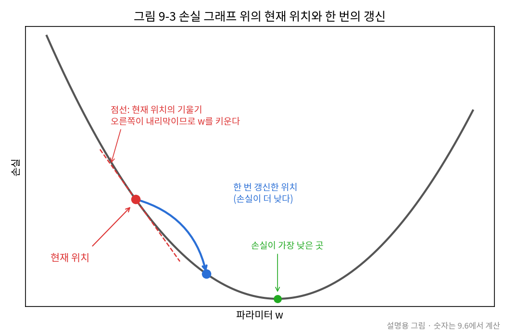
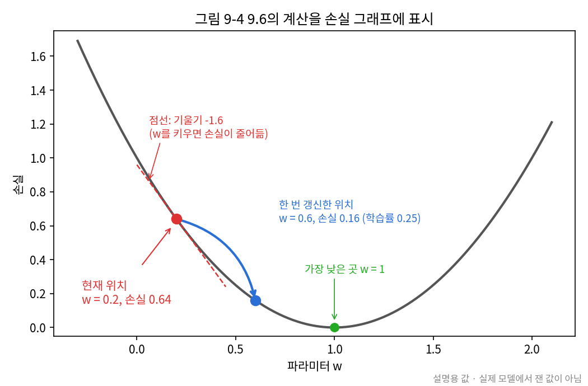
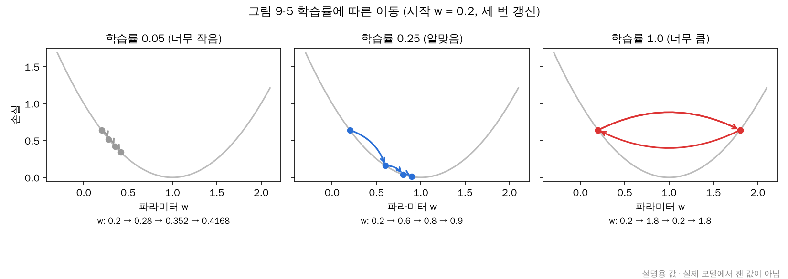

# 9장 Fine tuning은 무엇을 바꾸고 어떻게 작동하는가

<!--
문서 정보
- 상태: 본문 초안. 2026-11-09 독자 검토 26개 반영(검토노트/9장_독자검토_20261109.md, 19~21은 절충안)
- 기준 구성안: 학습문서_구성안/09_FineTuning.md
- 작성일: 2026-11-09
- 결정 사항(검토노트/9장_충돌점검_20261109.md, 2026-11-09 사용자 지시로 추천안 적용): (1) 9.5의 예시 모델은 '설명용으로 가정한 작은 모델'로 밝히고, 8.5의 실제 모델은 두 마감일을 이미 나누었다고 적는다. (2) 9.6은 예측값 = w, 손실 = (1 - w)², 기울기는 w를 0.01 움직여 구한다. 시작 w = 0.2, 학습률 0.05 / 0.25 / 1.0. (3) 그림 9-1~9-5, 그래프 9-3~9-5는 PNG. 독자 검토 반영으로 9-3은 숫자 없는 개념 그래프(9.5.4), 9-4는 숫자를 넣은 계산 그래프, 9-5는 학습률 비교(둘 다 9.6)로 다시 매기고, 옵티마이저 그림은 빼고 문장 설명만 남겼다. (4) '프롬프트'와 '환각'은 9.3에서 처음 정의한다.
- 그림 표기: [그림 9-n] 블록은 나중에 디자인 이미지로 교체할 자리다. 9-3~9-5는 실제 이미지 파일(images/)이 있고, 9-1·9-2는 텍스트 그림이다. 디자인 메모는 시안이며 확정안이 아니다.
- 이 장에서는 실제 Fine tuning을 하지 않았다. 9.6과 그림 9-4·9-5의 숫자는 설명용으로 만든 단순한 식을 Python으로 실제 계산한 값이다(장 끝 계산 기록).
- 집필 경계: 검토노트/9장_충돌점검_20261109.md 2절의 20개 항목. 특히 2.8 전용 용어, 10장의 지정 대상자 기준·제출 서류·통합 흐름·역추적, Fine tuning과 RAG의 결합 구조(10.6)는 쓰지 않는다.
-->

## 장 도입

8장 끝에서 이런 질문을 남겼습니다. 8.5에서 Skill은 모델을 바꾸지 않고 입력만 바꾸었습니다. 그래서 Skill을 빼면 출력도 Skill이 없을 때의 모양으로 돌아갑니다. 그렇다면 대상·일정·예외·출처 순서의 보고서 형식을 Skill 없이도 늘 지키게 하려면, 모델 자체를 바꾸어야 할까요?

모델 자체를 바꾸는 방법이 이 장에서 다룰 **Fine tuning**입니다. 5.8에서 Fine tuning을 "이미 만들어진 모델을 특정 목적에 맞게 추가로 학습시키는 것"이라고 소개했고, 4.9에서는 학습이 Inference와 달리 파라미터 자체를 고치는 일이라고 구분했습니다. 이 장에서는 그 학습이 실제로 어떤 순서로 이루어지는지 따라갑니다.

먼저 Skill과 Fine tuning이 바꾸는 것을 나누고(9.1~9.3), 학습 자료를 어떻게 만드는지 봅니다(9.4). 그다음 학습 한 번의 순서를 교육 안내문 예시로 따라가고(9.5), 아주 작은 숫자로 직접 계산해 봅니다(9.6). 마지막으로 학습이 끝난 모델이 실제로 답하는 과정을 다시 Inference로 돌아와 확인합니다(9.7~9.8).

---

## 9.1 Skill을 적용하는 것과 모델을 학습시키는 것은 무엇이 다른가

8.5에서 같은 모델에 같은 안내문을 넣고, 실험 B에만 Skill을 넣었습니다. B의 출력은 세 번 모두 대상·일정·예외·출처 순서를 지켰습니다. 이 차이는 입력에 Skill의 문장이 더 있었기 때문에 생겼습니다. 모델의 파라미터는 A와 B에서 똑같았습니다.

Fine tuning은 반대쪽에서 출발합니다. 입력은 그대로 두고 **모델의 파라미터를 바꿉니다.** 둘의 차이를 표로 나누면 다음과 같습니다.

| 구분 | Skill 적용 | Fine tuning |
|---|---|---|
| 바뀌는 것 | 이번 실행의 입력 | 모델의 파라미터 |
| 언제 일어나나 | 요청이 들어올 때마다. 앱이 Skill을 입력에 넣는다(8.1) | 질문을 받기 전에 한 번. 모델을 준비하는 쪽에서 학습시킨다 |
| 무엇이 필요한가 | 지침 문장(Skill 파일) | 입력과 목표 응답을 짝지은 많은 학습 예시(9.4) |
| 빼면 어떻게 되나 | 다음 실행부터 Skill 없는 출력으로 돌아간다 | 학습된 파라미터는 그대로 남는다. 되돌리려면 원래 모델을 쓴다 |

표에서 가장 중요한 줄은 둘째 줄입니다. **Fine tuning은 사용자가 질문할 때마다 다시 하는 일이 아닙니다.** 학습은 미리 끝내 두고, 사용자의 질문에는 학습이 끝난 모델로 Inference만 합니다. 그림으로 나누면 다음과 같습니다.

<!-- 그림 시작: fig-09-01 -->
> **[그림 9-1] Fine tuning 단계와 질문에 답하는 단계는 따로 일어난다**
>
> - **보여줄 핵심:** 위 줄(학습)은 질문을 받기 전에 한 번 일어나 '조정된 모델'을 남긴다. 아래 줄(Inference)은 질문이 들어올 때마다 일어나며, 위 줄의 결과물인 조정된 모델만 쓴다. 두 줄은 이어서 실행되는 하나의 과정이 아니다.
> - **구성 요소:** 위 줄: 학습 데이터 → Fine tuning(학습) → 조정된 모델. 아래 줄: 사용자 입력 → 조정된 모델의 Inference → 출력. 위 줄의 '조정된 모델'에서 아래 줄의 Inference 상자로 내려오는 점선 화살표 하나('저장해 두었다가 사용').
> - **배치와 흐름:** 위아래 두 줄을 회색 구분선으로 나누고, 위 줄 왼쪽에 '질문 전, 한 번', 아래 줄 왼쪽에 '질문마다'라고 적는다.
> - **디자인 메모(시안, 확정 아님):** 이 장의 대표 그림 후보다. 아래 줄의 상자 모양은 4장 그림 4-1의 Inference 상자와 맞춘다.
> - **대체 텍스트:** 위 줄에는 학습 데이터가 Fine tuning을 거쳐 조정된 모델이 되는 과정이 있고, '질문 전, 한 번'이라고 표시되어 있다. 아래 줄에는 사용자 입력이 조정된 모델의 Inference를 거쳐 출력이 되는 과정이 있고, '질문마다'라고 표시되어 있다. 조정된 모델에서 아래 줄의 Inference로 점선 화살표가 내려온다.
> - **성격:** 설명용 구조도.

```text
[설명용 예시] 학습 단계와 답변 단계
 질문 전, 한 번   [학습 데이터] ──▶ [Fine tuning(학습)] ──▶ [조정된 모델]
                                                              ┊ 저장해 두었다가 사용
 ───────────────────────────────────────────────────────────── ┊ ──────────
 질문마다          [사용자 입력] ──▶ [조정된 모델의 Inference] ◀┘ ──▶ [출력]
```
<!-- 그림 끝: fig-09-01 -->

8장의 Skill과 비교하면, Skill은 아래 줄의 '사용자 입력' 쪽에 더해지는 것입니다. 앱이 요청마다 Skill을 입력에 넣었습니다(8.1, 8.4). Fine tuning은 위 줄에서 모델 자체를 바꾸어 둡니다. 그래서 같은 '형식 지키기'라도 Skill은 입력을 통해, Fine tuning은 파라미터를 통해 출력에 영향을 줍니다.

> **이해 확인**
> 어떤 회사가 보고서 형식에 맞게 Fine tuning한 모델을 쓰고 있습니다. 직원 백 명이 하루에 한 번씩 질문하면, 그날 Fine tuning은 몇 번 일어날까요?

---

## 9.2 사전학습·후속학습·Fine tuning은 어떤 관계인가

2장 앞부분에서 모델은 사용자를 만나기 전에 아주 많은 글로 학습하고, 그 결과가 파라미터라는 수많은 숫자로 정해진다고 했습니다. 이 학습은 보통 여러 단계로 나누어 부릅니다.

| 단계 | 하는 일 | 학습에 쓰는 자료의 예 |
|---|---|---|
| 사전학습 | 아주 많은 글로, 어떤 글 다음에 어떤 토큰이 오기 쉬운지의 일반적인 패턴을 학습한다. 2장의 다음 토큰 확률을 만드는 패턴은 주로 이 학습에서 생긴다 | 책, 웹 문서처럼 정해진 정답 없이 이어지는 글 |
| 후속학습 | 사전학습이 끝난 모델이 지시를 따르고 대화하는 형식으로 답하도록 조정한다 | 요청과 바람직한 응답을 짝지은 예시 |
| Fine tuning | 이미 학습된 모델을 특정 목적에 맞게 추가로 학습시킨다(5.8) | 특정 업무의 입력과 목표 응답을 짝지은 예시 |

세 단계 모두 파라미터를 고치는 학습이라는 점은 같습니다. 다른 점은 출발점과 목적입니다. 사전학습은 아무 의미 없는 처음 값(무작위로 정한 숫자)에서 출발해 일반적인 패턴을 학습합니다. 후속학습과 Fine tuning은 **이미 학습된 모델에서 출발**해 그 위에 더 학습합니다.

그래서 Fine tuning은 완전히 새로운 모델을 처음부터 만드는 일이 아닙니다. 교육 안내문 보고서 형식을 Fine tuning한다고 해서, 모델이 한국어나 날짜를 처음부터 다시 학습하는 것은 아닙니다. 이미 할 수 있는 것은 그대로 두고, 원하는 형식과 행동 쪽으로 파라미터를 조금 옮기는 것에 가깝습니다.

한 가지 주의할 점이 있습니다. 자료에 따라 이 용어들이 가리키는 범위가 다릅니다. 어떤 자료는 후속학습 전체를 Fine tuning이라고 부르고, 어떤 자료는 회사가 모델을 만드는 과정은 후속학습, 사용자가 자기 목적에 맞게 더 학습시키는 것만 Fine tuning이라고 부릅니다. 이 책에서는 5.8의 정의대로, 이미 학습된 모델에 특정 목적의 학습을 더하는 것을 Fine tuning이라고 부르겠습니다. 실제 모델이 어떤 순서와 자료로 학습되었는지는 모델을 만든 곳마다 다르며, 이 표는 일반적인 구분입니다. 이미 학습된 모델에 Fine tuning을 허용하는지, 어떤 방식으로 하는지도 모델을 제공하는 곳마다 다릅니다.

> **이해 확인**
> 친구가 "Fine tuning을 하면 모델을 처음부터 새로 만드는 거니까 시간이 엄청 걸리겠네"라고 말했습니다. 어느 부분을 바로잡아야 할까요?

---

## 9.3 Fine tuning은 언제 필요한가

이제 8장 끝의 질문으로 돌아가겠습니다. 보고서 형식을 늘 지키게 하려면 꼭 Fine tuning을 해야 할까요? 8.5의 결과만 보면 그렇지 않습니다. Skill을 넣은 실험 B는 세 번 모두 형식을 지켰습니다. **Skill로 충분히 되는 일을 굳이 Fine tuning할 필요는 없습니다.**

먼저 용어 두 개를 정리하겠습니다. 다른 자료에서 자주 만나게 될 말입니다.

- **프롬프트:** 모델 입력에 넣는 요청과 지침의 글입니다. 이 책에서 지금까지 "입력의 요청과 지침"이라고 부른 것입니다. 7.4의 지침, 8장의 Skill 본문도 입력에 들어가면 프롬프트의 일부가 됩니다.
- **환각:** 그럴듯하지만 사실과 다른 출력입니다. 2장에서 본 것처럼 모델은 학습한 패턴으로 그럴듯한 다음 토큰을 고르므로, 입력과 학습한 글에 없는 내용도 그럴듯하게 채운 출력이 나올 수 있습니다(5.1).

그러면 Fine tuning은 언제 고려할까요? 대표적인 경우는 다음과 같습니다.

- **같은 문체와 응답 형식을 아주 많이 반복해야 할 때:** 8.5.5에서 Skill을 넣은 입력은 약 240토큰 더 길었습니다. 요청이 하루에 몇 건이면 문제가 되지 않지만, 아주 많은 요청을 처리하는 앱이라면 매번 같은 지침을 넣는 길이가 쌓입니다. 형식을 모델에 학습시켜 두면 그 지침을 줄일 수 있습니다.
- **정해진 입력을 정해진 출력 구조로 바꾸는 일이 반복될 때:** 안내문을 받아 늘 같은 칸의 보고서로 바꾸는 일이 그렇습니다.
- **분류 방식이나 행동 패턴을 지침으로 다 적기 어려울 때:** 문의를 회사만의 분류 기준으로 나누는 일처럼, 규칙을 문장으로 적는 것보다 예시를 많이 보여 주는 편이 쉬운 경우입니다.
- **프롬프트만으로는 결과가 고르게 나오지 않을 때:** 지침을 넣어도 여러 번 실행하면 형식이 자꾸 흔들리는 경우입니다. 8.5처럼 여러 번 실행해 기준표로 확인한 뒤에 판단합니다.

반대로 다른 방법이 더 알맞은 경우도 분명합니다.

| 하고 싶은 일 | 더 알맞은 방법 | 이유 |
|---|---|---|
| 이번 한 번만 다른 형식으로 받고 싶다 | 프롬프트 | 요청에 한 줄 적으면 된다 |
| 작업 절차와 확인 기준을 안내하고 싶다 | Skill | 필요할 때만 입력에 넣고, 고치기도 쉽다(8장) |
| 최신 마감일이나 바뀐 규정으로 답하게 하고 싶다 | RAG | 자료가 바뀌면 색인만 갱신하면 된다(5~7장) |
| 같은 형식과 행동을 많은 요청에서 고르게 지키게 하고 싶다 | Fine tuning을 고려 | 파라미터에 학습시켜 지침 없이도 그쪽으로 출력이 나오게 한다 |

> **8장 끝 질문에 대한 답**
>
> - Skill 없이도 보고서 형식을 늘 지키도록 만드는 방법은 Fine tuning입니다. 형식을 입력이 아니라 파라미터에 학습시키기 때문입니다. 그래도 9.8처럼 평가는 필요합니다.
> - 다만 8.5처럼 Skill로 이미 고르게 나온다면 먼저 Skill을 씁니다. 고치기 쉽고 학습 데이터도 필요 없습니다.
> - 요청이 아주 많아 매번 넣는 지침의 길이가 부담되거나, Skill을 넣어도 형식이 흔들릴 때 Fine tuning을 고려합니다.

마지막으로 꼭 기억할 점이 두 가지 있습니다.

첫째, **Fine tuning만으로 최신 지식이 저절로 들어오지는 않습니다.** 교육 A의 마감일이 내일 바뀌어도, 지난주에 학습시킨 모델의 파라미터는 그 사실을 모릅니다. 최신 사실은 5.8에서 본 것처럼 자료를 검색해 입력에 넣어야 합니다.

둘째, **Fine tuning을 한다고 환각이 사라지지는 않습니다.** 학습시킨 형식에 맞춰 칸을 채우는 쪽으로 출력이 기울면, 자료에 없는 칸까지 그럴듯한 값으로 채운 출력이 나올 수도 있습니다. 출처 확인과 검증은 7.7과 8.4에서 본 방법을 그대로 써야 합니다.

> **이해 확인**
> 회사 교육 일정이 매달 바뀝니다. 팀장이 "매달 새 일정을 학습시킨 모델을 만들자"고 제안했습니다. 이 목적에 더 알맞은 방법은 무엇이고, 왜 그런가요?

---

## 9.4 Fine tuning을 위한 학습 데이터는 어떻게 만드는가

Fine tuning의 재료는 **입력과 목표 응답을 짝지은 예시**입니다. 입력은 모델에 넣을 글이고, 목표 응답은 그 입력에 대해 모델이 내 주었으면 하는 출력입니다. 이 짝을 많이 학습할수록, 비슷한 입력에 목표 응답과 비슷한 출력이 나오는 쪽으로 파라미터가 조정됩니다.

교육 안내문을 받아 신청 대상·일정·예외 조건을 정해진 형식으로 정리하는 예를 들어 보겠습니다. 목표 응답의 순서는 8.3의 Skill과 같은 대상·일정·예외·출처로 맞춥니다.

```text
[설명용 예시] 학습 예시 한 쌍
── 입력 ───────────────────────────────
아래 교육 안내문을 보고서 형식으로 정리해 줘.
[교육 A 신청 안내]
교육일: 10월 8일
일반 신청 마감: 10월 5일
추가 모집 마감: 10월 7일 (지정 대상자에게만 적용)

── 목표 응답 ───────────────────────────
대상: 안내문에 적혀 있지 않음 (확인 필요)
일정: 교육일 10월 8일 / 일반 신청 마감 10월 5일
예외: 추가 모집 마감 10월 7일은 지정 대상자에게만 적용
출처: 교육 A 신청 안내
```

8.3의 Skill과 비교해 보면 차이가 분명해집니다. Skill은 "보고서는 대상·일정·예외·출처 순서로 작성한다"는 **지침 문장**을 입력에 넣었습니다. Fine tuning은 그런 문장 없이, 그 순서로 쓴 **목표 응답의 예**를 여러 개 보여 줍니다. 같은 형식을 하나는 설명으로, 하나는 예시로 전하는 셈입니다.

### 좋은 예시와 나쁜 예시

모델은 예시에 담긴 것을 그대로 배웁니다. 그래서 예시의 품질이 곧 결과의 품질입니다.

| 예시 | 목표 응답의 모습 | 학습에 미치는 영향 |
|---|---|---|
| 좋은 예 | 위처럼 네 칸이 늘 같은 순서이고, 안내문에 없는 대상은 '확인 필요'로 적는다 | 형식과 '추측하지 않기'를 함께 학습한다 |
| 나쁜 예 ① | 예외 줄을 빠뜨리고 일반 마감만 적는다 | 예외 조건을 빠뜨리는 출력 쪽으로 학습될 수 있다 |
| 나쁜 예 ② | 안내문에 없는 대상을 "전 직원"이라고 채운다 | 없는 정보를 그럴듯하게 채우는 쪽으로 학습될 수 있다(9.3의 환각) |
| 나쁜 예 ③ | 어떤 예시는 대상·일정 순서, 어떤 예시는 일정·대상 순서다 | 서로 충돌하는 형식을 함께 보여 주어, 출력의 형식이 흔들린다 |

나쁜 예 ③처럼 형식이 섞이는 일은 여러 사람이 나누어 예시를 만들 때 자주 생깁니다. 원하는 형식과 행동을 **여러 사례에서 일관되게** 보여 주어야 합니다. 안내문도 한 종류만 쓰지 말고, 예외가 있는 것과 없는 것, 대상이 적힌 것과 없는 것처럼 실제로 들어올 입력을 고루 담아야 합니다. 필요한 예시 개수는 작업과 모델, 모델을 제공하는 곳의 안내에 따라 다릅니다. 적은 수로 시작해, 아래의 평가 결과를 보며 늘려 갑니다.

### 학습·검증·평가 데이터를 나누는 이유

예시를 모았으면 세 묶음으로 나눕니다.

- **학습 데이터:** 실제로 파라미터를 조정하는 데 쓰는 예시입니다.
- **검증 데이터:** 학습하는 도중에 결과가 나아지고 있는지 확인하는 데 쓰는 예시입니다. 학습률 같은 설정(9.5)을 고를 때도 이 묶음의 결과를 봅니다.
- **평가 데이터:** 학습이 모두 끝난 뒤 마지막으로 성능을 확인하는 예시입니다. 학습과 설정 고르기에 한 번도 쓰지 않은 것이어야 합니다.

나누는 이유는 시험 문제를 미리 보여 주고 시험을 보면 실력을 알 수 없는 것과 같습니다. 학습에 쓴 안내문으로 평가하면, 그 안내문의 답을 그대로 외운 것인지 새 안내문에도 형식을 지키는 것인지 구분할 수 없습니다. 평가할 때는 8.5.4처럼 **미리 정해 둔 기준**(필수 항목, 순서, '확인 필요' 표시 등)으로 셉니다.

### 개인정보와 민감한 자료

학습 데이터에 들어간 내용은 파라미터에 영향을 줍니다. Vector DB의 자료는 한 건씩 지울 수 있지만(5.7), 한번 학습된 내용은 한 건만 골라 지우기 어렵습니다. 그래서 직원 이름, 연락처, 평가 결과 같은 개인정보나 외부에 나가면 안 되는 자료는 학습 데이터에 넣기 전에 빼거나 가려야 합니다. 5장에서 자료를 저장할 때 권한과 삭제를 함께 관리한 것처럼, 학습 데이터도 누가 만들고 무엇을 넣었는지 기록해 두는 것이 좋습니다. 회사와 서비스마다 지켜야 할 규칙이 다르므로, 실제로 학습시키기 전에는 담당 부서의 기준을 확인합니다.

> **이해 확인**
> 학습 예시 100개 가운데 30개는 '대상·일정·예외·출처', 70개는 '일정·대상·출처' 순서이고, 안내문에 예외 조건이 있어도 예외 칸을 쓰지 않았습니다. 이 데이터로 학습하면 어떤 문제가 생길 수 있을까요?

---

## 9.5 예시로 이해하는 순전파·손실·역전파·파라미터 갱신

이제 학습 한 번이 어떤 순서로 이루어지는지 따라가겠습니다. 이 절에는 용어가 아홉 개 나옵니다. 짝을 지어 다섯 묶음(순전파·예측값, 목표값·손실, 역전파·기울기, 학습률·옵티마이저, 파라미터 갱신)으로 보면 쉽습니다. 용어를 하나씩 따로 외우기보다, **모두 하나의 예시의 어느 부분을 가리키는지** 보면서 읽어 주세요. 숫자 계산은 9.6에서 직접 해 봅니다.

### 9.5.1 절 전체에서 이어 갈 예시

모델에게 교육 안내문의 신청 마감일을 정해진 형식으로 답하도록 학습시키는 상황입니다.

```text
[설명용 예시] 학습 예시 하나와 현재 모델의 예측
── 학습 입력 ───────────────────────────
[교육 A 신청 안내] 교육일: 10월 8일 / 일반 신청 마감: 10월 5일 /
추가 모집 마감: 10월 7일 (지정 대상자에게만 적용)
신청 마감일을 정해진 형식으로 답해 줘.

── 목표 응답 (학습 자료에 적힌 것) ───────
일반 신청 마감: 10월 5일
추가 모집 마감: 10월 7일 (지정 대상자에게만 적용)

── 현재 모델의 예측 ─────────────────────
일반 신청 마감: 10월 5일
(여기서 끝남)
```

이 절의 모델은 **설명을 위해 가정한 작은 모델**입니다. 아직 이 형식을 배우지 않아서, 일반 마감일 한 줄만 쓰고 끝내는 상태라고 가정합니다. 실제로 8.5에서 실행한 모델은 Skill이 없을 때도 두 마감일을 나누어 적었습니다. 지금 널리 쓰이는 큰 모델은 이 정도는 이미 하므로, 실제 Fine tuning은 9.3에서 본 것처럼 형식과 반복되는 행동을 맞추는 데 더 자주 쓰입니다. 그래도 '빠뜨린 줄을 채우게 되는 과정'은 학습의 순서를 보기에 좋은 예라서 이 예를 씁니다.

또 하나 단순화한 것이 있습니다. 실제 언어 모델에는 아주 많은 파라미터가 있고, 출력의 토큰 하나하나마다 확률을 계산합니다(2.6). 이 절에서는 그중 **한 자리만** 보겠습니다. 첫 줄을 쓴 다음, 둘째 줄을 '추가'로 시작할지 아니면 출력을 끝낼지를 정하는 자리입니다. 실제 학습에서는 3.6에서 본 것처럼 목표 응답의 모든 자리에서 이 계산을 한꺼번에 하고, 자리마다의 손실을 모아 하나로 만듭니다.

### 9.5.2 순전파와 예측값

**순전파**는 학습 입력이 현재 파라미터를 통과해 예측으로 나오는 과정입니다. 2장에서 본 Inference의 계산과 같은 길입니다. 입력이 토큰이 되고, 여러 레이어를 지나, 다음 토큰의 확률이 나옵니다.

예시에서 첫 줄 "일반 신청 마감: 10월 5일"을 쓴 다음 자리의 확률이 이렇게 나왔다고 해 봅시다.

| 다음 토큰 후보 | 현재 모델의 확률 (설명용) |
|---|---|
| (출력 끝: 2.7의 종료 토큰) | 70% |
| 추가 | 20% |
| 그 밖의 토큰 | 10% |

**예측값**은 모델이 각 후보에 준 확률입니다. 이 예에서 보는 값은 목표 토큰 '추가'의 확률 20%입니다. 2.6의 소프트맥스 표처럼 후보마다 확률이 있고, '출력 끝'의 확률이 가장 높으니 이 모델은 첫 줄만 쓰고 끝내기 쉽습니다. 현재 모델의 예측에서 둘째 줄이 빠진 이유가 여기에 있습니다.

### 9.5.3 목표값과 손실

**목표값**은 학습 데이터에 들어 있는 바람직한 정답입니다. 예시의 목표 응답에는 둘째 줄이 있으므로, 이 자리의 목표값은 '추가'입니다. 이상적으로는 '추가'의 확률이 100%에 가까워야 합니다.

**손실**은 모델의 예측과 목표 응답이 얼마나 어긋났는지를, 학습에 쓸 수 있는 하나의 값으로 나타낸 것입니다. 목표 토큰의 확률이 높으면 손실이 작고, 낮으면 손실이 큽니다.

<!-- 그림 시작: fig-09-02 -->
> **[그림 9-2] 잘 맞춘 예측과 빠뜨린 예측의 손실 크기**
>
> - **보여줄 핵심:** 같은 목표 응답에 대해, 목표 토큰 '추가'에 높은 확률을 준 예측은 손실이 작고, 낮은 확률을 준 예측은 손실이 크다.
> - **구성 요소:** 왼쪽에 목표 응답 두 줄. 오른쪽에 예측 두 개(가: 둘째 줄까지 씀, '추가' 확률 90% / 나: 첫 줄에서 끝남, '추가' 확률 20%). 각 예측 아래에 손실의 크기를 막대로 표시.
> - **배치와 흐름:** 목표 응답에서 두 예측으로 화살표. 손실 막대는 작은 쪽을 파랑, 큰 쪽을 빨강.
> - **디자인 메모(시안, 확정 아님):** 막대 길이는 9.6의 계산 결과(0.01과 0.64)의 비율에 맞출 수 있다. 숫자는 9.6에서 처음 보여 주므로 이 그림에는 쓰지 않는다.
> - **대체 텍스트:** 목표 응답 "일반 신청 마감 10월 5일 / 추가 모집 마감 10월 7일"에 대해, 둘째 줄까지 쓴 예측 가는 '추가'의 확률이 90%이고 손실 막대가 짧다. 첫 줄에서 끝난 예측 나는 '추가'의 확률이 20%이고 손실 막대가 길다.
> - **성격:** 설명용 예시. 확률은 가정한 값이다.

```text
[설명용 예시] 예측과 손실의 크기
 목표 응답: 일반 신청 마감: 10월 5일 / 추가 모집 마감: 10월 7일 (...)

 예측 가: 둘째 줄까지 씀   '추가' 확률 90%   손실 ▌            (작음)
 예측 나: 첫 줄에서 끝남   '추가' 확률 20%   손실 ██████████  (큼)
```
<!-- 그림 끝: fig-09-02 -->

손실을 하나의 값으로 만드는 이유는, 그래야 "이 값을 줄이는 쪽으로 파라미터를 고친다"는 분명한 목표가 생기기 때문입니다. 4.9에서 학습을 "출력과 정답의 차이가 줄어들도록 파라미터를 고치는 과정"이라고 했는데, 그 '차이'를 숫자로 만든 것이 손실입니다.

### 9.5.4 역전파와 기울기

손실이 크다는 것은 알았습니다. 이제 어떤 파라미터를 어느 쪽으로 고쳐야 할까요? 모델에는 파라미터가 아주 많고, 그 가운데 어떤 것이 '추가'의 확률을 낮게 만드는 데 영향을 주었는지 알아야 합니다.

**역전파**는 손실에서 출발해, 각 파라미터가 그 손실에 얼마나, 어느 방향으로 영향을 주었는지를 뒤쪽 레이어에서 앞쪽 레이어로 거슬러 계산하는 과정입니다. 순전파가 입력에서 출력으로 갔다면, 역전파는 손실에서 입력 쪽으로 되돌아갑니다. 예시에서는 '추가'의 확률이 20%로 낮게 나온 결과에서 출발해, 그 확률을 높이려면 관련 파라미터를 어느 쪽으로 바꾸어야 하는지를 찾습니다.

역전파로 얻는 것이 **기울기**입니다. 기울기는 파라미터를 조금 움직였을 때 손실이 어느 방향으로 얼마나 변하는지를 알려 주는 정보입니다.

경사진 길에 서 있다고 생각해 보세요. 안개가 짙어 골짜기 바닥이 보이지 않습니다. 그래도 발밑의 기울기는 느낄 수 있습니다. 내리막인 쪽으로 한 걸음씩 옮기면 언젠가 낮은 곳에 가까워집니다. 이때 높이가 손실이고, 서 있는 위치가 파라미터 값이고, 발밑의 경사가 기울기입니다.

<!-- 그림 시작: fig-09-03 -->
> **[그림 9-3] 손실 그래프 위의 현재 위치와 한 번의 갱신**
>
> - **보여줄 핵심:** 손실 그래프 위의 현재 위치에서 기울기는 '오른쪽으로 갈수록 손실이 줄어든다'고 알려 준다. 그 방향으로 한 번 갱신하면 손실이 더 낮은 위치로 옮겨 간다.
> - **구성 요소:** 가로축 파라미터 w, 세로축 손실(눈금과 숫자 없음). U자 모양의 곡선. 현재 위치의 빨간 점과 그 자리의 기울기를 나타내는 점선. 한 번 갱신한 위치의 파란 점과 화살표. 손실이 가장 낮은 곳 표시.
> - **배치와 흐름:** 왼쪽 위에서 오른쪽 아래로 옮겨 가는 화살표가 눈에 먼저 들어오게 한다. 글자는 곡선과 겹치지 않게 빈 곳에 둔다.
> - **디자인 메모(시안, 확정 아님):** 실제 이미지 파일이 있다(images/fig-09-03_손실그래프_개념.png). 숫자는 9.6에서 처음 계산하므로 이 그림에는 쓰지 않는다. 같은 그래프에 숫자를 넣은 것이 그림 9-4다.
> - **대체 텍스트:** 파라미터 w에 따른 손실을 나타낸 U자 모양의 곡선. 왼쪽 비탈의 현재 위치에 빨간 점이 있고, 그 자리의 기울기를 나타내는 점선은 오른쪽으로 내려간다. 오른쪽이 내리막이므로 w를 키우는 쪽으로 한 번 갱신하면 손실이 더 낮은 파란 점으로 옮겨 간다. 곡선의 가장 낮은 곳도 표시되어 있다.
> - **성격:** 설명용 그림. 숫자는 9.6에서 직접 계산한다.



```text
[설명용 예시] 손실 그래프 (임시 텍스트 그림, 숫자는 9.6에서)
 손실
  ●  현재 위치: 기울기가 오른쪽 내리막을 가리킴
   ╲
    ╲  한 번 갱신 (w를 키우는 쪽)
     ●  손실이 더 낮은 위치
        ╲___●___╱   손실이 가장 낮은 곳
 ────────────────────── 파라미터 w
```
<!-- 그림 끝: fig-09-03 -->

그래프의 현재 위치처럼 오른쪽으로 갈수록 손실이 줄어드는 자리에서는 기울기가 음수입니다. 기울기가 음수이면 w를 키우는 쪽(오른쪽)이 내리막이라는 뜻입니다. 그래서 파라미터는 기울기와 **반대 방향**으로 움직입니다. 실제 모델에서는 이런 축이 파라미터 수만큼 있어서 그래프로 그릴 수 없지만, 파라미터마다 이런 기울기를 하나씩 얻는다는 점은 같습니다. 이 그래프의 숫자는 9.6에서 직접 계산합니다(그림 9-4).

### 9.5.5 학습률과 옵티마이저

기울기는 방향을 알려 줍니다. 그러면 그 방향으로 **얼마나** 움직일까요?

**학습률**은 기울기가 알려 준 방향으로 파라미터를 한 번에 얼마나 움직일지 정하는 크기입니다. 같은 기울기라도 학습률이 크면 크게, 작으면 조금 움직입니다. 학습률은 학습을 시작하기 전에 사람이 정하는 설정이고, 9.4의 검증 데이터 결과를 보며 고릅니다.

학습률이 너무 크면 경사진 길에서 너무 큰 걸음으로 뛰어 골짜기 반대편으로 넘어가 버리는 것과 같습니다. 너무 작으면 바닥에 가까워지기까지 걸음을 아주 많이 옮겨야 합니다. 알맞은 크기일 때 적은 걸음으로 바닥에 가까워집니다. 학습률에 따라 실제로 얼마나 달라지는지는 9.6에서 숫자로 계산해 봅니다(그림 9-5).

**옵티마이저**는 기울기와 학습률, 그리고 이전에 움직인 정보 등을 이용해 실제로 파라미터를 어떻게 조정할지 정하는 학습 방법입니다. 가장 단순한 방법은 "지금 기울기 × 학습률"만큼 움직이는 것입니다. 이와 달리 이전에 움직여 온 방향도 함께 참고하는 방법도 있습니다. 파라미터가 둘 이상이면 손실은 선이 아니라 골짜기 모양의 지형이 됩니다. 이 골짜기가 한쪽으로 길쭉한 모양이면 지금 경사만 따라가는 방법은 골짜기의 좁은 방향으로 오가며 지그재그로 내려가는데, 이전 방향을 참고하면 그 흔들림이 줄어 더 고르게 내려갈 수 있습니다.

옵티마이저는 모델의 일부가 아니라, 학습할 때 파라미터를 고치는 **방법**입니다.

### 9.5.6 파라미터 갱신과 다음 반복

**파라미터 갱신**은 옵티마이저가 정한 만큼 실제 파라미터 값을 바꾸는 단계입니다. 예시에서는 갱신 전에 20%였던 '추가'의 확률이 갱신 뒤에는 그보다 높아집니다. 같은 입력으로 다시 순전파하면 둘째 줄을 이어 쓸 가능성이 커진 것입니다.

하지만 한 번의 갱신으로 학습이 끝나지는 않습니다. 이 과정은 다음과 같이 많은 학습 예시로 되풀이됩니다.

```text
[설명용 예시] 학습 한 번의 순서와 반복
 학습 예시 → 순전파(예측값) → 목표값과 비교(손실) → 역전파(기울기)
           → 옵티마이저와 학습률로 파라미터 갱신 → 다음 예시로 반복
```

예시마다 갱신하는 크기는 작습니다. 다른 교육의 안내문, 예외가 없는 안내문 같은 다양한 예시로 이 순서를 여러 번 되풀이해야, 특정 안내문 하나가 아니라 **비슷한 안내문 전체**에서 둘째 줄을 쓰는 쪽으로 파라미터가 옮겨 갑니다. 9.4에서 예시를 고르고 일관되게 만들라고 한 이유가 여기에 있습니다.

> **이해 확인**
> 학습 한 번의 순서에서 '어느 쪽으로'를 알려 주는 것과 '한 번에 얼마나'의 크기를 정하는 설정은 각각 무엇인가요?

---

## 9.6 작은 숫자로 Fine tuning 과정 따라가기

9.5의 순서를 숫자로 직접 따라가 보겠습니다. 실제 언어 모델 전체를 재현한 계산이 아니라, **학습의 순서를 보기 위해 아주 단순하게 줄인 계산**입니다.

### 계산을 위한 단순화

9.5의 한 자리, 첫 줄 다음에 '추가'가 나올 확률만 보겠습니다. 그리고 이 확률을 파라미터 **w** 하나가 그대로 정한다고 가정합니다.

- 예측값: w (지금 w = 0.2, 즉 9.5.2의 20%)
- 목표값: 1 (목표 응답에는 '추가'가 꼭 있어야 하므로 100%)
- 손실: (목표값 − 예측값)²

손실을 제곱으로 두면 예측이 목표에서 멀수록 손실이 빠르게 커지고, 목표와 같으면 0이 됩니다. 실제 언어 모델은 다른 모양의 식을 쓰지만, 목표 토큰의 확률이 낮을수록 손실이 크다는 점은 같습니다.

### 1단계: 현재 파라미터로 예측하기

w = 0.2이므로 예측값은 0.2입니다. 이것이 순전파입니다.

### 2단계: 손실 계산하기

손실 = (1 − 0.2)² = 0.8² = **0.64**

비교를 위해 9.5.3 그림 9-2의 예측 가처럼 '추가'의 확률이 0.9였다면, 손실은 (1 − 0.9)² = 0.1² = 0.01입니다. 잘 맞춘 예측의 손실이 훨씬 작습니다.

### 3단계: 기울기로 방향 확인하기

기울기는 "파라미터를 조금 움직였을 때 손실이 얼마나 변하는가"였습니다(9.5.4). 그 정의대로 직접 움직여 보겠습니다. w를 0.2에서 0.21로 0.01만큼 키웁니다.

- w = 0.21일 때 손실 = (1 − 0.21)² = 0.79² = 0.6241
- 손실의 변화 = 0.6241 − 0.64 = −0.0159
- 0.01 움직였을 때 −0.0159 변했으므로, 1만큼 움직이는 비율로 바꾸면 −0.0159 ÷ 0.01 = **약 −1.59**

기울기가 음수이므로, w를 키우면 손실이 줄어듭니다. 고칠 방향은 'w를 키우는 쪽'입니다. 참고로 이 식의 기울기는 −2 × (1 − w)로 바로 구할 수 있습니다(구하는 방법은 몰라도 됩니다). w = 0.2를 넣으면 −2 × 0.8 = −1.6이고, 조금 움직여 구한 값 −1.59와 거의 같습니다. 실제 학습에서는 파라미터마다 이렇게 하나씩 움직여 보지 않고, 역전파로 모든 파라미터의 기울기를 한 번에 계산합니다. 아래 계산에서는 정확한 값 −1.6을 쓰겠습니다.

### 4단계: 학습률만큼 갱신하기

가장 단순한 옵티마이저의 규칙은 이렇습니다.

> 새 w = 지금 w − 학습률 × 기울기

기울기에 빼기를 붙이는 것은 기울기와 반대 방향으로 움직이기 위해서입니다(9.5.4). 학습률을 0.25로 정하면 다음과 같습니다.

새 w = 0.2 − 0.25 × (−1.6) = 0.2 + 0.4 = **0.6**

### 5단계: 다시 예측하고 비교하기

새 w = 0.6으로 다시 순전파하면 예측값은 0.6이고, 손실은 (1 − 0.6)² = 0.4² = **0.16**입니다. 손실이 0.64에서 0.16으로 줄었습니다. '추가'의 확률이 20%에서 60%로 올라간 것과 같습니다. 이것이 9.5.6에서 말한 "갱신 뒤에는 확률이 이전보다 높아진다"의 숫자 모습입니다. 그림 9-3의 그래프에 이 숫자를 올리면 다음과 같습니다.

<!-- 그림 시작: fig-09-04 -->
> **[그림 9-4] 9.6의 계산을 손실 그래프에 표시**
>
> - **보여줄 핵심:** 그림 9-3의 그래프에 1~5단계의 숫자를 올린 것이다. w = 0.2에서 기울기 -1.6을 따라 학습률 0.25로 한 번 갱신하면 w = 0.6으로 옮겨, 손실이 0.64에서 0.16으로 준다.
> - **구성 요소:** 가로축 파라미터 w, 세로축 손실. 곡선 손실 = (1 - w)². 현재 위치(w = 0.2, 손실 0.64)의 빨간 점과 접선(기울기 -1.6). 학습률 0.25로 한 번 갱신한 위치(w = 0.6, 손실 0.16)의 파란 점과 화살표. 가장 낮은 곳(w = 1).
> - **배치와 흐름:** 그림 9-3과 같은 배치로 두어 두 그림을 견주어 볼 수 있게 한다. 글자는 곡선과 겹치지 않게 빈 곳에 두고, 바탕은 반투명 흰색으로 한다.
> - **디자인 메모(시안, 확정 아님):** 실제 이미지 파일이 있다(images/fig-09-04_손실그래프_계산.png). 교재 글꼴로 다시 그릴 때는 좌표와 값을 그대로 쓴다.
> - **대체 텍스트:** 파라미터 w에 따른 손실 (1 - w)²의 U자 곡선. w = 0.2에서 손실은 0.64이고 그 자리의 기울기는 -1.6이다. 학습률 0.25로 한 번 갱신하면 w = 0.6으로 옮겨 손실이 0.16이 된다. 손실이 가장 낮은 곳은 w = 1이다.
> - **성격:** 설명용 값. 이 절의 단순한 식을 실제로 계산해 그린 그래프이며, 실제 언어 모델에서 잰 값이 아니다.



```text
[설명용 예시] 9.6의 계산을 표시한 손실 그래프 (임시 텍스트 그림)
 손실
 0.64 ●  w = 0.2, 기울기 -1.6
      ╲
       ╲  학습률 0.25로 한 번 갱신
 0.16   ●  w = 0.6
          ╲___●___╱   가장 낮은 곳 w = 1
 ────────────────────── 파라미터 w
```
<!-- 그림 끝: fig-09-04 -->

같은 순서를 두 번 더 되풀이하면 다음과 같습니다.

| 반복 | 시작 w | 손실 | 기울기 | 갱신 뒤 w (학습률 0.25) | 갱신 뒤 손실 |
|---|---|---|---|---|---|
| 1 | 0.2 | 0.64 | −1.6 | 0.6 | 0.16 |
| 2 | 0.6 | 0.16 | −0.8 | 0.8 | 0.04 |
| 3 | 0.8 | 0.04 | −0.4 | 0.9 | 0.01 |

반복할수록 손실이 줄고, 기울기도 작아져 한 번에 움직이는 양이 줄어듭니다. 바닥에 가까워질수록 경사가 완만해지는 것과 같습니다.

### 학습률을 바꾸어 보기

이번에는 학습률만 바꾸어 같은 식으로 세 번씩 갱신해 보겠습니다(9.5.5). 시작은 모두 w = 0.2입니다.

| 학습률 | 1번 갱신 뒤 w (손실) | 2번 뒤 | 3번 뒤 |
|---|---|---|---|
| 0.05 | 0.28 (0.5184) | 0.352 (0.4199) | 0.4168 (0.3401) |
| 0.25 | 0.6 (0.16) | 0.8 (0.04) | 0.9 (0.01) |
| 1.0 | 1.8 (0.64) | 0.2 (0.64) | 1.8 (0.64) |

<!-- 그림 시작: fig-09-05 -->
> **[그림 9-5] 학습률에 따른 이동 차이**
>
> - **보여줄 핵심:** 같은 출발점에서 학습률만 바꾸면, 너무 작으면 손실이 느리게 줄고, 알맞으면 빠르게 낮은 곳에 가까워지고, 너무 크면 낮은 곳을 지나쳐 양쪽을 오간다.
> - **구성 요소:** 같은 손실 곡선을 세 칸에 나란히. 시작 w = 0.2에서 세 번 갱신한 위치를 점과 화살표로. 학습률 0.05(회색), 0.25(파랑), 1.0(빨강). 칸 아래에 w의 변화.
> - **배치와 흐름:** 왼쪽부터 너무 작음, 알맞음, 너무 큼.
> - **디자인 메모(시안, 확정 아님):** 실제 이미지 파일이 있다(images/fig-09-05_학습률비교.png).
> - **대체 텍스트:** 같은 U자 손실 곡선 세 개. 학습률 0.05에서는 w가 0.2 → 0.28 → 0.352 → 0.4168로 조금씩만 움직인다. 학습률 0.25에서는 0.2 → 0.6 → 0.8 → 0.9로 바닥에 빠르게 가까워진다. 학습률 1.0에서는 0.2 → 1.8 → 0.2 → 1.8로 바닥을 지나쳐 양쪽을 오가며 손실이 줄지 않는다.
> - **성격:** 설명용 값. 이 절의 식으로 실제 계산했으며, 실제 언어 모델에서 잰 값이 아니다.



```text
[설명용 예시] 학습률에 따른 세 번의 이동 (임시 텍스트 그림, w 값은 위 표 참고)
 학습률 0.05 (너무 작음): 천천히 내려감
 학습률 0.25 (알맞음):    바닥에 빠르게 가까워짐
 학습률 1.0  (너무 큼):   바닥을 넘어 양쪽을 오감
```
<!-- 그림 끝: fig-09-05 -->

학습률 1.0의 첫 갱신은 0.2 − 1.0 × (−1.6) = 1.8입니다. 목표인 1을 넘어가 버렸고, 손실은 (1 − 1.8)² = 0.64로 처음과 같습니다. 그다음에는 1.8에서 다시 0.2로 돌아와 같은 자리를 오갑니다. 확률이 1을 넘는 1.8이라는 값은 이 계산을 단순하게 줄였기 때문에 나온 것입니다. 실제 모델의 확률은 0과 1 사이를 벗어나지 않지만, 학습률이 너무 크면 낮은 곳을 지나쳐 손실이 줄지 않는다는 점은 같습니다.

정리하면, 이 절의 계산은 **예측 → 비교 → 수정 → 다시 예측**의 되풀이입니다. 실제 Fine tuning은 파라미터가 아주 많고 예시도 많지만, 이 순서는 그대로입니다.

> **이해 확인**
> w = 0.9에서 시작해 학습률 0.25로 한 번 갱신하면 w와 손실은 얼마가 될까요? (힌트: 기울기는 3단계의 식으로 구합니다.)

---

## 9.7 Fine tuning에서는 어느 범위의 파라미터를 조정하는가

9.6에서는 파라미터가 하나였습니다. 실제 언어 모델에는 아주 많은 파라미터가 있습니다. 그러면 Fine tuning은 그 가운데 얼마나 고칠까요?

**전체 Fine tuning**은 기존 모델의 많은 파라미터를 직접 조정합니다. 9.5의 순서를 모든 파라미터에 대해 하는 것입니다. 원하는 형식과 행동을 폭넓게 바꿀 수 있지만, 그만큼 계산에 많은 자원이 들고, 학습이 끝난 모델 전체를 따로 저장해야 해서 저장 공간도 많이 필요합니다. 목적이 다른 Fine tuning을 여러 개 하면 그 모델을 하나하나 다 보관해야 합니다.

그래서 **일부 파라미터만 효율적으로 학습하는 방법**도 쓰입니다. 원래 모델의 파라미터는 그대로 두고, 적은 수의 파라미터만 더하거나 골라서 학습시키는 방식입니다. 학습할 파라미터가 적으니 자원이 덜 들고, 목적마다 그 작은 부분만 저장해 두면 됩니다. **LoRA**는 이런 효율적인 Fine tuning 방법 가운데 하나입니다. LoRA를 왜 쓰는지와 전체 Fine tuning과의 기본 차이는 이 책의 부록 D에서 짧게 소개하고, 구체적인 원리와 실습은 이 책의 다음 편(2편)에서 다룹니다.

전체를 고치든 일부만 고치든, 학습은 질문을 받기 전에 끝내 둔다는 9.1의 구분은 같습니다.

> **이해 확인**
> 한 회사가 교육 안내문 보고서용, 회의록 요약용, 문의 분류용으로 목적이 다른 Fine tuning 세 개를 하려고 합니다. 전체 Fine tuning과 일부 파라미터만 학습하는 방법 가운데, 저장 공간을 아끼기에 유리한 쪽은 어느 쪽이고 왜 그런가요?

---

## 9.8 Fine tuning이 끝난 모델은 어떻게 답변하는가

학습이 끝났습니다. 이제 그림 9-1의 아래 줄, 실제로 질문에 답하는 쪽으로 돌아오겠습니다.

### 저장하고, 고르고, 실행하기

1. **저장과 배포:** 학습이 끝난 모델(전체 Fine tuning이라면 모델 전체, 일부만 학습했다면 추가로 학습한 파라미터)을 저장하고, 앱이 쓸 수 있는 곳에 올려 둡니다.
2. **앱의 모델 선택:** 앱은 요청을 처리할 때 어떤 모델을 부를지 정해 둡니다. 보고서 작업에는 Fine tuning된 모델을, 다른 작업에는 원래 모델을 부르도록 나눌 수도 있습니다. 1장에서 앱이 모델을 부른다고 한 것과 같은 일입니다.
3. **Inference:** 사용자의 입력을 토큰으로 바꾸고, 모델이 다음 토큰의 확률을 계산해 하나씩 고르며 답변을 이어 가는 과정은 2장에서 본 그대로입니다. 달라진 것은 파라미터 값뿐입니다. 9.6에서 w가 0.2에서 0.9가 된 것처럼, 학습으로 바뀐 파라미터 때문에 같은 입력에서도 '추가'의 확률이 높게 나옵니다.

**Fine tuning은 학습 단계이고 실제 답변 생성은 Inference 단계**이므로, 답하는 동안 파라미터는 바뀌지 않습니다(4.9).

### 평가하기

학습이 끝났다고 바로 쓰지 않고, 먼저 평가합니다.

- **학습에 쓰지 않은 평가 질문으로 확인합니다.** 9.4에서 나누어 둔 평가 데이터를 씁니다.
- **원하는 행동이 나아졌는지 확인합니다.** 미리 정해 둔 기준(9.4)으로 여러 출력을 셉니다.
- **원래 할 수 있던 일이 나빠지지 않았는지도 확인합니다.** 보고서 형식에 맞추어 학습시켰더니, 보고서와 상관없는 질문에도 대상·일정·예외 칸으로 답하는 일이 생길 수 있습니다. 그래서 학습 목적과 상관없는 질문도 평가에 함께 넣습니다.

### 네 가지 방법 비교

마지막으로 이 책에서 본 방법들이 각각 무엇을 바꾸는지 정리하겠습니다.

| 방법 | 무엇을 바꾸나 | 언제 바뀌나 | 알맞은 목적 | 이 책의 예 |
|---|---|---|---|---|
| 프롬프트 | 이번 입력의 요청과 지침 | 요청할 때마다 | 일회성 요청, 간단한 형식 지정 | 7.4의 지침, 8.5 실험 A의 지침 한 줄 |
| Skill | 이번 입력에 들어가는 작업 안내 | 앱이 요청에 맞는 Skill을 넣을 때마다 | 작업 절차와 확인 기준 안내 | 8.3의 notice-review |
| RAG | 이번 입력에 들어가는 검색 자료 | 질문마다 검색. 자료가 바뀌면 색인만 갱신 | 최신 사실과 회사 자료에 근거한 답 | 5~7장의 교육 A 안내문 검색 |
| Fine tuning | 모델의 파라미터 | 질문 전에 미리 학습 | 많은 요청에서 같은 형식·문체·행동 유지 | 9.4의 보고서 형식 학습 예시 |

앞의 세 가지는 모두 **입력**을 바꾸고, Fine tuning만 **모델**을 바꿉니다. 어느 하나가 다른 방법을 늘 대신하지는 않습니다. 형식은 Fine tuning으로 맞추더라도 출처 확인은 7.7과 8.4의 방법이 여전히 필요합니다. 이 방법들을 한 사례에서 함께 쓰면 무엇이 어떻게 달라지는지는 10장에서 살펴봅니다.

> **이해 확인**
> Fine tuning된 모델에 질문했더니 답이 마음에 들지 않았습니다. 친구가 "그럼 지금 질문하면서 바로 학습시키면 되잖아"라고 말했습니다. 이 말의 어느 부분이 9장의 구분과 맞지 않나요?

---

## 9장 정리

| 개념 | 한 줄 정의 | 이 장의 예 |
|---|---|---|
| Fine tuning | 이미 학습된 모델을 특정 목적에 맞게 추가로 학습시켜 파라미터를 바꾸는 것 | 보고서 형식 학습 |
| 사전학습·후속학습 | 많은 글로 일반 패턴을 학습하는 단계와, 지시를 따르고 대화하도록 조정하는 단계 | 2장의 다음 토큰 확률을 만드는 패턴은 주로 사전학습에서 생김 |
| 학습 데이터 | 입력과 목표 응답의 짝. 학습·검증·평가로 나눈다 | 교육 A 안내문 → 대상·일정·예외·출처 |
| 순전파·예측값 | 입력이 현재 파라미터를 통과해 나온 예측 | '추가' 확률 20% |
| 목표값·손실 | 학습 자료의 정답과, 예측이 그것과 어긋난 정도를 나타낸 값 | 목표 '추가', 손실 0.64 |
| 역전파·기울기 | 손실에서 거슬러 각 파라미터가 손실을 어느 방향으로 얼마나 바꾸는지 구한 것 | 기울기 −1.6 |
| 학습률·옵티마이저 | 한 번에 움직이는 크기와, 파라미터를 실제로 조정하는 방법 | 0.05 / 0.25 / 1.0 비교 |
| 파라미터 갱신 | 정한 만큼 파라미터를 바꾸고 다음 예시로 반복 | w 0.2 → 0.6 → 0.8 → 0.9 |
| 학습과 Inference | 학습은 질문 전에 한 번, 답변은 질문마다 Inference | 그림 9-1 |

## 스스로 확인하기

1. Skill과 Fine tuning은 각각 무엇을 바꾸나요? Skill을 빼면 출력이 원래대로 돌아가는데, Fine tuning한 모델은 왜 그렇지 않나요?
2. Fine tuning으로 최신 교육 일정을 알려 주게 할 수 없는 이유는 무엇이고, 그 목적에는 어떤 방법이 알맞나요?
3. 학습 데이터에서 평가 데이터를 따로 떼어 두지 않으면 어떤 문제가 생기나요?
4. 9.6의 계산을 '예측 → 비교 → 수정 → 다시 예측'의 네 단계에 맞추어, 각 단계에서 무엇을 계산했는지 말해 보세요.

## 이해 확인 해설

본문 중간의 '이해 확인'과 위의 '스스로 확인하기'에 대한 짧은 해설입니다. 먼저 스스로 답해 본 뒤 비교해 보세요.

**본문 중간의 이해 확인**

- **9.1 직원 백 명의 질문** — 0번입니다. Fine tuning은 질문을 받기 전에 이미 끝냈고, 그날 일어나는 것은 조정된 모델로 하는 Inference 백 번입니다(그림 9-1).
- **9.2 "처음부터 새로 만든다"** — Fine tuning은 이미 학습된 모델에서 출발해 그 위에 더 학습하는 것입니다. 한국어나 날짜처럼 이미 할 수 있는 것을 처음부터 다시 학습하지 않습니다. 걸리는 시간과 자원은 데이터의 양과 조정하는 범위(9.7)에 따라 다르지만, 처음부터 만드는 것과는 다릅니다.
- **9.3 매달 바뀌는 일정** — RAG가 더 알맞습니다. 일정은 자주 바뀌는 사실이므로, 바뀐 안내문을 자료로 갱신하고 질문마다 검색해 입력에 넣으면 됩니다(5~7장). 매달 Fine tuning을 하면 그때마다 학습 데이터를 만들고 학습시켜야 하고, 그래도 학습 직후에 바뀐 일정은 반영되지 않습니다.
- **9.4 형식이 섞인 데이터** — 두 가지 순서가 섞여 있어 출력의 형식이 흔들릴 수 있습니다. 또 70개는 예외 조건이 있는 안내문에서도 예외 칸을 쓰지 않았으므로, 예외 조건을 빠뜨리는 출력 쪽으로 학습될 수 있습니다. 순서를 하나로 통일하고, 예외가 있는 안내문에는 예외 칸을 채운 예시를 넣어야 합니다.
- **9.5 방향과 크기** — '어느 쪽으로'는 역전파로 구한 기울기가 알려 줍니다. '한 번에 얼마나'의 크기는 학습률이 정합니다. 옵티마이저는 이 둘을 써서 파라미터를 실제로 조정하는 방법입니다.
- **9.6 w = 0.9에서 한 번 더** — 기울기는 −2 × (1 − 0.9) = −0.2입니다. 새 w = 0.9 − 0.25 × (−0.2) = 0.95이고, 손실은 (1 − 0.95)² = 0.0025입니다. 손실이 0.01에서 0.0025로 더 줄었습니다.
- **9.7 목적이 다른 Fine tuning 세 개** — 일부 파라미터만 학습하는 방법이 유리합니다. 원래 모델은 하나만 두고 목적마다 작은 추가 부분만 저장하면 되기 때문입니다. 전체 Fine tuning은 목적마다 모델 전체를 따로 보관해야 합니다.
- **9.8 "질문하면서 바로 학습"** — 질문에 답하는 것은 Inference이고, 답하는 동안 파라미터는 바뀌지 않습니다(4.9, 9.8). 학습은 학습 데이터를 모아 질문 전에 따로 하는 단계입니다. 답이 마음에 들지 않으면 먼저 프롬프트나 Skill, 검색 자료를 고쳐 볼 수 있습니다.

**스스로 확인하기**

1. Skill은 이번 실행의 입력을 바꾸고, Fine tuning은 모델의 파라미터를 바꿉니다. Skill은 요청마다 입력에 넣는 것이라 빼면 다음 실행부터 입력에 없게 됩니다. Fine tuning으로 바뀐 파라미터는 모델에 남아 있으므로 지침 없이도 학습된 쪽으로 출력이 나옵니다.
2. 학습한 시점 이후에 바뀐 사실은 파라미터에 들어 있지 않기 때문입니다. 최신 일정은 RAG로 검색해 입력에 넣는 것이 알맞습니다.
3. 학습에 쓴 예시로 평가하게 되어, 그 예시를 외운 것인지 새 입력에도 잘하는 것인지 구분할 수 없습니다. 실제로 쓸 때의 성능을 알 수 없게 됩니다.
4. 예측: w = 0.2이므로 예측값 0.2. 비교: 손실 (1 − 0.2)² = 0.64. 수정: 기울기 −1.6을 구하고, 학습률 0.25로 w를 0.2 − 0.25 × (−1.6) = 0.6으로 갱신. 다시 예측: 예측값 0.6, 손실 0.16으로 줄었는지 확인.

## 다음 장으로

지금까지 앱과 모델과 도구(1장), 모델이 답을 만드는 과정(2~4장), 자료를 준비하고 검색해 답에 쓰는 방법(5~7장), Skill과 도구로 작업을 진행하는 방법(8장), 그리고 모델 자체를 바꾸는 Fine tuning(9장)을 하나씩 보았습니다. 실제 앱에서는 이 방법들이 따로 쓰이지 않고 함께 쓰입니다. 같은 교육 A 질문이 이 방법들을 어떻게 조합하느냐에 따라 어떤 중간 결과와 최종 출력으로 이어지는지, 10장에서 처음부터 끝까지 한 번에 따라가 보겠습니다.

---

<!--
그림 목록 (디자인 작업용)
| 번호 | ID | 제목 | 위치 | 성격 |
| 9-1 | fig-09-01 | Fine tuning 단계와 질문에 답하는 단계는 따로 일어난다 (대표 그림) | 9.1 | 설명용 구조도 |
| 9-2 | fig-09-02 | 잘 맞춘 예측과 빠뜨린 예측의 손실 크기 | 9.5.3 | 설명용 예시 |
| 9-3 | fig-09-03 | 손실 그래프 위의 현재 위치와 한 번의 갱신 | 9.5.4 | 설명용 그림(숫자 없음), 이미지 있음 |
| 9-4 | fig-09-04 | 9.6의 계산을 손실 그래프에 표시 | 9.6 5단계 | 설명용 값, 이미지 있음 |
| 9-5 | fig-09-05 | 학습률에 따른 이동 차이 | 9.6 학습률을 바꾸어 보기 | 설명용 값, 이미지 있음 |
(옵티마이저 경로 그림은 2026-11-09 독자 검토 C3에 따라 뺐다.)

계산 기록 (2026-11-09)
- 9.6과 그림 9-4·9-5(그림 9-3은 같은 곡선에서 눈금과 숫자를 뺀 판): 손실 = (1 - w)², 기울기 = -2(1 - w), 갱신 w ← w - 학습률 × 기울기. 시작 w = 0.2. Python으로 계산.
  - 학습률 0.05: 0.28 (0.5184), 0.352 (0.4199), 0.4168 (0.3401)
  - 학습률 0.25: 0.6 (0.16), 0.8 (0.04), 0.9 (0.01)
  - 학습률 1.0: 1.8 (0.64), 0.2 (0.64), 1.8 (0.64)
  - 0.01 움직여 구한 기울기: (0.6241 - 0.64) / 0.01 = -1.59
- 그래프 제작: matplotlib, 글꼴은 실행할 때 인자로 정한다(클라우드 사본 WenQuanYi Zen Hei, Mac 사본 NotoSansCJK-Regular.ttc). 스크립트는 graphs3.py(2026-11-12, 재테스트 5번 반영: 글자 위치와 반투명 바탕) (프로젝트 사본: 검토노트/9장_그래프/graphs2.py).
- 9.5의 확률(70%, 20%, 10%, 90%)은 가정한 값이다. 실제 Fine tuning은 하지 않았다.
-->
